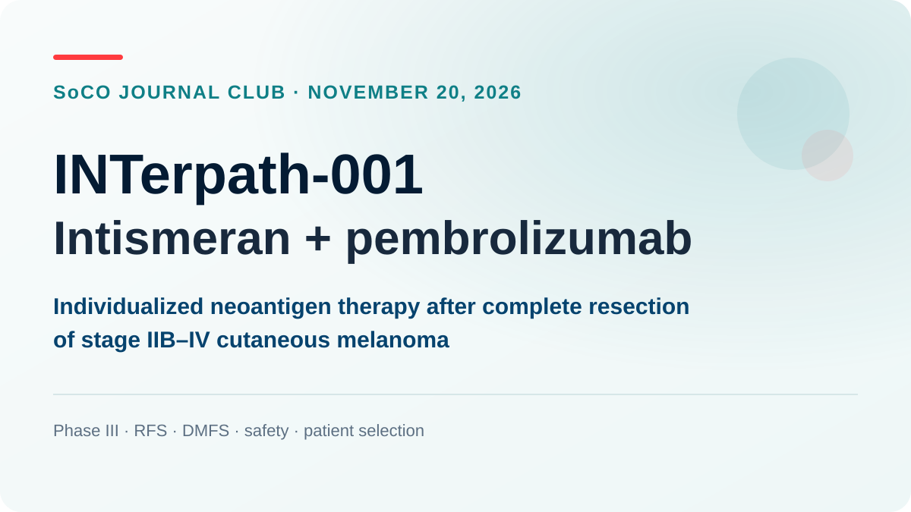

```{r}
#| label: recap-data
#| echo: false
#| results: hide

# The site owns Netlify authentication, retrieval, deduplication, and aggregation.
# A normal render reads saved aggregates. A live refresh runs the same event runner as the deck.
refresh_interpath_results <- function(input_dir) {
  runner <- file.path("workflows", "journal_club", "events", "2026-11-20_interpath",
                      "pre_event_survey", "R", "69_process_interpath_results.R")
  starts <- c(input_dir, Sys.getenv("QUARTO_PROJECT_DIR"), Sys.getenv("SOCO_WEBSITE_ROOT"))
  root <- NULL
  for (start in starts[nzchar(starts)]) {
    here <- normalizePath(start, winslash = "/", mustWork = FALSE)
    repeat {
      if (file.exists(file.path(here, runner))) { root <- here; break }
      parent <- dirname(here)
      if (identical(parent, here)) break
      here <- parent
    }
    if (!is.null(root)) break
  }
  if (is.null(root)) stop("Live refresh needs the existing SoCO website project's 69_process_interpath_results.R.")

  old_dir <- setwd(root)
  on.exit(setwd(old_dir), add = TRUE)
  vars <- c("SOCO_INTERPATH_PULL_LIVE", "SOCO_INTERPATH_RESPONSES_CSV")
  previous <- Sys.getenv(vars, unset = NA_character_)
  on.exit({
    Sys.unsetenv(vars)
    saved <- previous[!is.na(previous)]
    if (length(saved)) do.call(Sys.setenv, as.list(saved))
  }, add = TRUE)
  Sys.unsetenv("SOCO_INTERPATH_RESPONSES_CSV")
  Sys.setenv(SOCO_INTERPATH_PULL_LIVE = "YES")
  source(runner, local = new.env(parent = globalenv()), echo = FALSE)
  exported <- file.path(dirname(dirname(runner)), "outputs", "presentation_export")
  for (name in c("practice_snapshot.json", "summary.json")) {
    f <- file.path(root, exported, name)
    result <- if (file.exists(f)) jsonlite::read_json(f, simplifyVector = FALSE) else NULL
    if (!identical(result$survey_id, "soco-interpath-2026-11-20") ||
        !identical(result$data_status, "loaded")) {
      stop("The refresh did not produce a loaded November 20 aggregate in ", f)
    }
  }
}
recap_input <- knitr::current_input(dir = TRUE)
recap_dir <- if (length(recap_input) && file.exists(recap_input)) dirname(normalizePath(recap_input)) else getwd()
if (isTRUE(params$refresh_from_netlify)) refresh_interpath_results(recap_dir)

# Render both survey sections in one pass with Quarto's Pandoc. Embedding the filter
# and the verified meeting-day snapshot makes index.qmd portable as a single file.
render_interpath_charts <- function(input_dir) {
  work <- tempfile("interpath-recap-")
  dir.create(work)
  on.exit(unlink(work, recursive = TRUE), add = TRUE)
  filter <- file.path(work, "interpath.lua")
  source_md <- file.path(work, "figures.md")
  log <- file.path(work, "pandoc.log")
  writeLines("INTerpath survey figures", source_md)
  writeLines(r"---(
local charts = (function()
-- Display the two paired pre-meeting questions in the layout used in the presentation.
-- The caller supplies decoded, aggregate counts. No respondent records enter this module.
local module = {}

local treatments = {
  surveillance = {label = "Surveillance", short = "Surveillance"},
  pd1 = {label = "Anti–PD-1 alone", short = "PD-1 alone"},
  target = {label = "Dabrafenib + trametinib", short = "Dab/Tram"},
  combo = {label = "Pembrolizumab + intismeran", short = "PD-1 + intismeran"}
}
local order = {"surveillance", "pd1", "target", "combo"}
local group_names = {wt = "BRAF wild-type", mut = "BRAF-mutant"}
local stages = {"IIB", "IIC", "IIIA", "IIIB", "IIIC", "IIID", "IV"}
local sequencing = {
  {"Neoadjuvant therapy first", {{"ipi_nivo", "Ipilimumab + nivolumab"}, {"pembro", "Pembrolizumab"}}},
  {"Surgery first", {{"surgery_combo", "Then pembrolizumab + intismeran"}, {"surgery_pd1", "Then anti–PD-1 alone"}}},
  {"Other", {{"other", "Another strategy or clinical trial"}, {"outside", "Outside clinical role"}}}
}

local function escaped(text)
  return (tostring(text or ""):gsub("&", "&amp;"):gsub("<", "&lt;"):gsub(">", "&gt;"):gsub('"', "&quot;"))
end

local function integer(x)
  return type(x) == "number" and x >= 0 and x == math.floor(x)
end

local function choices(group, scenario)
  local active = {}
  for _, key in ipairs(order) do
    if (key ~= "target" or group == "mut") and (key ~= "combo" or scenario == "expected") then
      active[#active + 1] = key
    end
  end
  return active
end

local function valid_row(row, group)
  if type(row) ~= "table" or (row.status and row.status ~= "available") or not integer(row.n) or row.n == 0 then return false end
  for _, scenario in ipairs({"current", "expected"}) do
    local counts = row[scenario]
    if type(counts) ~= "table" then return false end
    local total = 0
    for _, key in ipairs(choices(group, scenario)) do
      if not integer(counts[key]) then return false end
      total = total + counts[key]
    end
    if total ~= row.n then return false end
  end
  return true
end

local function keyed_rows(rows, group)
  local found = {}
  if type(rows) == "table" then
    for _, row in ipairs(rows) do
      if valid_row(row, group) then found[row.stage] = row end
    end
  end
  return found
end

local function share(k, n)
  return string.format("%.1f%%", 100 * k / n)
end

local function stage_label(stage)
  return stage == "IV" and 'IV <small>resected</small>' or stage
end

local function panel(rows, group, scenario)
  local active = choices(group, scenario)
  local usual = scenario == "current"
  local caption = usual and "What do patients typically receive now?" or "What would patients receive if the combination were available?"
  local context = usual and "Usual treatment after shared decision-making" or "Assuming approval, access and coverage"
  local eyebrow = usual and "Current practice" or "Hypothetical practice"
  local out = {
    '<figure class="ips2-figure"><figcaption><span class="ips2-overline">' .. eyebrow .. '</span><strong>' .. caption .. '</strong></figcaption>',
    '<div class="ips2-context"><span class="ips2-pill">' .. group_names[group] .. '</span><span>' .. context .. '</span></div>',
    '<div class="ips2-legend" aria-label="Treatment options">'
  }
  for _, key in ipairs(active) do
    out[#out + 1] = '<span><i class="ips2-' .. key .. '"></i>' .. treatments[key].label .. '</span>'
  end
  out[#out + 1] = '</div><div class="ips2-box"><div class="ips2-row ips2-head" aria-hidden="true"><span>Stage</span><span>Share of respondents selecting each treatment</span><span>Paired n</span></div>'
  for _, stage in ipairs(stages) do
    local row = rows[stage]
    local label = stage_label(stage)
    if row then
      local n = row.n
      out[#out + 1] = '<div class="ips2-row"><div class="ips2-stage">' .. label .. '</div><div class="ips2-center"><div class="ips2-stack" aria-hidden="true">'
      local exact = {}
      for _, key in ipairs(active) do
        local k = row[scenario][key]
        local pct = 100 * k / n
        local title = string.format("%s %d/%d (%s)", treatments[key].label, k, n, share(k, n))
        if k > 0 then
          local inside = pct >= 8 and (math.floor(pct + 0.5) .. "%") or ""
          out[#out + 1] = string.format('<span class="ips2-seg ips2-%s" style="width:%.7f%%" title="%s">%s</span>', key, pct, title, inside)
        end
        exact[#exact + 1] = string.format('<span>%s %d/%d (%s)</span>', treatments[key].short, k, n, share(k, n))
      end
      out[#out + 1] = '</div><div class="ips2-exact">' .. table.concat(exact) .. '</div></div><b class="ips2-n">' .. string.format('%d', n) .. '</b></div>'
    else
      out[#out + 1] = '<div class="ips2-row"><div class="ips2-stage">' .. label .. '</div><span class="ips2-na">Paired results unavailable for this stage.</span></div>'
    end
  end
  out[#out + 1] = '</div></figure>'
  return table.concat(out)
end

local function delta(rows, group)
  local active = choices(group, "expected")
  local out = {'<div class="ips2-dgroup"><h4>' .. group_names[group] .. '</h4><div class="ips2-dscroll" tabindex="0" role="region" aria-label="Paired changes in ' .. group_names[group] .. '"><table class="ips2-dtable"><thead><tr><th scope="col">Stage</th>'}
  for _, key in ipairs(active) do out[#out + 1] = '<th scope="col">' .. treatments[key].short .. '</th>' end
  out[#out + 1] = '<th scope="col">Changed choice</th></tr></thead><tbody>'
  for _, stage in ipairs(stages) do
    local row = rows[stage]
    out[#out + 1] = '<tr><th scope="row">' .. stage_label(stage) .. '</th>'
    if row then
      for _, key in ipairs(active) do
        local b = key == "combo" and 0 or row.current[key]
        local pct = 100 * (row.expected[key] - b) / row.n
        local value = pct < 0 and string.format("−%.1f", -pct) or pct > 0 and string.format("+%.1f", pct) or "0.0"
        local pos = math.min(50, 50 + pct / 2)
        local length = math.abs(pct / 2)
        out[#out + 1] = string.format('<td><span>%s</span><i class="ips2-daxis" aria-hidden="true"><b class="%s" style="left:%.6f%%;width:%.6f%%"></b></i></td>', value, pct < 0 and "ips2-loss" or "ips2-gain", pos, length)
      end
      if integer(row.changed) and row.changed <= row.n then
        out[#out + 1] = string.format('<td><strong>%s</strong><small>%d/%d</small></td>', share(row.changed,row.n),row.changed,row.n)
      else
        out[#out + 1] = '<td>Unavailable</td>'
      end
    else
      out[#out + 1] = string.format('<td colspan="%d" class="ips2-na">Paired results unavailable.</td>', #active + 1)
    end
    out[#out + 1] = '</tr>'
  end
  out[#out + 1] = '</tbody></table></div></div>'
  return table.concat(out)
end

local function sequence_panel(seq, source)
  local heading = '<div class="ips2-sequence"><h3>When the patient presents before surgery</h3>'
  local missing = heading .. '<p>The aggregate export has no reportable distribution for this question.</p></div>'
  if type(seq) ~= "table" or (seq.status and seq.status ~= "available") or type(seq.counts) ~= "table" or not integer(seq.n) or seq.n == 0 then return missing end
  local total = 0
  for _, group in ipairs(sequencing) do
    for _, option in ipairs(group[2]) do
      local n = seq.counts[option[1]]
      if not integer(n) then return missing end
      total = total + n
    end
  end
  local skipped = seq.counts.not_answered or 0
  if not integer(skipped) or total + skipped ~= seq.n then return missing end
  local out = {heading .. '<p>The survey asked how clinicians would treat a fit patient with clinically apparent, resectable stage III melanoma who had received no prior systemic therapy. ' .. seq.n .. ' respondents are represented in this question, which was added in later versions of the survey.</p><div class="ips2-seqgrid">'}
  for _, group in ipairs(sequencing) do
    out[#out + 1] = '<div class="ips2-seqcard"><h4>' .. group[1] .. '</h4>'
    for _, option in ipairs(group[2]) do
      local n = seq.counts[option[1]]
      out[#out + 1] = string.format('<div class="ips2-seqitem"><span>%s</span><div class="ips2-seqline"><i aria-hidden="true"><b style="width:%.6f%%"></b></i><strong>%d/%d <small>(%s)</small></strong></div></div>', option[2], 100 * n / seq.n, n, seq.n, share(n,seq.n))
    end
    out[#out + 1] = '</div>'
  end
  out[#out + 1] = '</div>'
  if skipped > 0 then
    out[#out + 1] = string.format('<p class="ips2-note">No answer was recorded for %d of %d respondents (%s).</p>', skipped, seq.n, share(skipped, seq.n))
  end
  out[#out + 1] = '<p class="ips2-source">' .. escaped(source) .. '</p></div>'
  return table.concat(out)
end

-- Preserve the compact BRAF comparison from the previous recap.
local function combination_overview(rows)
  local out = {'<details class="ips2-deltas ips2-overview"><summary>Compare expected combination use across BRAF groups</summary><div class="ips2-details"><div class="ip-compare"><span>Stage</span><span>BRAF wild-type</span><span>BRAF-mutant</span>'}
  for _, stage in ipairs(stages) do
    table.insert(out, '<strong>' .. stage_label(stage) .. '</strong>')
    for _, group in ipairs({"wt", "mut"}) do
      local row = rows[group][stage]
      if row then
        local count = row.expected.combo
        local pct = 100 * count / row.n
        table.insert(out, string.format('<div class="ip-compare-cell ip-compare-%s"><span>%d/%d (%.1f%%)</span><i aria-hidden="true"><b style="width:%.4f%%"></b></i></div>', group, count, row.n, pct, pct))
      else
        table.insert(out, '<div class="ip-compare-cell">Unavailable</div>')
      end
    end
  end
  table.insert(out, '</div></div></details>')
  return table.concat(out)
end

function module.render_stage(data, snapshot)
  data = type(data) == "table" and data or {}
  snapshot = type(snapshot) == "table" and snapshot or {}
  local groups = type(data.groups) == "table" and data.groups or snapshot.groups or {}
  local seq = type(data.sequencing) == "table" and data.sequencing or snapshot.sequencing
  local archive = "Source · Final November 20 Journal Club presentation, using the premeeting survey."
  local stage_source = data.stage_provenance or (data.groups and "Source · SoCO paired pre-meeting survey export." or archive)
  local seq_source = data.sequencing_provenance or (data.sequencing and "Source · SoCO pre-meeting survey question summary." or archive)
  if type(data.group_source) == "string" and not data.stage_provenance then
    local date = data.group_source:match("%d%d%d%d%-%d%d%-%d%d")
    if date then stage_source = "Source · SoCO paired pre-meeting survey export dated " .. date .. "." end
  end
  local rows = {wt = keyed_rows(groups.wt, "wt"), mut = keyed_rows(groups.mut, "mut")}
  local out = {
    '<section class="ip-section ips2" id="practice" aria-labelledby="practice-survey-heading">',
    '<div class="ip-section-kicker">Pre-meeting survey</div><h2 id="practice-survey-heading">Where would clinicians add intismeran?</h2>',
    '<p>Before Journal Club, respondents described what patients with completely resected melanoma usually receive in their practice. In the same questionnaire, they chose what they expected patients would receive if pembrolizumab plus intismeran were approved, accessible and covered. Each bar shows one choice per respondent. Within each stage and BRAF group, both questions use the same respondents with two complete answers.</p>'
  }
  local early = rows.wt.IIB
  local late = rows.wt.IIIC
  if early and late then
    local treated = late.n - late.current.surveillance
    out[#out + 1] = string.format('<p>For <strong>BRAF wild-type stage IIIC</strong>, %d of %d respondents already favored systemic therapy, and %d of %d would choose the combination if available. For <strong>stage IIB</strong>, %d of %d selected surveillance under current practice and %d of %d would select it with access to the combination.</p>', treated, late.n, late.expected.combo, late.n, early.current.surveillance, early.n, early.expected.surveillance, early.n)
  end
  out[#out + 1] = '<p class="ips2-note">The initial BRAF-mutant scenario specified V600E/K. Later versions specified V600E. The figures pool responses across both wordings. Respondents could answer multiple stages and genotypes.</p>'
  for _, scenario in ipairs({"current","expected"}) do
    for _, group in ipairs({"wt","mut"}) do
      out[#out + 1] = panel(rows[group], group, scenario)
    end
  end
  out[#out + 1] = combination_overview(rows)
  out[#out + 1] = '<p class="ips2-source">' .. escaped(stage_source) .. '</p>'
  out[#out + 1] = '<details class="ips2-deltas"><summary>How much did choices change within each stage?</summary><div class="ips2-details"><p>Each cell gives the percentage-point difference between hypothetical and usual practice. The final column counts respondents who selected a different option, including switches that canceled out in the overall distribution. The combination was offered only in the hypothetical question.</p>'
  out[#out + 1] = delta(rows.wt, "wt")
  out[#out + 1] = delta(rows.mut, "mut")
  out[#out + 1] = '</div></details>' .. sequence_panel(seq, seq_source) .. '</section>'
  return table.concat(out, "\n")
end
return module

end)()

local source = (function()
-- Read released INTerpath aggregate files produced by the event's R/Netlify workflow.
local path = pandoc.path
local event = "soco-interpath-2026-11-20"
local export_dir = "workflows/journal_club/events/2026-11-20_interpath/pre_event_survey/outputs/presentation_export"
local stages = {"iib", "iic", "iiia", "iiib", "iiic", "iiid", "iv"}
local topics = {
  {id = "cost_influence", heading = "How might cost or coverage shape recommendations?",
   choices = {"major", "moderate", "minor", "minimal_if_covered", "unsure_or_outside_role"},
   scale = {"Major influence", "Moderate influence", "Minor influence", "Little or no influence if access and patient costs are covered", "Unsure or outside my clinical role"},
   description = "Respondents considered patient costs, insurance coverage and treatment resources. The question specified no price."},
  {id = "evidence_compelling", heading = "How compelling did colleagues find the evidence?",
   choices = {"very", "moderate", "promising_uncertain", "not_compelling", "need_review"},
   scale = {"Very compelling", "Moderately compelling", "Promising, with important uncertainty", "Not compelling at present", "I need to review the data"},
   description = "Respondents rated the evidence before the meeting. One answer allowed them to defer judgment until they had reviewed the data."}
}
local sequencing = {id="sequencing_strategy",
  choices={"neo_ipi_nivo", "neo_pembro", "surgery_mrna", "surgery_pd1", "other_strategy", "outside_role"}}
local sequence_keys = {neo_ipi_nivo="ipi_nivo", neo_pembro="pembro", surgery_mrna="surgery_combo",
  surgery_pd1="surgery_pd1", other_strategy="other", outside_role="outside", not_answered="not_answered"}
local treatment_keys = {surveillance="surveillance", pd1_mono="pd1", dab_tram="target", pd1_mrna="combo"}

local function esc(value)
  return (value:gsub("&", "&amp;"):gsub("<", "&lt;"):gsub(">", "&gt;"):gsub('"', "&quot;"))
end

local function integer(value)
  return type(value) == "number" and value >= 0 and value < math.huge and value == math.floor(value)
end

local function read_json(file)
  local handle = io.open(file, "rb")
  if not handle then return nil end
  local raw = handle:read("*a")
  handle:close()
  local ok, obj = pcall(pandoc.json.decode, (raw:gsub("^\239\187\191", "")))
  return ok and type(obj) == "table" and obj or false
end

local function locate()
  local cwd = pandoc.system.get_working_directory()
  local roots = {}
  for _, env in ipairs({"QUARTO_PROJECT_DIR","SOCO_WEBSITE_ROOT"}) do
    local root = os.getenv(env)
    if root and root ~= "" then table.insert(roots, root) end
  end
  for _, name in ipairs(PANDOC_STATE.input_files or {}) do
    if name ~= "-" then table.insert(roots, path.directory(name)) end
  end
  table.insert(roots, cwd)
  local seen = {}
  for _, root in ipairs(roots) do
    if path.is_relative(root) then root = path.join({cwd, root}) end
    root = path.normalize(root)
    while not seen[root] do
      seen[root] = true
      local dir = path.join({root, export_dir})
      local summary = read_json(path.join({dir, "summary.json"}))
      local practice = read_json(path.join({dir, "practice_snapshot.json"}))
      if summary ~= nil or practice ~= nil then return summary, practice end
      root = path.directory(root)
    end
  end
end

local function source_label(prefix, document)
  local date = type(document.generated_at) == "string" and document.generated_at:match("^(%d%d%d%d%-%d%d%-%d%d)")
  return date and (prefix .. " · " .. date) or prefix
end

local function find_unique(rows, key, value)
  local hit
  if type(rows) == "table" then
    for _, row in ipairs(rows) do
      if type(row) == "table" and row[key] == value then
        if hit then return nil, "invalid" end
        hit = row
      end
    end
  end
  if hit then return hit end
  return nil, "missing"
end

local function question_result(document, topic, source)
  local function result(status) return {status=status,source=source} end
  if not document then return result("missing") end
  if document.survey_id ~= event then return result("invalid") end
  if document.data_status ~= "loaded" then return result(document.data_status or "invalid") end
  local q, problem = find_unique(document.questions, "id", topic.id)
  if not q then return result(problem) end
  if q.status ~= "available" then return result(q.status or "invalid") end
  if q.kind ~= "single_choice" or not integer(q.n) or q.n == 0 or type(q.cells) ~= "table" then
    return result("invalid")
  end
  local allowed = {not_answered=true}
  for _, val in ipairs(topic.choices) do allowed[val] = true end
  local lookup, sum = {}, 0
  for _, cell in ipairs(q.cells) do
    if type(cell) ~= "table" or not allowed[cell.value] or lookup[cell.value] or
        type(cell.label) ~= "string" or not cell.label:match("%S") or not integer(cell.count) then
      return result("invalid")
    end
    lookup[cell.value] = {value=cell.value,label=cell.label,count=cell.count}
    sum = sum + cell.count
  end
  if sum ~= q.n then return result("invalid") end
  local ordered = {}
  for _, val in ipairs(topic.choices) do
    if not lookup[val] then return result("invalid") end
    table.insert(ordered, lookup[val])
  end
  if lookup.not_answered then table.insert(ordered, lookup.not_answered) end
  return {status="available", n=q.n, cells=ordered, source=source}
end

local function treatment_counts(raw, n, genotype)
  if type(raw) ~= "table" then return nil end
  local counts, sum = {target=0}, 0
  for val, count in pairs(raw) do
    local key = treatment_keys[val]
    if not key or not integer(count) or (genotype == "wt" and key == "target" and count > 0) then return nil end
    counts[key] = count
    sum = sum + count
  end
  if sum ~= n or not (counts.pd1 and counts.surveillance and counts.combo)
      or (genotype == "v600" and raw.dab_tram == nil) then return nil end
  return counts
end

local function stage_row(r, sid, genotype, missing_reason)
  local output = {stage=sid:upper(),status="invalid"}
  if not r then output.status = missing_reason or "missing"; return output end
  if r.status ~= "available" then output.status = r.status or "invalid"; return output end
  local n, changed = r.n_paired, r.changed_count
  if not integer(n) or n == 0 or not integer(changed) or changed > n then return output end
  local before = treatment_counts(r.before, n, genotype)
  local after = treatment_counts(r.after, n, genotype)
  if not before or not after or before.combo ~= 0 or type(r.transitions) ~= "table" then return output end
  local seen, row_sums, col_sums, switched = {}, {}, {}, 0
  for _, t in ipairs(r.transitions) do
    if type(t) ~= "table" or not treatment_keys[t.before] or not treatment_keys[t.after]
      or not integer(t.count) or t.count == 0 then return output end
    local b, a = treatment_keys[t.before], treatment_keys[t.after]
    local k = b .. "_" .. a
    if seen[k] then return output end
    seen[k] = true
    row_sums[b] = (row_sums[b] or 0) + t.count
    col_sums[a] = (col_sums[a] or 0) + t.count
    if b ~= a then switched = switched + t.count end
  end
  if switched ~= changed then return output end
  for _, key in pairs(treatment_keys) do
    if (row_sums[key] or 0) ~= before[key] or (col_sums[key] or 0) ~= after[key] then return output end
  end
  return {stage=sid:upper(), status="available", n=n, current=before, expected=after, changed=changed}
end

local function practice_groups(snapshot)
  if type(snapshot) ~= "table" or snapshot.contract ~= "interpath-practice-paired-v1"
    or snapshot.survey_id ~= event or snapshot.data_status ~= "loaded" then return nil end
  local groups = {}
  for _, gid in ipairs({"wt","v600"}) do
    local group, problem = find_unique(snapshot.groups, "id", gid)
    local key = gid == "wt" and "wt" or "mut"
    groups[key] = {}
    for _, sid in ipairs(stages) do
      local row, err
      if group then row, err = find_unique(group.rows, "stage_id", sid) end
      table.insert(groups[key], stage_row(row, sid, gid, err or problem))
    end
  end
  return groups
end

local function load()
  local summary, practice = locate()
  local results = {perspectives={}}
  if type(practice) == "table" then
    results.groups = practice_groups(practice)
    if results.groups then results.group_source = source_label("Paired survey export", practice) end
  end
  local source = type(summary) == "table" and source_label("Survey export",summary) or "Meeting materials"
  local categorical = type(summary) == "table" and summary or nil
  local seq = question_result(categorical, sequencing, source)
  if seq.status ~= "missing" and seq.status ~= "not_loaded" and seq.status ~= "no_data" then
    seq.counts = {}
    for _, cell in ipairs(seq.cells or {}) do seq.counts[sequence_keys[cell.value]] = cell.count end
    seq.cells = nil
    results.sequencing = seq
  end
  if summary == nil then
    local deck = os.getenv("SOCO_INTERPATH_PRESENTATION_DIR")
    if deck and deck ~= "" then
      local cached = read_json(path.join({deck,"data/processed/pre_survey/perspectives_snapshot.json"}))
      if type(cached) == "table" and cached.contract == "interpath-perspectives-v1" and cached.survey_id == event then
        source, categorical = source_label("Saved presentation survey export",cached), cached
      end
    end
  end
  for _, topic in ipairs(topics) do
    local info = question_result(categorical, topic, source)
    if summary == false then info.status = "invalid" end
    results.perspectives[topic.id] = info
  end
  return results
end

local status_copy = {
  no_data="There were no eligible responses in this export.",
  suppressed_small_cell="The survey export withholds this breakdown because at least one response category was small.",
  suppressed_low_n="The survey export withholds this breakdown because too few people answered.",
  suppressed_invalid_value="This response breakdown is pending review.",
  invalid="A verified distribution is unavailable for this question."
}
local function perspectives(data)
  local parts = {'<div class="ip-perspectives">'}
  for _, topic in ipairs(topics) do
    local q = data.perspectives[topic.id]
    table.insert(parts, '<section class="ip-perspective"><h3>' .. topic.heading .. '</h3>')
    table.insert(parts, '<p class="ip-perspective-context">' .. topic.description .. '</p>')
    if q.status == "available" then
      table.insert(parts, '<div class="ip-perspective-meta">'..string.format("%d",q.n)..' respondents · '..esc(q.source)..'</div><ul class="ip-perspective-bars">')
      for _, cell in ipairs(q.cells) do
        local fraction = 100 * cell.count / q.n
        table.insert(parts, string.format('<li><div class="ip-perspective-row"><span>%s</span><strong>%d/%d <small>(%.1f%%)</small></strong></div><div class="ip-perspective-track" aria-hidden="true"><i style="width:%.4f%%"></i></div></li>',
          esc(cell.label), cell.count, q.n, fraction, fraction))
      end
      table.insert(parts, '</ul>')
    else
      local msg = status_copy[q.status] or "The meeting slides included this question. Its response counts were unavailable."
      table.insert(parts, '<div class="ip-perspective-empty"><p>' .. msg .. '</p><details><summary>View the response options</summary><ul>')
      for _, choice in ipairs(topic.scale) do table.insert(parts, '<li>'..esc(choice)..'</li>') end
      table.insert(parts, '</ul></details></div>')
    end
    table.insert(parts, '</section>')
  end
  table.insert(parts, '</div>')
  return table.concat(parts, "\n")
end

return {load=load, perspectives=perspectives}

end)()

local meeting_snapshot = pandoc.json.decode([==[
{
  "groups": {
    "wt": [
      {
        "stage": "IIB",
        "n": 23,
        "current": {
          "surveillance": 18,
          "pd1": 5,
          "target": 0,
          "combo": 0
        },
        "expected": {
          "surveillance": 16,
          "pd1": 1,
          "target": 0,
          "combo": 6
        },
        "changed": 6
      },
      {
        "stage": "IIC",
        "n": 23,
        "current": {
          "surveillance": 10,
          "pd1": 13,
          "target": 0,
          "combo": 0
        },
        "expected": {
          "surveillance": 10,
          "pd1": 1,
          "target": 0,
          "combo": 12
        },
        "changed": 13
      },
      {
        "stage": "IIIA",
        "n": 23,
        "current": {
          "surveillance": 17,
          "pd1": 6,
          "target": 0,
          "combo": 0
        },
        "expected": {
          "surveillance": 14,
          "pd1": 0,
          "target": 0,
          "combo": 9
        },
        "changed": 9
      },
      {
        "stage": "IIIB",
        "n": 23,
        "current": {
          "surveillance": 3,
          "pd1": 20,
          "target": 0,
          "combo": 0
        },
        "expected": {
          "surveillance": 1,
          "pd1": 2,
          "target": 0,
          "combo": 20
        },
        "changed": 20
      },
      {
        "stage": "IIIC",
        "n": 23,
        "current": {
          "surveillance": 0,
          "pd1": 23,
          "target": 0,
          "combo": 0
        },
        "expected": {
          "surveillance": 0,
          "pd1": 2,
          "target": 0,
          "combo": 21
        },
        "changed": 21
      },
      {
        "stage": "IIID",
        "n": 22,
        "current": {
          "surveillance": 0,
          "pd1": 22,
          "target": 0,
          "combo": 0
        },
        "expected": {
          "surveillance": 0,
          "pd1": 2,
          "target": 0,
          "combo": 20
        },
        "changed": 20
      },
      {
        "stage": "IV",
        "n": 22,
        "current": {
          "surveillance": 0,
          "pd1": 22,
          "target": 0,
          "combo": 0
        },
        "expected": {
          "surveillance": 0,
          "pd1": 3,
          "target": 0,
          "combo": 19
        },
        "changed": 19
      }
    ],
    "mut": [
      {
        "stage": "IIB",
        "n": 23,
        "current": {
          "surveillance": 18,
          "pd1": 5,
          "target": 0,
          "combo": 0
        },
        "expected": {
          "surveillance": 16,
          "pd1": 0,
          "target": 0,
          "combo": 7
        },
        "changed": 8
      },
      {
        "stage": "IIC",
        "n": 23,
        "current": {
          "surveillance": 11,
          "pd1": 12,
          "target": 0,
          "combo": 0
        },
        "expected": {
          "surveillance": 10,
          "pd1": 1,
          "target": 0,
          "combo": 12
        },
        "changed": 13
      },
      {
        "stage": "IIIA",
        "n": 23,
        "current": {
          "surveillance": 11,
          "pd1": 4,
          "target": 8,
          "combo": 0
        },
        "expected": {
          "surveillance": 11,
          "pd1": 0,
          "target": 5,
          "combo": 7
        },
        "changed": 8
      },
      {
        "stage": "IIIB",
        "n": 23,
        "current": {
          "surveillance": 1,
          "pd1": 14,
          "target": 8,
          "combo": 0
        },
        "expected": {
          "surveillance": 1,
          "pd1": 1,
          "target": 2,
          "combo": 19
        },
        "changed": 19
      },
      {
        "stage": "IIIC",
        "n": 23,
        "current": {
          "surveillance": 0,
          "pd1": 18,
          "target": 5,
          "combo": 0
        },
        "expected": {
          "surveillance": 0,
          "pd1": 1,
          "target": 1,
          "combo": 21
        },
        "changed": 21
      },
      {
        "stage": "IIID",
        "n": 22,
        "current": {
          "surveillance": 0,
          "pd1": 17,
          "target": 5,
          "combo": 0
        },
        "expected": {
          "surveillance": 0,
          "pd1": 1,
          "target": 2,
          "combo": 19
        },
        "changed": 19
      },
      {
        "stage": "IV",
        "n": 22,
        "current": {
          "surveillance": 0,
          "pd1": 21,
          "target": 1,
          "combo": 0
        },
        "expected": {
          "surveillance": 0,
          "pd1": 2,
          "target": 0,
          "combo": 20
        },
        "changed": 20
      }
    ]
  },
  "sequencing": {
    "n": 24,
    "counts": {
      "ipi_nivo": 21,
      "pembro": 1,
      "surgery_combo": 0,
      "surgery_pd1": 0,
      "other": 0,
      "outside": 2
    }
  }
}
]==])

function Pandoc(doc)
  local aggregate = source.load()
  local topics = '<section class="ip-section ip-addon" aria-label="Premeeting views on cost and evidence">' .. source.perspectives(aggregate) .. '</section>'
  doc.blocks = {pandoc.RawBlock("html", charts.render_stage(aggregate, meeting_snapshot)),
                pandoc.RawBlock("html", "<!--IP-CHART-SECTION-->"),
                pandoc.RawBlock("html", topics)}
  return doc
end

)---", filter, useBytes = TRUE)

  original_dir <- setwd(input_dir)
  on.exit(setwd(original_dir), add = TRUE)
  quarto_bin <- Sys.getenv("QUARTO_BIN_PATH")
  quarto <- if (nzchar(quarto_bin)) file.path(quarto_bin, "quarto") else Sys.which("quarto")
  use_quarto <- nzchar(quarto) && file.exists(quarto)
  program <- if (use_quarto) quarto else rmarkdown::pandoc_exec()
  args <- c(if (use_quarto) "pandoc", "--from=markdown", "--to=html5", "--wrap=none",
            "--lua-filter", shQuote(filter), shQuote(source_md))
  html <- system2(program, args, stdout = TRUE, stderr = log)
  if (!is.null(attr(html, "status"))) stop("Could not draw the survey figures. ", paste(readLines(log, warn = FALSE), collapse = "\n"))
  sections <- strsplit(paste(html, collapse = "\n"), "<!--IP-CHART-SECTION-->", fixed = TRUE)[[1L]]
  if (length(sections) != 2L) stop("Expected both survey sections from the chart renderer.")
  setNames(trimws(sections), c("practice", "perspectives"))
}
interpath_charts <- render_interpath_charts(recap_dir)
raw_recap_html <- function(html) cat("\n\n\x60\x60\x60{=html}\n", html, "\n\x60\x60\x60\n\n", sep = "")

# The public recap does not load sign-in records, emails or individual activity.
interpath_attendance <- local({
  frozen_summary <- c(people = 40, median_minutes = 98 + 38 / 60,
                      pct_60min_plus = .9, pct_camera = .725, pct_unmute = .725,
                      pct_hand_raise = .25, pct_active = .8)
  frozen_names <- c(
    "Adewole S. Adamson", "Andrew D. Knight", "Claire Verschraegen",
    "Danielle M. Brazel", "David Carr", "David M. Miller", "David J. Savage",
    "Dmitri Grebennik", "Elizabeth I. Buchbinder", "Frances Collichio",
    "Howard L. Kaufman", "Isaac Brownell", "Juliane Andrade Czapla", "Justin Moyers",
    "Karam Khaddour", "Kathryn Bollin", "Kevin S. Emerick", "Krista M. Rubin",
    "Larisa Geskin", "Laureen Ojalvo", "Li Fan", "Manisha Thakuria",
    "Maya Dimitrova", "Meghan Mooradian", "Mehran Behruj Yusuf", "Michael Wong",
    "Michelle Brown", "Molly Yancovitz", "Nikhil Khushalani", "Rhoda Myra Alani",
    "Sameer G. Gupta", "Sanjay Chandrasekaran", "Sarah Weiss", "Scott Mazzeo",
    "Sophia K. McKinley", "Suzanne Topalian", "Toshifumi Hoki", "Vernon K. Sondak",
    "Vishal Patel", "William J. Benjamin IV"
  )
  input <- knitr::current_input(dir = TRUE)
  meeting_dir <- if (length(input) && file.exists(input)) dirname(normalizePath(input)) else getwd()
  folder <- file.path(meeting_dir, "files", "meeting recap-attendance")
  # Either filename in the event's recap folder can supply the summary.
  candidates <- file.path(folder, c("attendance_summary_2026-11-20.csv", "attendance_summary.csv"))
  summary_file <- candidates[file.exists(candidates)]
  headline <- frozen_summary
  if (length(summary_file)) {
    saved <- utils::read.csv(summary_file[1L], fileEncoding = "UTF-8-BOM")
    required <- names(frozen_summary)
    if (nrow(saved) != 1L || !all(required %in% names(saved))) {
      stop("Review the November 20 attendance summary columns.")
    }
    values <- vapply(saved[required], as.numeric, numeric(1))
    shares <- values[startsWith(names(values), "pct_")]
    if (any(!is.finite(values)) || any(shares < 0 | shares > 1) ||
        values[["people"]] < 1 || values[["people"]] != round(values[["people"]]) ||
        values[["median_minutes"]] < 0) {
      stop("Review the November 20 attendance summary values.")
    }
    headline <- values
  }

  roster <- data.frame(name = frozen_names, affiliation = "", stringsAsFactors = FALSE)
  if (nrow(roster) != headline[["people"]]) roster <- roster[FALSE, ]
  registry_roster <- function() {
    here <- meeting_dir
    relative <- file.path("workflows", "registry", "R", "tools", "40_build_registry_views.R")
    repeat {
      if (file.exists(file.path(here, relative)) && dir.exists(file.path(here, "data", "registry"))) break
      parent <- dirname(here)
      if (identical(parent, here)) break
      here <- parent
    }

    if (file.exists(file.path(here, relative))) {
      load_views <- function(root) {
        old <- setwd(root)
        on.exit(setwd(old), add = TRUE)
        views <- new.env(parent = globalenv())
        sys.source(relative, envir = views)
        views
      }
      views <- load_views(here)
      events <- views$events
      if (is.null(events)) events <- views$event_summary
      required <- c("event_id", "event_date", "event_type", "title")
      if (!all(required %in% names(events))) stop("Review the SoCO registry event schema.")
      selected <- !is.na(events$event_date) & as.character(events$event_date) == "2026-11-20" &
        tolower(trimws(events$event_type)) == "journal club" & grepl("interpath", events$title, ignore.case = TRUE)
      ids <- unique(events$event_id[which(selected)])
      if (length(ids) > 1L) stop("The SoCO registry contains multiple November 20 INTerpath Journal Clubs.")
      if (length(ids) == 1L && !is.null(views$event_participation)) {
        attendance <- views$event_participation
        if (!all(c("event_id", "person_id", "name") %in% names(attendance))) {
          stop("Review the SoCO registry event_participation schema.")
        }
        event <- attendance[which(attendance$event_id == ids), , drop = FALSE]
        if ("attended" %in% names(event)) {
          event <- event[tolower(as.character(event$attended)) %in% c("true", "1"), , drop = FALSE]
        }
        if (nrow(event)) {
          if (nrow(event) != headline[["people"]] || anyNA(event$person_id) ||
              anyDuplicated(event$person_id) || anyNA(event$name) || any(!nzchar(trimws(event$name)))) {
            stop("Reconcile the November 20 registry roster with the audited attendance summary.")
          }
          organization <- function(column) {
            if (!column %in% names(event)) return(rep(NA_character_, nrow(event)))
            value <- trimws(as.character(event[[column]]))
            value[!is.na(value) & !nzchar(value)] <- NA_character_
            value
          }
          affiliation <- organization("organization_at_event")
          current <- organization("current_affiliation")
          affiliation[is.na(affiliation)] <- current[is.na(affiliation)]
          affiliation[is.na(affiliation)] <- ""
          return(data.frame(name = event$name, affiliation = affiliation))
        }
      }
    }
    NULL
  }
  canonical <- tryCatch(registry_roster(), error = function(e) {
    message("Using the audited attendance snapshot. ", conditionMessage(e))
    NULL
  })
  if (!is.null(canonical)) roster <- canonical
  list(summary = headline, roster = roster[order(roster$name), , drop = FALSE])
})

render_attendance_pulse <- function(summary) {
  n <- summary[["people"]]
  stayed <- round(n * summary[["pct_60min_plus"]])
  values <- c(format(n, trim = TRUE), paste0(round(summary[["median_minutes"]]), " min"),
              sprintf("%.0f%%", 100 * summary[["pct_60min_plus"]]))
  labels <- c("People who joined", "Median time with us", "Stayed at least an hour")
  notes <- c("Colleagues at SoCO’s 81st meeting", "Half the group stayed this long or longer",
             sprintf("%d of the %d attendees", stayed, n))
  cards <- sprintf('<div class="ip-metric"><span class="ip-metric-label">%s</span><span class="ip-metric-value">%s</span><span class="ip-metric-note">%s</span></div>', labels, values, notes)
  paste0('<section class="ip-section ip-pulse" aria-labelledby="ip-pulse-title"><div class="ip-section-kicker">Meeting pulse</div><h2 id="ip-pulse-title">A great turnout — and people stayed</h2><div class="ip-metrics">',
         paste(cards, collapse = "\n"), '</div></section>')
}
```

```{=html}
<style>
#title-block-header,.quarto-title-block {display:none}
main.content:has(.ip-head) {width:100%;max-width:1060px;margin-inline:auto;min-width:0}
body.ip-preview {margin:0;background:white}
.ip-preview main {padding:0 22px}
.ip-section,.ip-head,.ip-nav,.ip-footer {--ip-navy:#082d4d;--ip-ink:#273d49;--ip-teal:#126d68;--ip-line:#cfdddc; color:var(--ip-ink);font:normal 17px/1.6 'Source Sans 3','Segoe UI',Arial,sans-serif;max-width:1030px;margin-left:auto;margin-right:auto;box-sizing:border-box}
.ip-head *,.ip-section *,.ip-nav *,.ip-footer * {box-sizing:border-box}
.ip-head {border-top:7px solid var(--ip-navy);border-bottom:1px solid var(--ip-line);padding:32px 0 28px;margin-top:20px}
.ip-meta {display:flex;flex-wrap:wrap;gap:.35em .8em;align-items:center;color:#3e5d65;font-size:.83em;font-weight:650;letter-spacing:.03em}
.ip-meta span+span:before {content:'·';padding-right:.8em;color:#126d68}
.ip-head h1 {color:var(--ip-navy);font:600 clamp(2.7rem,6vw,4.3rem)/1.04 Georgia,'Times New Roman',serif;letter-spacing:-.045em;margin:19px 0 12px}
.ip-head .ip-question {font:500 clamp(1.45rem,3vw,2.05rem)/1.25 Georgia,'Times New Roman',serif;color:var(--ip-navy);letter-spacing:-.02em;margin:0 0 12px}
.ip-head .ip-lede {max-width:855px;margin:0;font-size:1.09em}
.ip-nav {display:flex;flex-wrap:wrap;align-items:center;gap:6px 24px;border-bottom:1px solid var(--ip-line);padding:12px 0;font-size:.86em}
.ip-nav a,.ip-section a,.ip-footer a {color:var(--ip-teal);text-underline-offset:.18em;text-decoration-thickness:1px}
.ip-nav a {font-weight:650;text-decoration:none}.ip-nav a:hover,.ip-nav a:focus {text-decoration:underline}
.ip-section {margin-top:42px;scroll-margin-top:70px}.ip-section h2,.ip-section h3 {border:0;color:var(--ip-navy);padding:0}
.ip-section h2 {font:600 clamp(1.65rem,3.2vw,2.3rem)/1.14 Georgia,'Times New Roman',serif;letter-spacing:-.028em;margin:0 0 .5em}
.ip-section h3 {font-size:1.18em;line-height:1.3;letter-spacing:-.01em;margin:1.1em 0 .35em}.ip-section p {margin:.45em 0 .8em}.ip-section p:last-child {margin-bottom:0}
.ip-section .ip-copy {max-width:860px}.ip-section .ip-byline,.ip-section .ip-caption {font-size:.88em;color:#4f636c}
.ip-section .ip-byline {margin-top:11px}.ip-facts {display:flex;flex-wrap:wrap;gap:5px 14px;align-items:baseline;margin:9px 0 18px;color:#355864;font-size:.92em}
.ip-facts span+span {border-left:1px solid #a8c6c4;padding-left:14px}
.ip-results {margin:18px 0;background:#f3f8f7;border:1px solid #d9e6e3;border-radius:12px;padding:22px 26px}
.ip-results figcaption {font-weight:700;color:var(--ip-navy);margin-bottom:13px;font-size:1.05em}.ip-legend {display:flex;gap:5px 22px;flex-wrap:wrap;font-size:.84em}.ip-legend span {display:inline-flex;align-items:center;gap:7px}.ip-legend i {width:.85em;height:.85em;display:inline-block;border-radius:2px}.ip-combo {background:#18756d}.ip-control {background:#59738c}
.ip-outcome {display:grid;grid-template-columns:minmax(155px,1.05fr) minmax(240px,2.7fr) minmax(155px,1fr);align-items:center;gap:1rem;border-top:1px solid #ccdad9;padding:14px 0}.ip-outcome:first-of-type {margin-top:12px}.ip-outcome:last-child {padding-bottom:0}
.ip-outcome strong {color:var(--ip-navy);font-size:.98em}.ip-outcome small {font-size:.83em;line-height:1.4}.ip-scale {display:grid;gap:5px}.ip-rail {display:flex;gap:7px;align-items:center;line-height:1;white-space:nowrap}.ip-rail i {height:11px;display:block;max-width:calc(100% - 3.6em);border-radius:0 2px 2px 0}.ip-rail b {font-size:.83em;font-variant-numeric:tabular-nums;color:var(--ip-navy)}
.ip-pull {font-size:1.03em;border-left:3px solid #17726b;padding:4px 0 4px 16px;max-width:850px}.ip-paper {margin-top:16px;font-size:.88em}
.ip-topic {display:grid;grid-template-columns:minmax(190px,.85fr) minmax(260px,2fr);gap:18px 40px;border-top:1px solid var(--ip-line);padding:22px 0 20px}.ip-topic h3 {margin:0}.ip-topic p {margin-top:0}.ip-topic:last-child {border-bottom:1px solid var(--ip-line)}
.ip-voice {font:500 1.18em/1.5 Georgia,serif;color:#193b51;background:#f2f7f6;border-left:3px solid #197168;padding:15px 20px;max-width:900px}
.ip-credits {max-width:950px}.ip-footnote {font-size:.9em;color:#48606c}
.ip-footer {font-size:.86em;margin-top:38px;margin-bottom:26px;padding-top:14px;border-top:2px solid var(--ip-navy);display:flex;gap:10px 20px;flex-wrap:wrap;justify-content:space-between}.ip-footer p {margin:0}
@media (max-width:730px){.ip-preview main{padding:0 15px}.ip-head{padding-top:22px;margin-top:10px}.ip-outcome{grid-template-columns:1fr;gap:7px}.ip-results{padding:14px 16px}.ip-outcome small{margin-top:1px}.ip-topic{grid-template-columns:1fr;gap:8px;padding:17px 0}.ip-section{margin-top:31px}.ip-facts span+span{border:0;padding-left:0}.ip-nav{gap:6px 15px}.ip-meta{font-size:.78em}.ip-section,.ip-head{font-size:16px}}
@media print {.ip-head{margin-top:0}.ip-nav{display:none}.ip-results,.ip-topic,.ip-voice{break-inside:avoid}.ip-section{margin-top:22px}.ip-section,.ip-head{font-size:10.5pt}.ip-head h1{font-size:26pt}}
.ip-head .ip-question{max-width:900px}.ip-section .ip-pull {font-size:1em;background:#f5f8f7;padding:10px 14px}
.ip-section table {border-collapse:collapse}.ip-section th,.ip-section td {padding:.45em .65em;text-align:left;border-bottom:1px solid var(--ip-line)}
.ip-section .interpath-attendance {border-top:1px solid var(--ip-line);border-bottom:1px solid var(--ip-line);padding:.7em 0;margin-top:16px}.interpath-attendance summary{font-weight:650;color:#104b55;cursor:pointer}.interpath-roster{columns:3;padding-left:22px;line-height:1.6}.interpath-roster li {break-inside:avoid}.interpath-attendance table{margin:8px 0;width:100%}
.ip-section.ip-addon {margin-top:12px}.ip-section .survey-note,.ip-section.ip-addon .survey-note{font-size:.9em;color:#4f636c}
.ip-section.ip-survey .ips-chart figcaption {display:block}.ip-section.ip-survey .ips-matrix {margin-bottom:5px}
@media(max-width:700px){.interpath-roster{columns:2}}@media(max-width:420px){.interpath-roster{columns:1}}

.ip-rail{display:grid;grid-template-columns:minmax(0,1fr) 3.7em;gap:6px}.ip-bar-track{display:block;background:#e0e9e7}.ip-bar-track i{max-width:100%}.ip-section .ip-results figcaption{padding:0;text-align:left;color:#082d4d}.ip-legend{margin-bottom:10px}.ip-section .interpath-attendance summary{font:650 1em/1.5 "Segoe UI",Arial,sans-serif}.ip-released table{width:100%;max-width:800px}.ip-released caption{text-align:left;caption-side:top;color:#405865}.ip-released h3{font:600 1.1em/1.4 "Segoe UI",Arial,sans-serif}.ip-preview .ip-section table{font-family:inherit}.ip-survey h3{margin-top:1.5em}

</style>
<style id="ip-paper-art-style">
.ip-section .ip-paper-card.ip-paper-with-art {display:grid;grid-template-columns:minmax(0,1fr) minmax(165px,29%);align-items:center;gap:1.4rem}
.ip-paper-with-art .ip-paper-art {display:block;width:100%;height:auto;border-radius:10px;border:1px solid #d6e6e7;box-sizing:border-box}
@media(max-width:700px){.ip-section .ip-paper-card.ip-paper-with-art{grid-template-columns:1fr;gap:1rem}.ip-paper-with-art .ip-paper-art{width:min(100%,325px)}}
</style>
<style id="ip-daromun-skin">
/* DAROMUN / PIVOTAL recap forms, scoped to the INTerpath article. */
main.content:has(.ip-daromun-hero) {
  width:100%; max-width:1120px; min-width:0; margin-inline:auto;
}
body.ip-preview main.content:has(.ip-daromun-hero) {
  box-sizing:content-box; width:auto; max-width:1120px; margin-inline:auto; padding-inline:1.25rem;
}
.ip-head,.ip-section,.ip-nav,.ip-footer {
  --ip-navy:#082d4d; --ip-ink:#31424e; --ip-teal:#126e6a; --ip-line:#d9e8e8;
  --ip-bright:#28a9a2; --ip-coral:#e25a4e; --ip-muted:#6b747b;
  width:100%;max-width:1120px;
  color:var(--ip-ink);font:400 1rem/1.6 Inter,system-ui,-apple-system,"Segoe UI",Arial,sans-serif;
}
.ip-head.ip-daromun-hero {
  margin:2rem auto 2.4rem;padding:2.8rem 3rem;border-radius:24px;border:1px solid var(--ip-line);
  background:radial-gradient(circle at 88% 12%,rgba(40,169,162,.11),transparent 31%),linear-gradient(135deg,#f3f8f8 0%,#fff 72%);
  box-shadow:0 10px 30px rgba(8,45,77,.07);
}
.ip-head .ip-kicker,.ip-section .ip-section-kicker,.ip-section .ip-paper-card .ip-paper-eyebrow {
  margin:0;color:var(--ip-bright);font-weight:800;letter-spacing:.15em;text-transform:uppercase;font-size:.8rem;line-height:1.5;
}
.ip-head.ip-daromun-hero h1 {
  font:800 clamp(2.7rem,5vw,4.1rem)/1.02 Inter,system-ui,-apple-system,"Segoe UI",Arial,sans-serif;color:var(--ip-navy);
  max-width:900px;letter-spacing:-.04em;margin:.55rem 0 .8rem;
}
.ip-head.ip-daromun-hero .ip-lede {font-size:1.2rem;max-width:850px;color:#56636d;line-height:1.65;margin:0}
.ip-head .ip-accent {width:94px;height:5px;border-radius:4px;background:linear-gradient(90deg,var(--ip-bright) 0 68%,var(--ip-coral) 68%);margin-top:1.4rem}
.ip-section {margin-top:2.8rem;scroll-margin-top:6rem}
.ip-section h2 {
  margin:.55rem 0 1rem;padding:0 0 .35rem;border:0;border-bottom:1px solid #dce4e7;
  color:var(--ip-navy);font:800 clamp(1.55rem,2.5vw,1.95rem)/1.16 Inter,system-ui,-apple-system,"Segoe UI",Arial,sans-serif;letter-spacing:-.035em;
}
.ip-section h3 {font-family:inherit;color:var(--ip-navy);font-weight:750}
.ip-section .ip-metrics {display:grid;grid-template-columns:repeat(3,minmax(0,1fr));gap:1rem;margin:1.4rem 0 0}
.ip-section .ip-metric {
  background:#fff;border:1px solid var(--ip-line);border-radius:18px;padding:1.35rem 1.4rem;
  box-shadow:0 6px 18px rgba(8,45,77,.05);
}
.ip-metric-label,.ip-metric-value,.ip-metric-note {display:block}
.ip-metric-label {color:var(--ip-muted);font-size:.8rem;font-weight:800;letter-spacing:.09em;text-transform:uppercase}
.ip-metric-value {color:var(--ip-navy);font-size:2.35rem;font-weight:850;letter-spacing:-.04em;line-height:1.05;margin:.35rem 0}
.ip-metric-note {color:#626e76;font-size:.92rem;line-height:1.45}
.ip-nav {display:flex;gap:.3rem 1.45rem;flex-wrap:wrap;border:0;border-bottom:1px solid var(--ip-line);font-size:.85rem;margin:1.25rem auto 0;padding:.25rem 0 .8rem}
.ip-nav a {font-weight:700;text-decoration:none}
.ip-section .ip-paper-card {
  max-width:980px;margin:1.2rem auto 2rem;padding:1.75rem 2rem 1.7rem;border-left:7px solid var(--ip-bright);
  border-radius:0 20px 20px 0;background:linear-gradient(135deg,rgba(40,169,162,.085),rgba(8,45,77,.035));
  box-shadow:0 12px 30px rgba(8,45,77,.08);
}
.ip-section .ip-paper-card .ip-paper-eyebrow {font-size:.78rem;margin:0 0 .65rem}
.ip-section .ip-paper-card .ip-paper-title {font-size:1.62rem;line-height:1.22;font-weight:830;letter-spacing:-.02em;margin:0 0 .7rem}
.ip-section .ip-paper-card .ip-paper-citation {margin:0;color:#52616d;font-size:.98rem;line-height:1.45}
.ip-section .ip-paper-links {display:flex;flex-wrap:wrap;gap:.65rem;margin-top:1.2rem}
.ip-section .ip-paper-links a {display:inline-flex;align-items:center;padding:.48rem .88rem;border-radius:999px;border:1px solid var(--ip-navy);background:var(--ip-navy);color:#fff;font-size:.87rem;font-weight:750;text-decoration:none}
.ip-section .ip-paper-links a+a {background:#fff;border-color:#a5cfce;color:var(--ip-navy)}
.ip-section .ip-paper-links a:hover,.ip-section .ip-paper-links a:focus-visible {text-decoration:underline}
.ip-section .ip-question-card {margin:1.6rem 0 2rem;padding:1.35rem 1.6rem;border-left:5px solid var(--ip-coral);border-radius:0 14px 14px 0;background:linear-gradient(135deg,rgba(226,90,78,.055),rgba(40,169,162,.045))}
.ip-question-card strong {display:block;color:var(--ip-navy);font-size:1.2rem;line-height:1.55}
.ip-facts {font-size:.94rem}
.ip-section .ip-results {padding:1.55rem 1.65rem;border-radius:18px;background:#f5f9f9;box-shadow:0 5px 18px rgba(8,45,77,.045)}
.ip-section .ip-discussion-grid {display:grid;grid-template-columns:repeat(2,minmax(0,1fr));gap:1rem;margin:1.2rem 0 1.5rem}
.ip-section .ip-discussion-grid .ip-topic {
  display:block;margin:0;padding:1.2rem 1.25rem;border:1px solid #dce8eb;border-radius:16px;background:#fff;box-shadow:0 5px 18px rgba(8,45,77,.045)
}
.ip-section .ip-discussion-grid .ip-topic h3 {font-size:1.12rem;line-height:1.3;margin:.1rem 0 .55rem}
.ip-section .ip-topic p {color:#405463;font-size:.96rem;line-height:1.55;margin:0 0 .6rem}
.ip-section .ip-topic p:last-child {margin:0}
.ip-section .ip-perspective-card {
  margin:1.2rem 0;padding:1.5rem 1.6rem;border:1px solid var(--ip-line);border-radius:18px;
  background:radial-gradient(circle at 88% 12%,rgba(40,169,162,.10),transparent 28%),linear-gradient(135deg,#f7fbfb,#fff);
  box-shadow:0 8px 24px rgba(8,45,77,.05);
}
.ip-section .ip-voice {max-width:900px;border:0;padding:0;margin:0;color:#314956;background:transparent;font-weight:500;font-family:inherit;font-size:1.08rem;line-height:1.65}
.ip-section .ip-credits {max-width:950px}
.ip-section .interpath-attendance {overflow:hidden;border:1px solid var(--ip-line);padding:0 1.15rem 1rem;border-radius:16px;background:#fff;box-shadow:0 5px 18px rgba(8,45,77,.045)}
.ip-section .interpath-attendance:not([open]) {padding-bottom:0}
.ip-section .interpath-attendance summary {margin:0 -1.15rem .8rem;padding:1rem 1.15rem;border-bottom:1px solid var(--ip-line);color:var(--ip-navy);background:linear-gradient(135deg,#f3f8f8,#fff);font-family:inherit}
.ip-section .interpath-attendance:not([open]) summary {margin-bottom:0;border:0}
.ip-footer {margin:2.4rem auto 1.6rem;font-size:.86rem;border-top:1px solid #d9e8e8}
@media(max-width:760px) {
  body.ip-preview main.content:has(.ip-daromun-hero) {padding-inline:1rem}
  .ip-head.ip-daromun-hero {margin:1rem auto 1.8rem;padding:1.55rem 1.1rem 1.45rem;border-radius:18px}
  .ip-head.ip-daromun-hero h1 {font-size:clamp(2rem,9.5vw,2.55rem);line-height:1.04;overflow-wrap:anywhere}
  .ip-head.ip-daromun-hero .ip-lede {font-size:1rem;line-height:1.52}
  .ip-section .ip-section-kicker,.ip-head .ip-kicker {font-size:.72rem;letter-spacing:.11em}
  .ip-section .ip-metrics,.ip-section .ip-discussion-grid {grid-template-columns:minmax(0,1fr);gap:.8rem}
  .ip-section .ip-metric,.ip-section .ip-discussion-grid .ip-topic {padding:1.05rem 1.1rem;border-radius:14px}
  .ip-metric-value {font-size:2rem}
  .ip-section .ip-paper-card {padding:1.2rem 1rem;border-left-width:5px;margin:1rem 0 1.6rem;border-radius:0 15px 15px 0}
  .ip-section .ip-paper-card .ip-paper-title {font-size:1.28rem}
  .ip-section .ip-results {padding:1rem}
}
@media print {
  .ip-head.ip-daromun-hero {margin-top:0;padding:1rem;box-shadow:none}
  .ip-nav {display:none}
  .ip-section .ip-topic,.ip-metric,.ip-paper-card {break-inside:avoid}
}

</style>
<header class="ip-head ip-daromun-hero" id="interpath-top">
<div class="ip-kicker">SoCO Journal Club · November 20, 2026</div>
<h1>INTerpath-001</h1>
<p class="ip-lede">At two years, an estimated 12 more patients per 100 were alive without recurrence when individualized neoantigen therapy was added to pembrolizumab. For a patient already planning adjuvant PD-1 blockade, that difference answers a practical question. For someone leaning toward surveillance, or someone we see before surgery, the decision is different.</p>
<div class="ip-accent" aria-hidden="true"></div>
</header>

```

```{r}
#| label: meeting-pulse
#| echo: false
#| results: asis

raw_recap_html(render_attendance_pulse(interpath_attendance$summary))
```

```{=html}

<nav class="ip-nav" aria-label="Recap sections"><a href="#paper">The trial</a><a href="#discussion">The discussion</a><a href="#practice">Practice survey</a><a href="#value">Cost and coverage</a><a href="#people">Who joined</a></nav>
<section class="ip-section" id="paper">
<div class="ip-section-kicker">The paper we discussed</div>
<h2>What did adding intismeran achieve?</h2>
<article class="ip-paper-card ip-paper-with-art" aria-labelledby="ip-paper-title"><div class="ip-paper-info">
<div class="ip-paper-eyebrow">Phase III trial · 2026</div>
<h3 class="ip-paper-title" id="ip-paper-title">Intismeran Autogene plus Pembrolizumab for Resected Stage IIB to IV Melanoma</h3>
<p class="ip-paper-citation"><strong>Long GV and colleagues.</strong> New England Journal of Medicine, 2026.</p>
<div class="ip-paper-links"><a href="https://doi.org/10.1056/NEJMoa2609762">Primary paper and supplement</a> <a href="https://pubmed.ncbi.nlm.nih.gov/38246194/">KEYNOTE-942 phase IIb report</a> <a href="https://pubmed.ncbi.nlm.nih.gov/42223134/">Five-year update</a></div></div>
</article>
<div class="ip-question-card"><strong>After melanoma surgery, who would add intismeran?</strong></div>
<div class="ip-facts"><span>Randomized, double-blind phase III trial</span><span>1,137 participants</span><span>Median follow-up 24.6 months</span></div>
<p class="ip-copy">Nikhil Khushalani opened with KEYNOTE-942, the randomized phase IIb study that prompted this larger trial. INTerpath-001 enrolled patients with completely resected stage IIB–IV cutaneous melanoma. All participants were assigned to adjuvant pembrolizumab. Randomization allocated 757 to receive up to nine additional injections of intismeran autogene, an mRNA therapy designed from each patient’s tumor, and 380 to receive diluent placebo.</p>
<figure class="ip-results" aria-labelledby="ip-results-title"><figcaption id="ip-results-title">Estimated survival at 24 months</figcaption>
<div class="ip-legend"><span><i class="ip-combo" aria-hidden="true"></i>Intismeran + pembrolizumab (n = 757)</span><span><i class="ip-control" aria-hidden="true"></i>Placebo + pembrolizumab (n = 380)</span></div>
<div class="ip-outcome"><strong>Recurrence-free survival</strong><div class="ip-scale"><div class="ip-rail" aria-label="Intismeran group, 82.2 percent"><span class="ip-bar-track" aria-hidden="true"><i class="ip-combo" style="width:82.2%"></i></span><b>82.2%</b></div><div class="ip-rail" aria-label="Placebo group, 70.0 percent"><span class="ip-bar-track" aria-hidden="true"><i class="ip-control" style="width:70%"></i></span><b>70.0%</b></div></div><small>HR 0.58 (95% CI 0.45–0.75)<br>P &lt; 0.001</small></div>
<div class="ip-outcome"><strong>Distant metastasis-free survival</strong><div class="ip-scale"><div class="ip-rail" aria-label="Intismeran group, 88.5 percent"><span class="ip-bar-track" aria-hidden="true"><i class="ip-combo" style="width:88.5%"></i></span><b>88.5%</b></div><div class="ip-rail" aria-label="Placebo group, 80.2 percent"><span class="ip-bar-track" aria-hidden="true"><i class="ip-control" style="width:80.2%"></i></span><b>80.2%</b></div></div><small>HR 0.62 (95% CI 0.45–0.85)<br>P = 0.002</small></div></figure>
<p class="ip-caption">The bars show Kaplan–Meier estimates at two years. Hazard ratios summarize follow-up. Recurrence-free and distant metastasis-free survival met their prespecified testing thresholds. Overall survival was immature (HR 0.77, 95% CI 0.45–1.31).</p>

</section>
<section class="ip-section" id="discussion">
<div class="ip-section-kicker">Discussion highlights</div>
<h2>What the room wrestled with</h2>
<div class="ip-discussion-grid">
<div class="ip-topic"><h3>Why did the curves separate around six months?</h3><div><p>Andrew Knight started with the part of Figure 1 that the overall hazard ratio obscures. The estimated RFS hazard ratio was 0.99 (95% CI 0.66–1.49) in the first six months and 0.42 (0.30–0.58) thereafter. Both groups could begin pembrolizumab while the individualized product was being made. The median time from randomization to first injection was 64 days for intismeran and 45 days for placebo.</p><p>Nikhil Khushalani asked what the delay says about the urgency of postoperative treatment. Michelle Brown raised the time needed to mount an immune response. Vishal Patel asked whether outcomes varied with time to the first dose. That analysis was unavailable. When Sanjay Chandrasekaran asked about apparent convergence late in follow-up, Li Fan pointed to the small numbers still at risk beyond 30 months.</p><p class="ip-pull">At 24 months, estimated recurrence-free survival was 12.2 percentage points higher with intismeran plus pembrolizumab than with pembrolizumab alone. Over those first 24 months, patients in the combination group spent an average of 1.2 additional months alive without recurrence (95% CI, 0.4–2.1).</p></div></div>
<div class="ip-topic"><h3>Who made it through screening?</h3><div><p>Of 1,749 people screened, 1,137 reached randomization. Sameer Gupta asked where a personalized therapy could fall out of reach. Michelle Brown clarified that approximately 17% of people entering screening lacked tumor material that met the initial quality requirements. This occurred before randomization and manufacturing. The team could sometimes use another block, additional slides, or the original biopsy. Among randomized participants, the team described one product that missed the protocol’s manufacturing window.</p><p>Elizabeth Buchbinder raised a separate question about who was represented. Stage III included people with very different treatment options at diagnosis. The breakdown by clinically apparent nodal disease, microscopic nodal disease, and in-transit disease was unavailable during the discussion. Adewole Adamson cautioned against drawing geographic or other subgroup conclusions from estimates with few events and wide confidence intervals.</p></div></div>
<div class="ip-topic"><h3>Could patients or their clinicians infer the assignment?</h3><div><p>Vernon Sondak asked how the trial could reproduce the wait for an individualized product in the placebo arm. The study team described staggering the first placebo injection, masking the syringes, and separating preparation and administration roles. Suzanne Topalian asked what happened after the injection. Fever or an injection-site reaction might give someone a clue.</p><p>The Teams chat connected that possibility to investigator-assessed recurrence. The protocol scheduled imaging every 12 weeks through week 96, beginning at week 12. An equivocal finding still leaves room for judgment about additional imaging or biopsy. The group questioned whether suspected assignment might affect that judgment and whether a more reactogenic control would be ethical. The effect of any inadvertent unblinding remains uncertain.</p></div></div>
<div class="ip-topic"><h3>What would establish that the selected antigens mattered?</h3><div><p>Suzanne Topalian recognized the achievement of delivering individualized treatment across an international trial, then asked what the expanded T-cell clones actually recognized. Michael Wong asked how much of the effect might arise from the delivery platform. A diluent placebo answers the clinical question about adding the complete product. It leaves the contribution of the encoded neoantigens unresolved.</p><p>Suzanne Topalian and Michael Wong wanted functional evidence of recognition of the selected targets, including comparable analyses in patients receiving pembrolizumab alone. Laureen Ojalvo described ongoing analyses. Dmitri Grebennik also raised the ethical cost of exposing controls to an investigational formulation solely to mimic adverse effects.</p></div></div>
<div class="ip-topic"><h3>How should we discuss the eight fatal adverse events?</h3><div><p>Danielle Brazel and Karam Khaddour walked the group through the safety tables. Grade 3–5 adverse events of any cause occurred in 23.6% with the combination and 20.3% with placebo plus pembrolizumab. An adverse event led to discontinuation of at least one trial agent in 16.6% and 9.5%, respectively. Fever, injection-site symptoms, and flu-like reactions also mattered to patients receiving repeated injections.</p><p>The safety population included 755 patients in the combination arm and 380 controls. Eight fatal adverse events occurred in the former group and zero in the latter. Five occurred before the first intismeran dose, including both deaths investigators attributed to pembrolizumab. Investigators judged the three after intismeran dosing unrelated to either agent. Michael Wong emphasized how differently even a rare serious harm can weigh on someone who may already have been cured by surgery.</p></div></div>
<div class="ip-topic"><h3>Does the result change what happens before surgery?</h3><div><p>Suzanne Topalian compared the delayed separation here with the early separation in NADINA. Vernon Sondak pointed out that the two trials started their clocks at different times. NADINA enrolled people with macroscopic stage III disease before surgery, so its event-free survival analysis counted events that could prevent surgery. INTerpath-001 enrolled after complete resection. A patient who progressed before postoperative randomization could never enter its RFS analysis.</p><p>The distinction has an immediate clinical consequence. A patient referred with palpable, resectable nodes has a neoadjuvant option. A patient first seen after those nodes have been removed faces an adjuvant decision. Vernon Sondak closed by asking whether individualized therapy might have a role for patients left at high risk after an inadequate neoadjuvant response. The question remains open. <a href="https://doi.org/10.1056/NEJMoa2402604">NADINA trial</a></p></div></div>
</div>
</section>
<style>
/* The four panels retain the presentation's stage order and treatment palette. */
.ips2 {
  --ips2-ink: #082d4d;
  --ips2-muted: #425d70;
  --ips2-line: #dce7ec;
  --ips2-surveillance: #7f8d9e;
  --ips2-pd1: #0f7f86;
  --ips2-target: #bd8d36;
  --ips2-combo: #df666c;
  color: var(--ips2-ink);
  min-width: 0;
}
.ips2 *, .ips2 *::before, .ips2 *::after { box-sizing: border-box; }
.ips2 .ips2-note, .ips2 .ips2-source { color: var(--ips2-muted); font-size: .91rem; line-height: 1.5; }
.ips2 .ips2-figure {
  display: block; margin: 1.45rem 0; padding: clamp(.8rem,2vw,1.5rem); width: 100%;
  border: 1px solid var(--ips2-line); border-radius: 18px;
  background: linear-gradient(115deg,#f6fbfb 10%,#edf5f6); color: var(--ips2-ink);
}
.ips2 .ips2-figure figcaption {
  display: block; position: static; margin: 0; padding: 0 0 .7rem; border-bottom: 1px solid var(--ips2-line);
  text-align: left; background: transparent; color: var(--ips2-ink); line-height: 1.18;
}
.ips2 .ips2-overline { display: block; margin-bottom: .3rem; color: #08656c; font-size: .72rem; letter-spacing: .13em; text-transform: uppercase; font-weight: 750; }
.ips2 .ips2-figure figcaption strong { display: block; font-size: clamp(1.15rem,2.3vw,1.8rem); font-weight: 780; }
.ips2 .ips2-context { display: flex; justify-content: space-between; gap: .45rem 1rem; flex-wrap: wrap; align-items: center; margin: .75rem 0 .45rem; font-size: .88rem; color: var(--ips2-muted); }
.ips2 .ips2-pill { display: inline-block; border-radius: 1rem; background:#dfefee; border: 1px solid #cce3e0; padding: .13rem .65rem; font-size: 1rem; font-weight: 750; color: #095e62; }
.ips2 .ips2-legend { display: flex; gap: .2rem 1.1rem; flex-wrap: wrap; align-items: center; margin: .6rem 0 .8rem; font-size: .84rem; line-height: 1.5; }
.ips2 .ips2-legend span { display: inline-flex; align-items: center; gap: .35rem; }
.ips2 .ips2-legend i { display: inline-block; width: .7rem; height: .7rem; border-radius: .14rem; }
.ips2 .ips2-surveillance { background-color: var(--ips2-surveillance); color: #071a2e; }
.ips2 .ips2-pd1 { background-color: var(--ips2-pd1); color: #fff; }
.ips2 .ips2-target { background-color: var(--ips2-target); color: #142132; }
.ips2 .ips2-combo { background-color: var(--ips2-combo); color: #201a23; }
.ips2 .ips2-box { background: white; border: 1px solid var(--ips2-line); border-radius: .8rem; padding: .22rem .8rem .35rem; }
.ips2 .ips2-row { display: grid; grid-template-columns: 4.5rem minmax(0,1fr) 3.6rem; align-items: center; gap: .55rem; padding: .45rem 0; border-top: 1px solid #e4edef; }
.ips2 .ips2-head { border-top: 0; color:#425b70; font-size:.68rem; line-height:1.2; text-transform:uppercase; letter-spacing:.055em; font-weight:700; }
.ips2 .ips2-head span:last-child, .ips2 .ips2-n { text-align: center; }
.ips2 .ips2-stage,.ips2 .ips2-n { font-size: clamp(.92rem,1.5vw,1.15rem); line-height: 1.15; font-weight: 760; color:var(--ips2-ink); }
.ips2 .ips2-stage small,.ips2 .ips2-dtable th small { display: block; font-size:.66rem; font-weight:550; color:var(--ips2-muted); }
.ips2 .ips2-center { min-width: 0; }
.ips2 .ips2-stack { display: flex; overflow: hidden; width: 100%; height: 1.34rem; border-radius: .32rem; background: #eaf0f2; }
.ips2 .ips2-seg { display: flex; align-items: center; justify-content: center; flex: 0 0 auto; min-width: 0; overflow: hidden; white-space: nowrap; font-size: .85rem; line-height:1; font-weight: 720; }
.ips2 .ips2-exact { display:flex; flex-wrap:wrap; gap: .04rem .6rem; margin-top:.22rem; color: var(--ips2-muted); line-height:1.3; font-size:.76rem; font-variant-numeric:tabular-nums; }
.ips2 .ips2-exact span { white-space: nowrap; }
.ips2 .ips2-na { color: var(--ips2-muted); font-size:.85rem; }
.ips2 .ips2-deltas { margin: 1.1rem 0; padding:0; background:white; border:1px solid var(--ips2-line); border-radius:.8rem; overflow:hidden; }
.ips2 .ips2-deltas summary { padding:.85rem 1rem; cursor:pointer; font-weight:710; line-height:1.35; }
.ips2 .ips2-deltas summary:focus-visible,.ips2 .ips2-dscroll:focus-visible { outline: 2px solid #0f7f86; outline-offset:-3px; }
.ips2 .ips2-details { padding:0 1rem 1rem; }
.ips2 .ips2-details p { margin:.3rem 0 .8rem; }
.ips2 h4 { font-size:1rem; line-height:1.25; margin:1rem 0 .45rem; color:var(--ips2-ink); }
.ips2 .ips2-dscroll { overflow-x:auto; }
.ips2 .ips2-dtable { font-variant-numeric:tabular-nums; width:100%; border-collapse:collapse; color:var(--ips2-ink); font-size:.82rem; line-height:1.2; margin:0; }
.ips2 .ips2-dtable th,.ips2 .ips2-dtable td { min-width:4rem; padding:.5rem .3rem; border:0; border-bottom:1px solid var(--ips2-line); text-align:center; vertical-align:middle; background:transparent; }
.ips2 .ips2-dtable th:first-child { text-align:left; }
.ips2 .ips2-dtable td small { display:block; margin-top:.1rem; font-size:.72rem; }
.ips2 .ips2-daxis { display:block; position:relative; height:4px; overflow:visible; margin:.35rem auto 0; width:90%; background:#e7edf0; border-radius:3px; }
.ips2 .ips2-daxis::after { content:""; position:absolute; width:1px; height:8px; background:#8fa3b1; left:50%; top:-2px; }
.ips2 .ips2-daxis b { position:absolute; top:0; height:100%; }
.ips2 .ips2-gain { background: #0f7f86; }
.ips2 .ips2-loss { background:#c35059; }
.ips2 .ips2-sequence h3 { margin-top:1.7rem; }
.ips2 .ips2-seqgrid { display:grid; grid-template-columns: repeat(auto-fit,minmax(min(100%,14rem),1fr)); gap:.6rem; }
.ips2 .ips2-seqcard { background:#f5faf9; border:1px solid var(--ips2-line); border-radius:.7rem; padding:.9rem; }
.ips2 .ips2-seqcard h4 { margin:.05rem 0 .6rem; }
.ips2 .ips2-seqitem { font-size:.85rem; padding:.4rem 0; line-height:1.4; }
.ips2 .ips2-seqline { display:flex; align-items:center; gap:.5rem; margin-top:.1rem; font-variant-numeric:tabular-nums; }
.ips2 .ips2-seqline i { display:block; flex:1; height:.45rem; border-radius:3px; overflow:hidden; background:#dae6e8; }
.ips2 .ips2-seqline b { display:block; height:100%; background:#0f7f86; }
.ips2 .ips2-seqline small { font-weight:500; font-size:.76rem; }
@media(max-width:620px){
  .ips2 .ips2-figure { padding:.65rem; }
  .ips2 .ips2-box { padding: .15rem .4rem; }
  .ips2 .ips2-row { grid-template-columns: 2.6rem minmax(0,1fr) 2.45rem; gap:.28rem; }
  .ips2 .ips2-stack { height:1.2rem; }
  .ips2 .ips2-seg { font-size:.68rem; }
  .ips2 .ips2-head { font-size:.57rem; letter-spacing:.02em; }
  .ips2 .ips2-exact { font-size:.68rem; gap: .04rem .4rem; }
  .ips2 .ips2-context { font-size:.8rem; }
  .ips2 .ips2-dtable { min-width:420px; }
}
@media print {
  .ips2 .ips2-stack,.ips2 .ips2-legend i,.ips2 .ips2-daxis,.ips2 .ips2-seqline { print-color-adjust:exact; -webkit-print-color-adjust:exact; }
  .ips2 .ips2-figure { break-inside:avoid; }
}

.ip-perspectives{display:grid;grid-template-columns:repeat(2,minmax(0,1fr));gap:clamp(1.2rem,3vw,2.7rem);margin:1.25rem 0 1.75rem}
.ip-perspective{min-width:0;padding:1.15rem 0;border-top:3px solid #147d81}
.ip-perspective:nth-child(2){border-color:#496584}
.ip-perspective h3{font-size:clamp(1.03rem,1.8vw,1.28rem);letter-spacing:-.014em;line-height:1.3;margin:0 0 .47rem;color:#15314e}
.ip-perspective-context,.ip-perspective-empty{font-size:.91rem;line-height:1.5;color:#465b6e}
.ip-perspective-context{margin:0 0 .75rem}
.ip-perspective-empty{border-left:2px solid #bacbd2;padding-left:.65rem;margin:.8rem 0}
.ip-perspective-meta{font-size:.78rem;color:#526878;margin:.6rem 0 .75rem;font-variant-numeric:tabular-nums}
.ip-perspective .ip-perspective-bars{list-style:none;margin:0;padding:0}
.ip-perspective-bars li{margin-bottom:.8rem}
.ip-perspective-row{display:flex;gap:.55rem;align-items:baseline;justify-content:space-between;font-size:.88rem;line-height:1.32;color:#254056}
.ip-perspective-row strong{white-space:nowrap;color:#163a50;font-variant-numeric:tabular-nums}
.ip-perspective-row small{font-weight:400;font-size:.84em;color:#486575}
.ip-perspective-track{margin-top:.32rem;height:7px;border-radius:8px;overflow:hidden;background:#e8eff0}
.ip-perspective-track i{display:block;height:100%;border-radius:inherit;background:#137e82}
.ip-perspective:nth-child(2) .ip-perspective-track i{background:#526c8d}
@media(max-width:720px){.ip-perspectives{grid-template-columns:1fr;gap:.5rem}}
@media print{.ip-perspective{break-inside:avoid}}
.ip-perspective-empty p{margin:0 0 .45rem}.ip-perspective-empty details{font-size:.83rem}.ip-perspective-empty summary{cursor:pointer;color:#27646c}.ip-perspective-empty ul{margin:.5rem 0 0;padding-left:1.15rem}

.ip-compare{display:grid;grid-template-columns:minmax(4em,.65fr) repeat(2,minmax(0,1.7fr));column-gap:1rem;row-gap:.65rem;align-items:center;margin-top:.45em;font-variant-numeric:tabular-nums}.ip-compare>span{color:#405867;font-size:.83em;font-weight:700}.ip-compare strong{color:#082d4d}.ip-compare-cell{font-size:.88em}.ip-compare-cell i{display:block;background:#e7efef;height:7px;border-radius:3px;overflow:hidden}.ip-compare-cell b{display:block;height:100%;background:#187672}.ip-compare-mut b{background:#af554a}.ips2 .ips2-overview{margin-bottom:.6rem}

</style>

```

```{r}
#| label: stage-practice-charts
#| echo: false
#| results: asis

raw_recap_html(interpath_charts[["practice"]])
```

```{=html}
<section class="ip-section ip-addon"><h3>What divided the room at stage IIIA?</h3>
<p>Suzanne Topalian favored surveillance. Nikhil Khushalani would discuss treatment in light of the patient’s baseline risk and favored discussing targeted therapy for BRAF V600 disease. Vishal Patel described a patient who might reasonably choose surveillance but, once committed to treatment, would prefer the combination to PD-1 alone.</p>
<p>David Miller asked for the absolute benefit by substage. With only 50 and 32 stage IIIA patients in the two trial arms, precise estimates would be difficult. For BRAF-mutant disease, Nikhil Khushalani also asked how clinicians would weigh the mature experience with dabrafenib–trametinib. INTerpath-001 did not compare those two regimens directly.</p></section>
<section class="ip-section" id="value">
<div class="ip-section-kicker">Cost and coverage</div>
<h2>What belongs in the value calculation?</h2>
<div class="ip-copy"><p>Isaac Brownell asked how many lower-risk patients would need treatment to prevent one recurrence, and what that would cost. Vernon Sondak asked the other half of that question. What does it cost a patient and a health system to treat a distant recurrence, sometimes through several lines of therapy? Both questions depend on the patient’s absolute risk, the durability of benefit, and the consequences of treatment.</p>
<p>The premeeting survey asked how cost or coverage would influence recommendations, taking account of both out-of-pocket costs and overall treatment resources. It specified no price. The chat also raised how long therapy must continue for optimal benefit. INTerpath-001 evaluated the assigned regimen as a whole. The minimum effective number of doses remains an open question.</p></div>
</section>
```


```{r}
#| label: cost-and-evidence-charts
#| echo: false
#| results: asis

raw_recap_html(interpath_charts[["perspectives"]])
```


```{=html}
<section class="ip-section" id="people">
<div class="ip-section-kicker">Our community</div>
<h2>Who joined the conversation?</h2>
<div class="ip-credits"><p>David Miller moderated, with Kevin Emerick and Vishal Patel bringing the Teams chat into the discussion. We were pleased to welcome Dr. Sophia K. McKinley and Dr. Justin Moyers to Journal Club.</p>
<p>Nikhil Khushalani introduced the trial, Elizabeth Buchbinder reviewed Table 1, Andrew Knight presented Figure 1, and Adewole Adamson examined the subgroup analyses. Danielle Brazel and Karam Khaddour led the safety review. Suzanne Topalian and Vernon Sondak led the closing discussion.</p>
<p>SoCO organized the meeting independently and received no industry funding. Colleagues from Moderna and Merck joined the academic-led review to answer questions about trial design, treatment delivery, and analysis.</p></div>
</section>
```

::: {.ip-section .ip-addon}


```{r}
#| label: interpath-attendance
#| echo: false
#| results: asis

local({
  s <- interpath_attendance$summary
  roster <- interpath_attendance$roster
  escape <- function(x) as.character(htmltools::htmlEscape(as.character(x)))
  count <- function(field) round(s[["people"]] * s[[field]])
  minutes <- round(60 * s[["median_minutes"]])
  cat('<details class="interpath-attendance"><summary>Attendance and acknowledgments</summary>\n')
  cat(sprintf('<p>%d colleagues attended. Median attendance was %d minutes %d seconds. %d stayed at least an hour.</p>\n',
              s[["people"]], minutes %/% 60, minutes %% 60, count("pct_60min_plus")))
  cat(sprintf('<p>Teams recorded camera use for %d attendees, microphone use for %d, and hand raises for %d. In all, %d used at least one of these features.</p>\n',
              count("pct_camera"), count("pct_unmute"), count("pct_hand_raise"), count("pct_active")))
  if (nrow(roster)) {
    if (any(nzchar(roster$affiliation))) {
      cat('<table><thead><tr><th scope="col">Attendee</th><th scope="col">Affiliation</th></tr></thead><tbody>\n')
      cat(sprintf('<tr><td>%s</td><td>%s</td></tr>\n', escape(roster$name), escape(roster$affiliation)), sep = "")
      cat('</tbody></table>\n')
    } else {
      cat('<ul class="interpath-roster">\n')
      cat(sprintf('<li>%s</li>\n', escape(roster$name)), sep = "")
      cat('</ul>\n')
    }
  }
  cat('<p>SoCO thanks the colleagues who led the figure-by-figure review and the study team members who joined the discussion. Laureen Ojalvo and Michelle Brown joined from Moderna. Dmitri Grebennik, Scott Mazzeo, Toshifumi Hoki, and Li Fan joined from Merck.</p>\n')
  cat('</details>\n')
})
```


:::

```{=html}
<section class="ip-section" id="next-question">
<div class="ip-section-kicker">Where the discussion landed</div>
<h2>What would we take back to clinic?</h2>
<div class="ip-perspective-card"><p class="ip-voice">First ask which decision the patient actually faces. If they already plan to take pembrolizumab, INTerpath-001 gives them an estimate of what adding intismeran could buy over two years. If they are choosing between treatment and surveillance, they also need an estimate of their risk after surgery alone. If surgery is still ahead, the order of treatment is itself part of the decision.</p></div>
<p class="ip-copy">Building on SoCO’s <i>Art of Authorship</i> workshop, David Miller invited participants interested in developing a <i>Perspective on the Science</i> to reach out with the contribution they would like to make.</p></section>
<footer class="ip-footer"><p>Society of Cutaneous Oncology · Journal Club · November 20, 2026</p><a href="https://societyofcutaneousoncology.org/jc">More SoCO Journal Clubs</a></footer>
```
