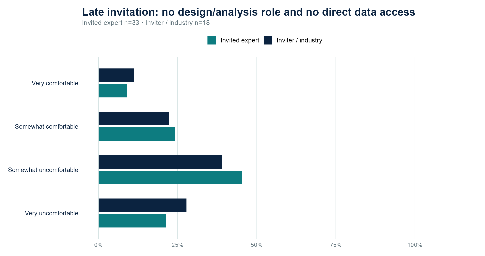
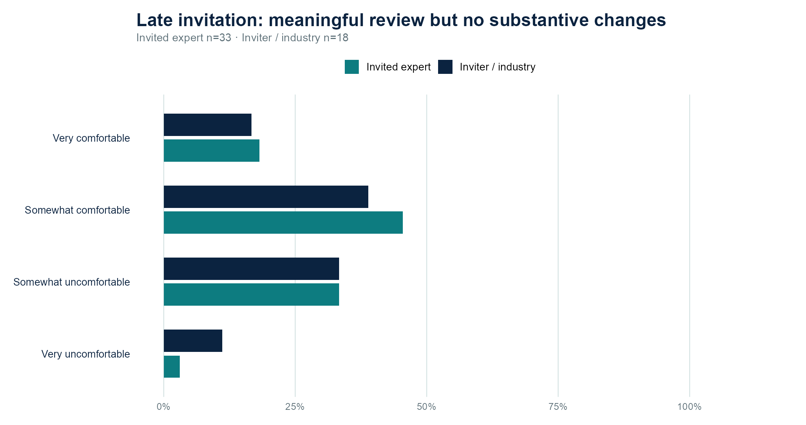
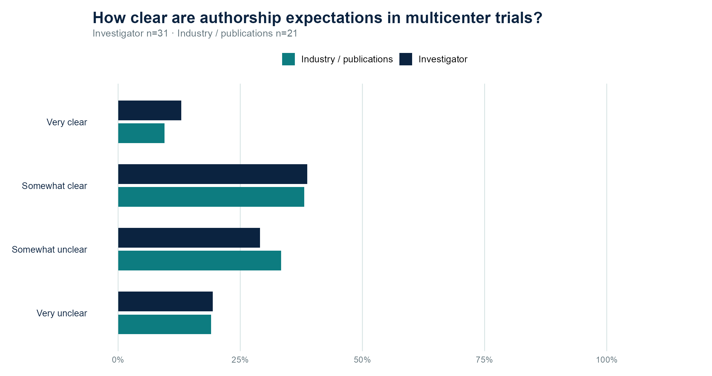
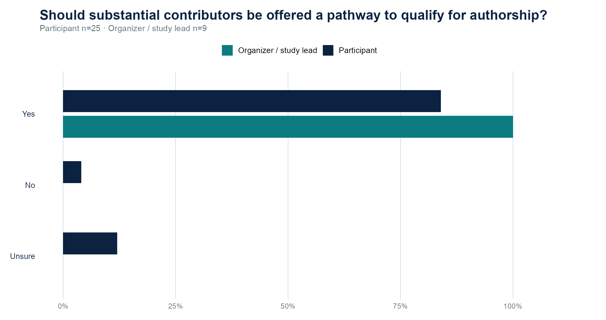
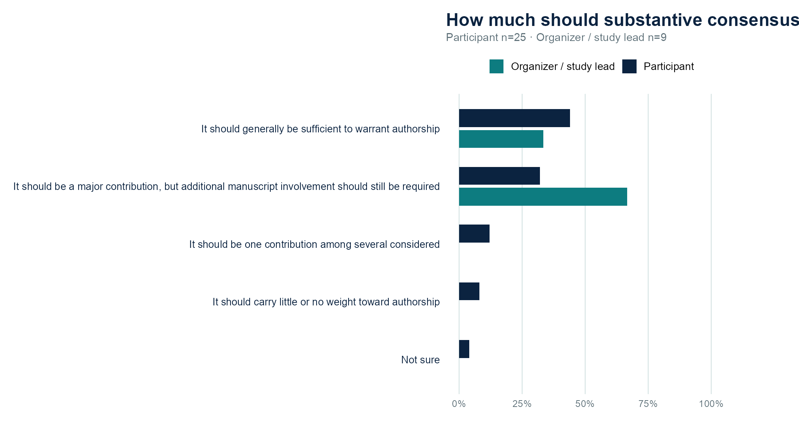
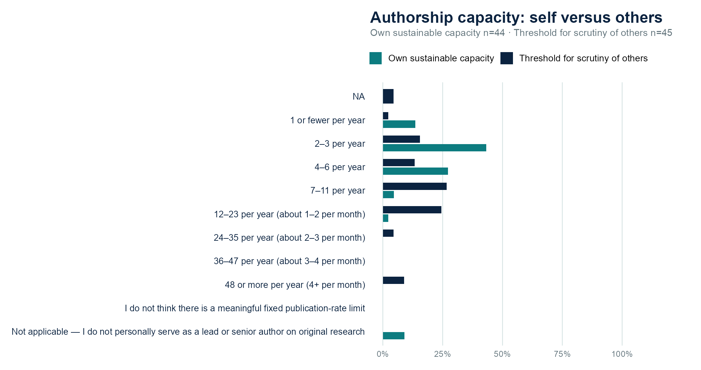
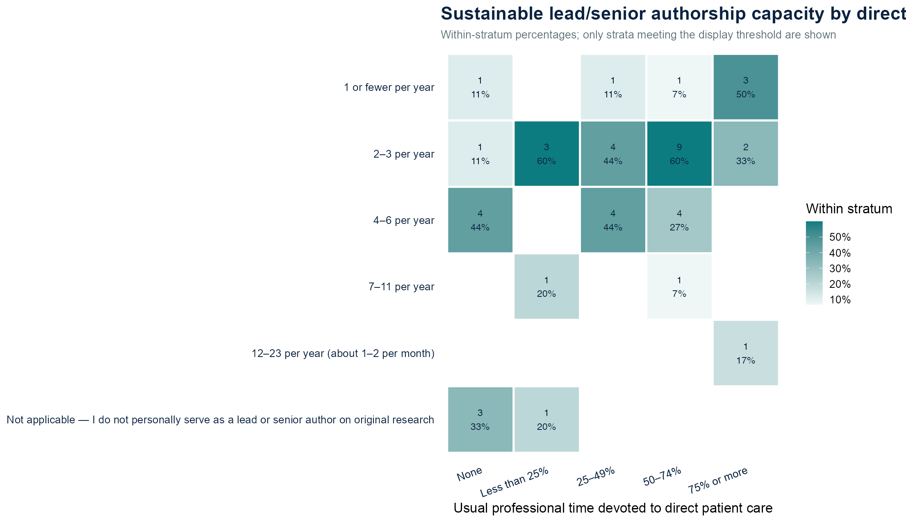

```{=html}
<style>
  :root {
    --soco-navy: #041b33;
    --soco-blue: #06436e;
    --soco-deep-blue: #0f2a59;
    --soco-teal: #0f7f86;
    --soco-coral: #ff3b3f;
    --soco-ink: #18293d;
    --soco-muted: #5c6f82;
    --soco-surface: #f6fafb;
    --soco-line: #dbe8ee;
  }

  #title-block-header,
  .quarto-title-block,
  .quarto-title,
  .quarto-title-meta {
    display: none !important;
  }

  main.content {
    width: 100%;
    max-width: 100%;
    min-width: 0;
    padding-top: 0 !important;
  }

  main.content,
  main.content * {
    box-sizing: border-box;
  }

  body {
    background: var(--soco-surface);
  }

  /* =========================================================
     Hero
     ========================================================= */

  .forum-entry-hero {
    position: relative;
    overflow: hidden;
    padding: 4.8rem 2rem 7.2rem;
    background:
      radial-gradient(
        circle at 84% 18%,
        rgba(15, 127, 134, 0.13),
        transparent 30%
      ),
      radial-gradient(
        circle at 14% 24%,
        rgba(255, 59, 63, 0.045),
        transparent 30%
      ),
      linear-gradient(
        135deg,
        #eef8f7 0%,
        #f7fbfb 58%,
        #ffffff 100%
      );
    color: var(--soco-navy);
    border-bottom: 1px solid var(--soco-line);
  }

  .forum-entry-hero::after {
    content: "";
    position: absolute;
    width: 420px;
    height: 420px;
    top: -120px;
    right: -80px;
    opacity: 0.20;
    background-image:
      radial-gradient(
        circle,
        rgba(255,255,255,0.82) 0 1.4px,
        transparent 2px
      );
    background-size: 30px 30px;
    mask-image: radial-gradient(circle, #000 0%, transparent 72%);
    -webkit-mask-image: radial-gradient(circle, #000 0%, transparent 72%);
    pointer-events: none;
  }

  .forum-entry-hero-inner {
    position: relative;
    z-index: 1;
    width: min(1120px, 92vw);
    margin: 0 auto;
    opacity: 0;
    transform: translateY(18px);
    animation: forumFadeUp 0.85s ease-out forwards;
  }

  .forum-entry-eyebrow {
    display: inline-flex;
    align-items: center;
    gap: 0.7rem;
    margin-bottom: 1.45rem;
    color: var(--soco-teal);
    font-size: 0.80rem;
    font-weight: 800;
    letter-spacing: 0.15em;
    text-transform: uppercase;
  }

  .forum-entry-eyebrow::before {
    content: "";
    width: 2.6rem;
    height: 2px;
    background: var(--soco-coral);
  }

  .forum-entry-hero h1 {
    max-width: 1060px;
    margin: 0;
    color: var(--soco-navy);
    font-size: clamp(2.7rem, 5.2vw, 4.9rem);
    font-weight: 700;
    line-height: 1.02;
    letter-spacing: -0.052em;
    text-wrap: balance;
  }

  .forum-entry-subtitle {
    max-width: 920px;
    margin: 1.65rem 0 0;
    color: #4f6574;
    font-size: clamp(1.08rem, 1.65vw, 1.28rem);
    line-height: 1.72;
  }

  .forum-entry-tags {
    display: flex;
    flex-wrap: wrap;
    gap: 0.7rem;
    margin-top: 2.2rem;
  }

  .forum-entry-tag {
    display: inline-flex;
    padding: 0.45rem 0.82rem;
    border: 1px solid rgba(15,127,134,0.24);
    border-radius: 999px;
    background: rgba(255,255,255,0.82);
    color: var(--soco-navy);
    font-size: 0.77rem;
    font-weight: 700;
  }

  /* =========================================================
     Main shell
     ========================================================= */

  .forum-entry-shell {
    position: relative;
    z-index: 2;
    width: min(1120px, 94vw);
    margin: -3.1rem auto 5rem;
  }

  .forum-entry-card {
    overflow: hidden;
    border: 1px solid rgba(4, 27, 51, 0.07);
    border-radius: 1.15rem;
    background: #ffffff;
    box-shadow: 0 20px 54px rgba(4, 27, 51, 0.10);
  }

  /* =========================================================
     Metadata
     ========================================================= */

  .forum-entry-meta {
    display: grid;
    grid-template-columns: 1fr 1fr 1fr;
    border-bottom: 1px solid var(--soco-line);
    background:
      linear-gradient(
        135deg,
        rgba(15, 127, 134, 0.035),
        rgba(255, 59, 63, 0.018)
      ),
      #ffffff;
  }

  .forum-entry-meta-item {
    padding: 1.4rem 1.6rem;
  }

  .forum-entry-meta-item + .forum-entry-meta-item {
    border-left: 1px solid var(--soco-line);
  }

  .forum-entry-meta-label {
    display: block;
    margin-bottom: 0.35rem;
    color: var(--soco-muted);
    font-size: 0.72rem;
    font-weight: 800;
    letter-spacing: 0.11em;
    text-transform: uppercase;
  }

  .forum-entry-meta-value {
    color: var(--soco-navy);
    font-size: 1rem;
    font-weight: 650;
    line-height: 1.45;
  }

  /* =========================================================
     Content
     ========================================================= */

  .forum-entry-content {
    max-width: 900px;
    margin: 0 auto;
    padding: 4rem 3rem 4.5rem;
  }

  .forum-entry-section {
    margin-bottom: 3.2rem;
  }

  .forum-entry-section h2 {
    margin: 0 0 1.2rem;
    padding-bottom: 0.7rem;
    border-bottom: 1px solid var(--soco-line);
    color: var(--soco-navy);
    font-size: clamp(1.9rem, 3vw, 2.55rem);
    line-height: 1.12;
  }

  .forum-entry-section p,
  .forum-entry-section li {
    color: #495b69;
    font-size: 1.08rem;
    line-height: 1.8;
  }

  /* =========================================================
     Presentation image
     ========================================================= */

  .forum-entry-image {
    margin: 0 0 3.5rem;
  }

  .forum-entry-image img {
    display: block;
    width: 100%;
    border: 1px solid var(--soco-line);
    border-radius: 0.9rem;
    box-shadow: 0 14px 38px rgba(4, 27, 51, 0.09);
  }

  /* =========================================================
     Highlight panels
     ========================================================= */

  .forum-entry-takeaway {
    margin: 2.75rem 0;
    padding: 2rem 2.1rem;
    border-left: 5px solid var(--soco-coral);
    border-radius: 0.9rem;
    background:
      linear-gradient(
        135deg,
        rgba(255, 59, 63, 0.05),
        rgba(15, 127, 134, 0.05)
      );
  }

  .forum-entry-takeaway-label {
    display: block;
    margin-bottom: 0.6rem;
    color: var(--soco-coral);
    font-size: 0.74rem;
    font-weight: 800;
    letter-spacing: 0.12em;
    text-transform: uppercase;
  }

  .forum-entry-takeaway p {
    margin: 0;
    color: var(--soco-navy);
    font-size: 1.16rem;
    line-height: 1.8;
  }

  /* =========================================================
     Question cards
     ========================================================= */

  .forum-entry-grid {
    display: grid;
    grid-template-columns: repeat(2, minmax(0, 1fr));
    gap: 1rem;
  }

  .forum-entry-mini-card {
    padding: 1.45rem;
    border: 1px solid var(--soco-line);
    border-radius: 0.9rem;
    background: var(--soco-surface);
  }

  .forum-entry-mini-card::before {
    content: "";
    display: block;
    width: 2.6rem;
    height: 0.2rem;
    margin-bottom: 1rem;
    border-radius: 999px;
    background: var(--soco-teal);
  }

  .forum-entry-mini-card:nth-child(2)::before {
    background: var(--soco-blue);
  }

  .forum-entry-mini-card:nth-child(3)::before {
    background: var(--soco-coral);
  }

  .forum-entry-mini-card:nth-child(4)::before {
    background: var(--soco-teal);
  }

  .forum-entry-mini-card h3 {
    margin: 0 0 0.7rem;
    color: var(--soco-navy);
    font-size: 1.08rem;
  }

  .forum-entry-mini-card p {
    margin: 0 !important;
    color: var(--soco-muted) !important;
    font-size: 0.94rem !important;
    line-height: 1.62 !important;
  }

  /* =========================================================
     Discussion topics
     ========================================================= */

  .forum-entry-topics {
    padding: 1.8rem 2rem;
    border: 1px solid var(--soco-line);
    border-radius: 0.9rem;
    background: var(--soco-surface);
  }

  .forum-entry-topics ul {
    margin: 0;
    padding-left: 1.25rem;
  }

  .forum-entry-topics li + li {
    margin-top: 0.75rem;
  }

  /* =========================================================
     Meeting recap / attendance
     ========================================================= */

  .forum-meeting-pulse {
    display: grid;
    grid-template-columns: repeat(3, minmax(0,1fr));
    gap: 1rem;
    margin: 1.4rem 0 3rem;
  }

  .forum-pulse-card {
    padding: 1.25rem 1.3rem;
    border: 1px solid var(--soco-line);
    border-radius: .95rem;
    background:
      linear-gradient(135deg, rgba(15,127,134,.055), rgba(255,255,255,.98));
    box-shadow: 0 7px 22px rgba(4,27,51,.045);
  }

  .forum-pulse-label {
    display:block;
    color:var(--soco-muted);
    font-size:.73rem;
    font-weight:800;
    text-transform:uppercase;
    letter-spacing:.09em;
  }

  .forum-pulse-value {
    display:block;
    margin:.32rem 0;
    color:var(--soco-navy);
    font-size:2rem;
    font-weight:850;
    line-height:1.05;
  }

  .forum-pulse-note {
    color:var(--soco-muted);
    font-size:.86rem;
    line-height:1.45;
  }

  .forum-standout-card {
    margin: 1.2rem 0 2rem;
    padding: 1.35rem 1.45rem 1.25rem;
    border: 1px solid rgba(15,127,134,.28);
    border-left: 7px solid var(--soco-teal);
    border-radius: 18px;
    background:
      radial-gradient(circle at 92% 18%,rgba(255,255,255,.72),transparent 28%),
      linear-gradient(135deg,#E9F7F5 0%,#F8FCFC 100%);
    box-shadow:0 10px 28px rgba(15,127,134,.08);
  }

  .forum-standout-title {
    margin:0 0 .35rem;
    color:var(--soco-navy);
    font-size:1.08rem;
    font-weight:850;
  }

  .forum-standout-copy {
    max-width:860px;
    margin:0;
    color:#526574;
    font-size:.93rem;
    line-height:1.55;
  }

  .forum-standout-pills {
    display:flex;
    flex-wrap:wrap;
    gap:.55rem;
    margin-top:.9rem;
  }

  .forum-standout-pill {
    display:inline-flex;
    padding:.5rem .72rem;
    border:1px solid rgba(15,127,134,.20);
    border-radius:999px;
    background:#ffffff;
    color:var(--soco-navy);
    font-size:.85rem;
    font-weight:780;
  }

  .forum-roster-summary {
    display:flex;
    justify-content:space-between;
    gap:1rem;
    margin:0 0 .8rem;
    padding:.9rem 1rem;
    border:1px solid var(--soco-line);
    border-radius:14px;
    background:#F7FBFB;
  }

  .forum-roster-summary strong {
    color:var(--soco-navy);
  }

  .forum-roster-summary span {
    color:var(--soco-muted);
    font-size:.84rem;
  }

  .forum-attendance-scroll {
    width:100%;
    overflow-x:auto;
    -webkit-overflow-scrolling:touch;
    border-radius:16px;
  }

  .forum-attendance-table {
    width:100%;
    min-width:690px;
    border-collapse:separate;
    border-spacing:0;
    overflow:hidden;
    border:1px solid var(--soco-line);
    border-radius:16px;
    background:#fff;
    box-shadow:0 8px 24px rgba(4,27,51,.045);
  }

  .forum-attendance-table thead th {
    padding:.7rem .72rem;
    background:var(--soco-teal);
    color:#fff;
    border:0;
    font-size:.76rem;
    font-weight:800;
    text-align:center;
  }

  .forum-attendance-table thead th:first-child {
    text-align:left;
  }

  .forum-attendance-table tbody td {
    padding:.64rem .72rem;
    border-top:1px solid #E9EFF1;
    color:#334857;
    font-size:.86rem;
    text-align:center;
  }

  .forum-attendance-table .name-cell {
    color:var(--soco-navy);
    font-weight:750;
    text-align:left;
  }

  .forum-attendance-table .minutes-cell {
    color:#17384C;
    font-variant-numeric:tabular-nums;
  }

  .forum-attendance-table .signal-on {
    color:var(--soco-teal);
    font-weight:900;
  }

  .forum-attendance-note {
    margin-top:.8rem;
    color:var(--soco-muted);
    font-size:.78rem;
    line-height:1.5;
  }


  .forum-attendance-details {
    margin: 1rem 0 2rem;
    overflow: hidden;
    border: 1px solid var(--soco-line);
    border-radius: 16px;
    background: #fff;
    box-shadow: 0 8px 24px rgba(4,27,51,.045);
  }

  .forum-attendance-details > summary {
    position: relative;
    min-height: 64px;
    padding: 1rem 3.4rem 1rem 1.05rem;
    cursor: pointer;
    list-style: none;
    background: linear-gradient(135deg,#F3F8F8 0%,#FFFFFF 100%);
    color: var(--soco-navy);
  }

  .forum-attendance-details > summary::-webkit-details-marker {
    display: none;
  }

  .forum-attendance-details > summary::after {
    content: "+";
    position: absolute;
    right: 1.05rem;
    top: 50%;
    transform: translateY(-50%);
    color: var(--soco-teal);
    font-size: 1.65rem;
    font-weight: 500;
    line-height: 1;
  }

  .forum-attendance-details[open] > summary::after {
    content: "−";
  }

  .forum-attendance-summary-title {
    display: block;
    color: var(--soco-navy);
    font-size: 1rem;
    font-weight: 850;
  }

  .forum-attendance-summary-subtitle {
    display: block;
    margin-top: .18rem;
    color: var(--soco-muted);
    font-size: .82rem;
    line-height: 1.4;
  }

  .forum-attendance-details .forum-attendance-note {
    margin: 0;
    padding: .85rem 1rem;
    border-top: 1px solid var(--soco-line);
    background: #FBFDFD;
  }

  .forum-attendance-details .forum-attendance-scroll {
    border-top: 1px solid var(--soco-line);
    border-radius: 0;
  }

  .forum-attendance-details .forum-attendance-table {
    min-width: 560px;
    margin: 0;
    border: 0;
    border-radius: 0;
    box-shadow: none;
  }

  .forum-attendance-details .forum-attendance-table thead th,
  .forum-attendance-details .forum-attendance-table tbody td {
    text-align: left;
  }

  .forum-attendance-details .forum-attendance-table .name-cell {
    width: 38%;
  }

  .forum-attendance-details .affiliation-cell {
    color: #52616D;
  }

  /* =========================================================
     Follow-up / publication
     ========================================================= */

  .forum-followup-card {
    margin: 1.5rem 0 2.5rem;
    padding: 1.5rem 1.55rem;
    border: 1px solid var(--soco-line);
    border-left: 7px solid var(--soco-teal);
    border-radius: 18px;
    background:
      radial-gradient(circle at 92% 12%, rgba(15,127,134,.10), transparent 30%),
      linear-gradient(135deg, #F3FAF9 0%, #FFFFFF 100%);
    box-shadow: 0 10px 28px rgba(4,27,51,.06);
  }

  .forum-followup-eyebrow {
    color: var(--soco-teal);
    font-size: .74rem;
    font-weight: 850;
    letter-spacing: .12em;
    text-transform: uppercase;
  }

  .forum-followup-card h3 {
    margin: .4rem 0 .7rem;
    color: var(--soco-navy);
    font-size: 1.25rem;
    line-height: 1.3;
  }

  .forum-followup-card p {
    margin: 0;
    color: #4f6270;
    font-size: .96rem;
    line-height: 1.65;
  }

  .forum-followup-citation {
    margin-top: 1rem;
    padding-top: .95rem;
    border-top: 1px solid var(--soco-line);
    color: var(--soco-muted);
    font-size: .88rem;
    line-height: 1.55;
  }

  /* =========================================================
     Navigation
     ========================================================= */

  .forum-entry-links {
    display: flex;
    flex-wrap: wrap;
    gap: 0.75rem;
    margin-top: 1.7rem;
  }

  .forum-entry-link {
    display: inline-flex;
    padding: 0.68rem 1rem;
    border-radius: 999px;
    background: var(--soco-blue);
    color: #ffffff !important;
    font-size: 0.89rem;
    font-weight: 700;
    text-decoration: none;
  }

  .forum-entry-link:hover {
    background: var(--soco-navy);
  }

  .forum-entry-link.secondary {
    border: 1px solid #bfd4df;
    background: #ffffff;
    color: var(--soco-blue) !important;
  }

  .forum-entry-link.secondary:hover {
    border-color: var(--soco-blue);
    background: var(--soco-blue);
    color: #ffffff !important;
  }

  .forum-entry-note {
    margin-top: 3rem;
    padding-top: 1.35rem;
    border-top: 1px solid var(--soco-line);
    color: var(--soco-muted);
    font-size: 0.84rem;
    line-height: 1.65;
  }

  /* =========================================================
     Motion
     ========================================================= */

  .fade-in {
    opacity: 0;
    transform: translateY(18px);
    transition:
      opacity 0.6s ease-out,
      transform 0.6s ease-out;
  }

  .fade-in.visible {
    opacity: 1;
    transform: translateY(0);
  }

  @keyframes forumFadeUp {
    to {
      opacity: 1;
      transform: translateY(0);
    }
  }

  /* =========================================================
     Responsive
     ========================================================= */

  @media (max-width: 760px) {
    /*
      MOBILE LAYOUT
      Quarto uses a page-level CSS grid. These rules:
      1) allow the page grid item and every custom component to shrink;
      2) constrain the hero/shell to the viewport;
      3) use minmax(0,1fr) for collapsed grids;
      4) keep the attendance table wide only inside its own horizontal scroller.
    */

    html,
    body {
      max-width: 100%;
      overflow-x: hidden;
    }

    #quarto-content,
    #quarto-content.page-columns,
    main.content,
    .page-columns .content {
      min-width: 0 !important;
      max-width: 100% !important;
    }

    main.content {
      width: 100% !important;
      margin: 0 !important;
      padding: 0 !important;
    }

    .forum-entry-hero,
    .forum-entry-hero-inner,
    .forum-entry-shell,
    .forum-entry-card,
    .forum-entry-meta,
    .forum-entry-meta-item,
    .forum-entry-content,
    .forum-entry-section,
    .forum-entry-image,
    .forum-entry-takeaway,
    .forum-entry-grid,
    .forum-entry-mini-card,
    .forum-entry-topics,
    .forum-meeting-pulse,
    .forum-pulse-card,
    .forum-standout-card,
    .forum-standout-pills,
    .forum-standout-pill,
    .forum-roster-summary,
    .forum-attendance-details,
    .forum-attendance-scroll,
    .forum-followup-card,
    .forum-entry-links,
    .forum-entry-link,
    .forum-entry-note,
    .forum-entry-tags,
    .forum-entry-tag {
      min-width: 0;
      max-width: 100%;
    }

    .forum-entry-hero {
      padding: 2.3rem 1rem 4.3rem;
    }

    .forum-entry-hero::after {
      width: 240px;
      height: 240px;
      top: -70px;
      right: -70px;
      background-size: 24px 24px;
    }

    .forum-entry-hero-inner {
      width: 100%;
      max-width: 100%;
      margin: 0;
    }

    .forum-entry-eyebrow {
      max-width: 100%;
      gap: .5rem;
      margin-bottom: 1rem;
      font-size: .7rem;
      line-height: 1.45;
      letter-spacing: .11em;
      overflow-wrap: anywhere;
    }

    .forum-entry-eyebrow::before {
      width: 1.8rem;
      flex: 0 0 1.8rem;
    }

    .forum-entry-hero h1 {
      max-width: 100%;
      font-size: clamp(2rem, 9.5vw, 2.65rem);
      line-height: 1.03;
      letter-spacing: -.035em;
      text-wrap: pretty;
      overflow-wrap: anywhere;
    }

    .forum-entry-subtitle {
      max-width: 100%;
      margin-top: 1rem;
      font-size: 1rem;
      line-height: 1.52;
    }

    .forum-entry-tags {
      display: grid;
      grid-template-columns: minmax(0,1fr);
      gap: .5rem;
      margin-top: 1.35rem;
    }

    .forum-entry-tag {
      width: 100%;
      justify-content: flex-start;
      white-space: normal;
    }

    .forum-entry-shell {
      width: calc(100% - 1.4rem);
      max-width: calc(100% - 1.4rem);
      margin: -2.25rem auto 3rem;
    }

    .forum-entry-card {
      width: 100%;
      border-radius: .95rem;
    }

    .forum-entry-meta,
    .forum-entry-grid,
    .forum-meeting-pulse {
      grid-template-columns: minmax(0,1fr);
    }

    .forum-entry-meta-item {
      padding: 1rem 1.05rem;
    }

    .forum-entry-meta-item + .forum-entry-meta-item {
      border-top: 1px solid var(--soco-line);
      border-left: 0;
    }

    .forum-entry-content {
      width: 100%;
      max-width: 100%;
      padding: 1.8rem 1rem 2.5rem;
    }

    .forum-entry-section {
      margin-bottom: 2.3rem;
    }

    .forum-entry-section h2 {
      max-width: 100%;
      font-size: clamp(1.55rem, 7vw, 2rem);
      line-height: 1.14;
      overflow-wrap: anywhere;
    }

    .forum-entry-section h3 {
      max-width: 100%;
      overflow-wrap: anywhere;
    }

    .forum-entry-section p,
    .forum-entry-section li {
      font-size: 1rem;
      line-height: 1.65;
      overflow-wrap: anywhere;
    }

    .forum-entry-section ul {
      padding-left: 1.15rem;
    }

    .forum-entry-image {
      margin-bottom: 2.2rem;
    }

    .forum-entry-image img {
      max-width: 100%;
      height: auto;
      border-radius: .75rem;
    }

    .forum-entry-takeaway,
    .forum-entry-topics {
      width: 100%;
      padding: 1rem;
    }

    .forum-entry-takeaway p {
      font-size: 1.02rem;
      line-height: 1.65;
    }

    .forum-entry-grid,
    .forum-meeting-pulse {
      display: grid;
      grid-template-columns: minmax(0,1fr);
      gap: .8rem;
    }

    .forum-entry-mini-card,
    .forum-pulse-card {
      width: 100%;
      padding: 1rem;
    }

    .forum-pulse-value {
      font-size: 1.85rem;
    }

    .forum-standout-card,
    .forum-followup-card {
      padding: 1rem;
    }

    .forum-standout-pills {
      display: grid;
      grid-template-columns: minmax(0,1fr);
    }

    .forum-standout-pill {
      width: 100%;
      white-space: normal;
    }

    .forum-roster-summary {
      display: block;
      padding: .85rem .9rem;
    }

    .forum-roster-summary span {
      display: block;
      margin-top: .3rem;
    }

    .forum-attendance-scroll {
      width: 100%;
      max-width: 100%;
      margin: 0;
      padding-bottom: .3rem;
      overflow-x: auto;
      -webkit-overflow-scrolling: touch;
    }

    .forum-attendance-table {
      width: 690px;
      min-width: 690px;
      max-width: none;
    }

    .forum-attendance-details > summary {
      min-height: 60px;
      padding: .85rem 3rem .85rem .9rem;
    }

    .forum-attendance-summary-title {
      font-size: .92rem;
    }

    .forum-attendance-summary-subtitle,
    .forum-attendance-details .forum-attendance-note {
      font-size: .74rem;
    }

    .forum-attendance-details .forum-attendance-table {
      width: 100%;
      min-width: 500px;
      max-width: none;
    }

    .forum-entry-links {
      display: grid;
      grid-template-columns: minmax(0,1fr);
      gap: .6rem;
    }

    .forum-entry-link {
      width: 100%;
      max-width: 100%;
      justify-content: center;
      text-align: center;
      white-space: normal;
    }

    img,
    svg,
    video,
    iframe,
    canvas {
      max-width: 100%;
      height: auto;
    }
  }

  @media (max-width: 420px) {
    .forum-entry-hero {
      padding-left: .85rem;
      padding-right: .85rem;
    }

    .forum-entry-hero h1 {
      font-size: clamp(1.9rem, 9vw, 2.35rem);
    }

    .forum-entry-shell {
      width: calc(100% - 1rem);
      max-width: calc(100% - 1rem);
    }

    .forum-entry-content {
      padding-left: .85rem;
      padding-right: .85rem;
    }

    .forum-pulse-value {
      font-size: 1.75rem;
    }

    .forum-attendance-table {
      width: 620px;
      min-width: 620px;
    }

    .forum-attendance-details .forum-attendance-table {
      width: 100%;
      min-width: 470px;
    }
  }

  @media (prefers-reduced-motion: reduce) {

    .forum-entry-hero-inner,
    .fade-in {
      opacity: 1;
      transform: none;
      animation: none;
      transition: none;
    }
  }


.forum-entry-tag{text-decoration:none}.recap-figure{margin:1.6rem 0 2rem}.recap-figure img{display:block;width:100%;height:auto;border:1px solid var(--soco-line);border-radius:.5rem;background:#fff}.recap-figure figcaption{margin-top:.7rem;color:var(--soco-muted);font-size:.88rem;line-height:1.55}.recap-figure figcaption span{white-space:nowrap}.survey-image-link{display:block;cursor:zoom-in}.recap-additional-thanks{margin:1.25rem 0 0;font-size:.95rem;line-height:1.7;color:var(--soco-muted)}.survey-search-label{display:block;font-weight:700;margin:1.5rem 0 .5rem}.survey-search{width:100%;padding:.8rem 1rem;border:1px solid var(--soco-line);border-radius:.6rem;font:inherit}.survey-search:focus{outline:2px solid var(--soco-teal);outline-offset:2px}.survey-search-status{font-size:.9rem;color:var(--soco-muted);margin:.6rem 0 1rem}.survey-group{margin:1rem 0}.survey-group-content{padding:1rem 1.25rem}.survey-item{border-top:1px solid var(--soco-line);padding:1rem 0}.survey-item>summary{cursor:pointer;font-weight:650;line-height:1.55;color:var(--soco-navy);padding:.3rem .2rem}.survey-item[open]>summary{color:var(--soco-teal)}.survey-scenario{font-size:.95rem;color:var(--soco-muted)}.survey-item .recap-figure{margin:1rem 0}.recap-references{padding-left:1.4rem;font-size:.95rem;line-height:1.7}.recap-references li{margin:.65rem 0}.survey-lightbox{width:min(96vw,1600px);max-width:96vw;max-height:96vh;border:1px solid var(--soco-line);border-radius:.7rem;padding:1rem;color:var(--soco-navy);background:#fff}.survey-lightbox::backdrop{background:rgba(4,27,51,.7)}.lightbox-controls{display:flex;gap:.6rem;justify-content:flex-end;position:sticky;top:0;background:#fff;padding:.4rem}.lightbox-controls button{font:inherit;border:1px solid var(--soco-line);padding:.45rem .8rem;border-radius:.4rem;cursor:pointer;background:#f6fafb;color:var(--soco-navy)}.lightbox-title{font-size:1rem;font-weight:650;line-height:1.5;margin:.6rem 0}.lightbox-image-wrap{max-height:77vh;overflow:auto}.lightbox-image{display:block;max-width:100%;height:auto}.lightbox-image.actual-size{max-width:none;width:auto}.lightbox-note{font-size:.83rem;color:var(--soco-muted);margin:.6rem 0 0}[hidden]{display:none!important}@media(max-width:600px){.survey-group-content{padding:.65rem}.survey-group>summary{flex-direction:column;align-items:flex-start;gap:.4rem}.recap-figure figcaption span{white-space:normal}.survey-item>summary{font-size:.98rem}}
.recap-attendance-roster{display:grid;grid-template-columns:repeat(3,minmax(0,1fr));gap:.55rem 1.2rem;list-style:none;padding:0;margin:1rem 0;font-size:.96rem}.recap-attendance-roster li{margin:0;overflow-wrap:anywhere}.recap-attendance{margin:1.5rem 0 2.5rem}.forum-entry-hero,.forum-entry-hero *{box-sizing:border-box}@media(max-width:600px){.forum-entry-content{padding:1.5rem 1rem 2rem}.recap-attendance-roster{grid-template-columns:1fr}}
@media(prefers-reduced-motion:reduce){.forum-entry-hero-inner,.fade-in{animation:none!important;transform:none!important;opacity:1!important;transition:none!important}}


.native-survey-tools{display:flex;align-items:flex-end;gap:1rem;margin:1.6rem 0 .7rem}.native-search-wrap{flex:1;min-width:0}.native-search-wrap .survey-search-label{margin:0 0 .5rem}.native-expand-button{border:1px solid var(--soco-border,var(--soco-line));background:#f0f8f8;color:var(--soco-teal);border-radius:.6rem;padding:.85rem 1rem;font:inherit;font-size:.88rem;font-weight:700;cursor:pointer;min-height:49px}.native-expand-button:hover{background:#e5f3f3}.pub-survey-stack{display:grid;gap:1.2rem}.pub-survey-panel{min-width:0;border:1px solid var(--soco-line);border-top:3px solid var(--soco-teal);border-radius:15px;padding:1.35rem 1.4rem;background:#fff;box-shadow:0 5px 18px rgba(4,27,51,.035);margin:0}.pub-survey-kicker{color:var(--soco-teal);font-size:.69rem;font-weight:800;letter-spacing:.075em;text-transform:uppercase;margin:0 0 .55rem;line-height:1.45}.native-survey-heading{display:flex;align-items:flex-start;justify-content:space-between;gap:1rem}.forum-entry-content .pub-survey-title{color:var(--soco-navy);font-size:1.13rem;font-weight:750;line-height:1.4;margin:0;letter-spacing:-.018em;min-width:0}.native-n{flex-shrink:0;white-space:nowrap;border:1px solid #cfe5e5;background:#eff8f7;padding:.25rem .6rem;border-radius:999px;color:var(--soco-teal);font-size:.8rem;font-weight:750;line-height:1.4}.native-n.is-unavailable{background:#f4f6f7;border-color:#dbe3e8;color:var(--soco-muted)}.forum-entry-content .pub-survey-meta{color:var(--soco-muted);font-size:.8rem;line-height:1.5;margin:.6rem 0 1rem}.pub-survey-context{padding:.8rem 1rem;border-left:3px solid var(--soco-teal);border-radius:0 9px 9px 0;background:#f3f9f9;color:var(--soco-muted);font-size:.88rem;line-height:1.6;margin:.9rem 0 1.25rem}.pub-survey-context strong{color:var(--soco-navy)}.pub-bar-list{display:grid;gap:.1rem}.pub-bar-row{display:grid;grid-template-columns:minmax(200px,1.35fr) minmax(120px,1fr) 82px;gap:.85rem;align-items:center;padding:.75rem 0;border-bottom:1px solid #eef3f5;min-width:0}.pub-bar-row:last-child{border-bottom:0;padding-bottom:.1rem}.pub-bar-label{font-size:.91rem;line-height:1.5;color:var(--soco-ink);overflow-wrap:anywhere;min-width:0}.pub-bar-track{height:10px;border-radius:999px;background:#edf3f4;overflow:hidden;min-width:0}.pub-bar-fill{height:100%;border-radius:999px;background:linear-gradient(90deg,#0f7f86,#63bbbd)}.pub-bar-fill.uncertainty{background:linear-gradient(90deg,#c85558,#e78b8d)}.pub-bar-value{display:flex;flex-direction:column;align-items:flex-end;gap:.15rem;font-variant-numeric:tabular-nums;white-space:nowrap}.native-percent{color:var(--soco-navy);font-size:1.17rem;font-weight:750;line-height:1.15}.native-count{color:var(--soco-muted);font-size:.76rem;font-weight:500;line-height:1.3}.forum-entry-content .native-panel-caption,.forum-entry-content .native-perspective-note{margin:.85rem 0 0;color:var(--soco-muted);font-size:.83rem;line-height:1.55}.forum-entry-content .native-unavailable{color:var(--soco-muted);font-size:.92rem;line-height:1.65;margin:1rem 0 0}.featured-survey{margin:1.5rem 0 1.8rem}.featured-survey-pair{display:grid;grid-template-columns:repeat(2,minmax(0,1fr));gap:1rem;align-items:start;margin:1.5rem 0 0}.featured-survey-pair .featured-survey{margin:0;height:100%}.featured-survey-pair .native-survey-heading{flex-direction:column;gap:.6rem}.featured-survey-pair .pub-bar-row{grid-template-columns:minmax(0,1fr) 82px;gap:.5rem .8rem}.featured-survey-pair .pub-bar-label{grid-column:1/-1}.featured-survey-pair .pub-bar-track{grid-column:1;grid-row:2}.featured-survey-pair .pub-bar-value{grid-column:2;grid-row:2}.native-source-note,.native-group-note{font-size:.86rem!important;line-height:1.65!important;color:var(--soco-muted)}.recap-export-links{display:flex;flex-wrap:wrap;gap:.6rem 1.2rem;margin:1.1rem 0 1.6rem;font-size:.86rem}.archived-comparisons{margin:1.2rem 0}.native-group-note{margin:0 0 .3rem!important}.survey-group-content.pub-survey-stack{padding:1.2rem}.pub-survey-panel:focus-within{outline:2px solid #70c4c5;outline-offset:2px}@media(max-width:760px){.pub-bar-row{grid-template-columns:minmax(0,1fr) 76px;gap:.5rem .8rem}.pub-bar-label{grid-column:1/-1}.pub-bar-track{grid-column:1;grid-row:2}.pub-bar-value{grid-column:2;grid-row:2}.featured-survey-pair{grid-template-columns:1fr}.native-survey-tools{flex-direction:column;align-items:stretch}.native-expand-button{align-self:flex-start}.native-survey-heading{flex-direction:column;gap:.55rem}.pub-survey-panel{padding:1.1rem 1rem}.survey-group-content.pub-survey-stack{padding:.75rem}.forum-entry-content .pub-survey-title{font-size:1.08rem}.pub-bar-label{font-size:.94rem}.native-percent{font-size:1.16rem}}@media print{.survey-search,.native-survey-tools,.survey-search-status{display:none}.survey-group>.survey-group-content{display:block!important}.pub-survey-panel{break-inside:avoid;box-shadow:none;margin:0 0 1rem}}

@supports(grid-template-rows:subgrid){.featured-survey-pair{row-gap:0}.featured-survey-pair .featured-survey{display:grid;grid-template-rows:subgrid;grid-row:span 4;row-gap:0}@media(max-width:760px){.featured-survey-pair{row-gap:1rem}.featured-survey-pair .featured-survey{display:block;grid-row:auto}}}
</style>
<section class="forum-entry-hero">
<div class="forum-entry-hero-inner">
<div class="forum-entry-eyebrow">SoCO Research Workshop · October 28, 2026</div>
<h1>The Art of Authorship</h1>
<p class="forum-entry-subtitle">Who Gets on the Paper? A conversation about contribution, credit, accountability, and the process that connects them.</p>
<div class="forum-entry-tags">
<a class="forum-entry-tag" href="#clinical-contribution">Clinical contribution</a>
<a class="forum-entry-tag" href="#late-expert">Late invitations</a>
<a class="forum-entry-tag" href="#clinical-trials">Clinical trials</a>
<a class="forum-entry-tag" href="#survey-results">Survey results</a>
</div>
</div>
</section>
<main class="forum-entry-shell">
<article class="forum-entry-card">
<div class="forum-entry-meta">
<div class="forum-entry-meta-item">
<span class="forum-entry-meta-label">Program</span>
<span class="forum-entry-meta-value">SoCO Research Workshop</span>
</div>
<div class="forum-entry-meta-item">
<span class="forum-entry-meta-label">Moderator</span>
<span class="forum-entry-meta-value">David M. Miller</span>
</div>
<div class="forum-entry-meta-item">
<span class="forum-entry-meta-label">Date</span>
<span class="forum-entry-meta-value">October 28, 2026</span>
</div>
</div>
<div class="forum-entry-content">
<section class="forum-entry-section fade-in">
<h2>The conversation</h2>
<p>On October 28, 2026, the SoCO Research Workshop brought clinicians, investigators, an editor, and industry colleagues together to discuss how authorship decisions are made. Three cases anchored the conversation: the clinician whose patients generated the data, the expert invited after a draft exists, and the investigator navigating a multicenter trial.</p>
<p>The discussion repeatedly returned to a practical problem: people can know the same authorship criteria and still disagree about the contribution required, the opportunity to make that contribution, or the order in which contributors should appear. Hearing how colleagues have handled those situations was as important as reviewing the rules.</p>
</section>
<section class="forum-entry-section fade-in">
<h2>The room</h2>
<div class="forum-meeting-pulse">
<div class="forum-pulse-card">
<span class="forum-pulse-label">People who joined</span>
<span class="forum-pulse-value">43</span>
<span class="forum-pulse-note">Colleagues represented in the meeting</span>
</div>
<div class="forum-pulse-card">
<span class="forum-pulse-label">Median time together</span>
<span class="forum-pulse-value">93.5 min</span>
<span class="forum-pulse-note">Median recorded attendance per person</span>
</div>
<div class="forum-pulse-card">
<span class="forum-pulse-label">Stayed at least an hour</span>
<span class="forum-pulse-value">88%</span>
<span class="forum-pulse-note">38 of 43 people attended for at least 60 minutes</span>
</div>
</div>
<p>From the October 28 meeting attendance records. Survey response counts reflect the people who answered each question.</p>
</section>
<div class="forum-entry-takeaway fade-in">
<span class="forum-entry-takeaway-label">The practical question</span>
<p>How do we give people a meaningful opportunity to contribute, make decisions understandable, and revisit them as the work changes?</p>
</div>
<section class="forum-entry-section fade-in">
<h2>A shared starting point</h2>
<p>The workshop used ICMJE’s four-part framework: substantial input into the study’s design, data collection, analysis, or interpretation; drafting or substantive intellectual review; approval of the final manuscript; and accountability for questions about its accuracy or integrity. All four are required. The author group should include everyone who fulfills them, and people meeting the first requirement should have an opportunity to complete the manuscript-related requirements. <a href="#ref-icmje">[1]</a>
</p>
<p>The opening distinguished that threshold from COPE’s publication-ethics guidance, CRediT’s vocabulary for describing contributions, and individual journal policies. CRediT describes work performed; it does not independently decide who qualifies as an author. <a href="#ref-cope">[2]</a> <a href="#ref-credit">[3]</a>
</p>
<p>Ade Adamson described what an editor can realistically assess. A journal sees the submitted paper and contribution statements, not every interaction that produced them. Mike Wong emphasized the culture and leadership through which groups apply the criteria. Their comments placed much of the practical responsibility within the research team, before submission.</p>
</section>
<section class="forum-entry-section fade-in">
<h2>What the community survey added</h2>
<div class="forum-meeting-pulse">
<div class="forum-pulse-card">
<span class="forum-pulse-label">Familiar with ICMJE</span>
<span class="forum-pulse-value">67%</span>
<span class="forum-pulse-note">30 of 45 were very or somewhat familiar</span>
</div>
<div class="forum-pulse-card">
<span class="forum-pulse-label">Very familiar</span>
<span class="forum-pulse-value">24%</span>
<span class="forum-pulse-note">11 of 45 selected the highest familiarity category</span>
</div>
<div class="forum-pulse-card">
<span class="forum-pulse-label">Often or always use guidance</span>
<span class="forum-pulse-value">36%</span>
<span class="forum-pulse-note">16 of 45; 8 additional respondents chose not applicable</span>
</div>
</div>
<p>The distinction between familiarity and use mattered. Familiarity was common, but a smaller group reported being very familiar, and use of formal guidance varied. These were self-reports from a community survey, not an audit of whether contributors met authorship requirements.</p>
<p>Question-specific denominators are shown throughout the figures. The survey used several perspective-based question sets; answering an investigator or publication-team question does not by itself verify someone’s employment sector. The complete chart collection, including questions not reached during the meeting, is available below.</p>
</section>
<section class="forum-entry-section fade-in" id="clinical-contribution">
<h2>Case 1 · Clinical contribution and a meaningful opportunity</h2>
<p>The first case concerned a clinician whose patient care substantially supported a retrospective study but who had not participated in its design, analysis, interpretation, or writing. The central question was what a meaningful invitation into the research should look like.</p>
<p>
<strong>In the survey:</strong> 26 of 35 respondents (74%) selected the view that care alone is insufficient but clinicians should generally be offered an opportunity to contribute further. Among the 33 respondents to the clinician-reaction question, 26 (79%) would be somewhat or very bothered if they were not approached.</p>
<p>Kevin Emerick described moving from late requests to approve a finished case series toward engagement when the question is first taking shape. Examples included continuing a conversation after tumor board, setting aside a project or lab meeting, and offering office hours to review the data and challenge the interpretation. David Miller described an office-hours invitation that resulted in an engaged author group.</p>
<p>Elizabeth Buchbinder emphasized the research work embedded in clinical practice: obtaining tissue, arranging banking consent, supporting ctDNA collection, and documenting information so that it can be analyzed reliably. These contributions can be easy to miss if a project team first contacts clinicians when the manuscript is nearly complete. Early involvement was discussed as a way to improve the science as well as clarify credit.</p>
<article class="pub-survey-panel featured-survey" id="featured-m2_researcher_clinical_care_principle" data-question-id="m2_researcher_clinical_care_principle" data-search="case 1 · clinical contribution which best reflects your view? m2_researcher_clinical_care_principle single choice caring for the patients whose data make the study possible should itself carry meaningful weight toward authorship clinical care alone is not enough for authorship, but those clinicians should generally be offered an opportunity to contribute further authorship should depend only on contributions to the research itself, regardless of who provided the clinical care unsure">
<div class="pub-survey-kicker">Study-lead question</div>
<div class="native-survey-heading">
<h3 class="pub-survey-title">Which best reflects your view?</h3>
<span class="native-n">n = 35</span>
</div>
<p class="pub-survey-meta">Single choice</p>
<div class="pub-bar-list" role="list" aria-label="Answer choices and results">
<div class="pub-bar-row" role="listitem" data-option-value="care_counts" data-count="8" data-denominator="35" data-proportion="0.22857142857142856">
<div class="pub-bar-label">Caring for the patients whose data make the study possible should itself carry meaningful weight toward authorship</div>
<div class="pub-bar-track" aria-hidden="true">
<div class="pub-bar-fill" style="width:22.857143%">
</div>
</div>
<div class="pub-bar-value">
<span class="native-percent">23%</span>
<span class="native-count">8 / 35</span>
</div>
</div>
<div class="pub-bar-row" role="listitem" data-option-value="offer_path" data-count="26" data-denominator="35" data-proportion="0.7428571428571429">
<div class="pub-bar-label">Clinical care alone is not enough for authorship, but those clinicians should generally be offered an opportunity to contribute further</div>
<div class="pub-bar-track" aria-hidden="true">
<div class="pub-bar-fill" style="width:74.285714%">
</div>
</div>
<div class="pub-bar-value">
<span class="native-percent">74%</span>
<span class="native-count">26 / 35</span>
</div>
</div>
<div class="pub-bar-row" role="listitem" data-option-value="research_only" data-count="1" data-denominator="35" data-proportion="0.02857142857142857">
<div class="pub-bar-label">Authorship should depend only on contributions to the research itself, regardless of who provided the clinical care</div>
<div class="pub-bar-track" aria-hidden="true">
<div class="pub-bar-fill" style="width:2.857143%">
</div>
</div>
<div class="pub-bar-value">
<span class="native-percent">3%</span>
<span class="native-count">1 / 35</span>
</div>
</div>
<div class="pub-bar-row" role="listitem" data-option-value="unsure" data-count="0" data-denominator="35" data-proportion="0">
<div class="pub-bar-label">Unsure</div>
<div class="pub-bar-track" aria-hidden="true">
<div class="pub-bar-fill uncertainty" style="width:0.000000%">
</div>
</div>
<div class="pub-bar-value">
<span class="native-percent">0%</span>
<span class="native-count">0 / 35</span>
</div>
</div>
</div>
<p class="native-panel-caption">Study-lead question, n = 35. The opportunity-to-contribute answer received 26 responses (74%).</p>
</article>
</section>
<section class="forum-entry-section fade-in" id="late-expert">
<h2>Case 2 · The late invited expert</h2>
<p>This case began with a different relationship to the work: an academic expert had not treated the patients or participated in the study, and the manuscript was already substantially drafted. The question was whether enough meaningful intellectual work remained for the expert to qualify and accept responsibility.</p>
<p>
<strong>In the survey:</strong> 22 of 33 respondents (67%) were somewhat or very uncomfortable accepting late authorship without direct access to the underlying data. In a separate question, 18 of 33 (55%) said they had declined a late invitation because they did not feel their contribution justified authorship.</p>
<p>Wong’s personal test was whether he could defend the paper in front of peers. Buchbinder distinguished an invitation to help shape interpretation from an invitation to endorse a finished product. Daniel Coit offered another perspective: a rigorous internal review can have intellectual value, even when the reviewer ultimately endorses the existing analysis. The group did not settle a universal threshold for how much interpretive input is enough.</p>
<p>Howard Kaufman described legitimate reasons to seek expertise outside an existing team and the value of doing so early. He also explained the internal reviews that may surround industry publications, including scientific, publication-planning, conflict-of-interest, partner, and intellectual-property considerations. The discussion made clear why timing, access, and freedom to challenge conclusions belong in the invitation itself.</p>
<article class="pub-survey-panel featured-survey" id="featured-m1_acad_ever_declined_contribution" data-question-id="m1_acad_ever_declined_contribution" data-search="case 2 · the late invited expert have you ever declined a late invitation to authorship because you did not feel your contribution justified authorship? m1_acad_ever_declined_contribution single choice yes no not sure / don&#x27;t recall">
<div class="pub-survey-kicker">Invited-expert question</div>
<div class="native-survey-heading">
<h3 class="pub-survey-title">Have you ever declined a late invitation to authorship because you did not feel your contribution justified authorship?</h3>
<span class="native-n">n = 33</span>
</div>
<p class="pub-survey-meta">Single choice</p>
<div class="pub-bar-list" role="list" aria-label="Answer choices and results">
<div class="pub-bar-row" role="listitem" data-option-value="yes" data-count="18" data-denominator="33" data-proportion="0.5454545454545454">
<div class="pub-bar-label">Yes</div>
<div class="pub-bar-track" aria-hidden="true">
<div class="pub-bar-fill" style="width:54.545455%">
</div>
</div>
<div class="pub-bar-value">
<span class="native-percent">55%</span>
<span class="native-count">18 / 33</span>
</div>
</div>
<div class="pub-bar-row" role="listitem" data-option-value="no" data-count="12" data-denominator="33" data-proportion="0.36363636363636365">
<div class="pub-bar-label">No</div>
<div class="pub-bar-track" aria-hidden="true">
<div class="pub-bar-fill" style="width:36.363636%">
</div>
</div>
<div class="pub-bar-value">
<span class="native-percent">36%</span>
<span class="native-count">12 / 33</span>
</div>
</div>
<div class="pub-bar-row" role="listitem" data-option-value="not_sure" data-count="3" data-denominator="33" data-proportion="0.09090909090909091">
<div class="pub-bar-label">Not sure / don&#x27;t recall</div>
<div class="pub-bar-track" aria-hidden="true">
<div class="pub-bar-fill uncertainty" style="width:9.090909%">
</div>
</div>
<div class="pub-bar-value">
<span class="native-percent">9%</span>
<span class="native-count">3 / 33</span>
</div>
</div>
</div>
<p class="native-panel-caption">Late-invitation question, n = 33. Eighteen respondents (55%) reported having declined because their contribution did not justify authorship.</p>
</article>
</section>
<section class="forum-entry-section fade-in" id="clinical-trials">
<h2>Case 3 · Clinical trials, author order, and competing expectations</h2>
<p>The third case expanded the problem across investigators, sites, specialties, and publication teams. Buchbinder described how authorship conversations can be more direct in small early-phase studies and more remote in larger programs. Expectations about enrollment, scientific input, and lead roles may develop well before a manuscript appears.</p>
<p>
<strong>In the survey:</strong> only 4 of 31 respondents (13%) to the investigator-expectations question said authorship expectations were very clear. The separate publication-team question had 21 responses. Those are question-specific response counts, not verified counts of academics and industry employees.</p>
<p>Raj Patel described how publication planning may consider enrollment, data quality, scientific insights, relevant expertise, and earlier conversations with the clinical team. He identified opportunities to contribute during a trial: investigator meetings, suggestions for additional analyses, and communication with clinical or medical teams. These were descriptions of practice and experience, not a single policy governing every sponsor.</p>
<p>The exchange also exposed difficult tradeoffs. Additional authors require coordination, while a one-author-per-site convention can obscure contributions from surgeons, pathologists, and other specialists. The chat raised equity across sites and the risk of rewarding whoever presses hardest. Author order drew particular concern, including unclear decision rules and the repeated selection of established names for leading positions.</p>
<p>Buchbinder raised the implications for advancement of other investigators. Kamaneh Montazeri described the importance of negotiating multidisciplinary roles early. Danielle Brazel connected publication pressure to trainee incentives, and Wong argued for assessing collaborative success more directly. These comments widened the discussion from manuscript administration to the institutions that assign value to a byline.</p>
<div class="featured-survey-pair">
<article class="pub-survey-panel featured-survey" id="featured-m3_acad_authorship_clarity" data-question-id="m3_acad_authorship_clarity" data-search="case 3 · clinical trial authorship before agreeing to participate in a multicenter clinical trial, how clear are you usually about whether your contribution could lead to authorship? m3_acad_authorship_clarity single choice very clear somewhat clear somewhat unclear very unclear">
<div class="pub-survey-kicker">Investigator question</div>
<div class="native-survey-heading">
<h3 class="pub-survey-title">Before agreeing to participate in a multicenter clinical trial, how clear are you usually about whether your contribution could lead to authorship?</h3>
<span class="native-n">n = 31</span>
</div>
<p class="pub-survey-meta">Single choice</p>
<div class="pub-bar-list" role="list" aria-label="Answer choices and results">
<div class="pub-bar-row" role="listitem" data-option-value="very_clear" data-count="4" data-denominator="31" data-proportion="0.12903225806451613">
<div class="pub-bar-label">Very clear</div>
<div class="pub-bar-track" aria-hidden="true">
<div class="pub-bar-fill" style="width:12.903226%">
</div>
</div>
<div class="pub-bar-value">
<span class="native-percent">13%</span>
<span class="native-count">4 / 31</span>
</div>
</div>
<div class="pub-bar-row" role="listitem" data-option-value="somewhat_clear" data-count="12" data-denominator="31" data-proportion="0.3870967741935484">
<div class="pub-bar-label">Somewhat clear</div>
<div class="pub-bar-track" aria-hidden="true">
<div class="pub-bar-fill" style="width:38.709677%">
</div>
</div>
<div class="pub-bar-value">
<span class="native-percent">39%</span>
<span class="native-count">12 / 31</span>
</div>
</div>
<div class="pub-bar-row" role="listitem" data-option-value="somewhat_unclear" data-count="9" data-denominator="31" data-proportion="0.2903225806451613">
<div class="pub-bar-label">Somewhat unclear</div>
<div class="pub-bar-track" aria-hidden="true">
<div class="pub-bar-fill" style="width:29.032258%">
</div>
</div>
<div class="pub-bar-value">
<span class="native-percent">29%</span>
<span class="native-count">9 / 31</span>
</div>
</div>
<div class="pub-bar-row" role="listitem" data-option-value="very_unclear" data-count="6" data-denominator="31" data-proportion="0.1935483870967742">
<div class="pub-bar-label">Very unclear</div>
<div class="pub-bar-track" aria-hidden="true">
<div class="pub-bar-fill" style="width:19.354839%">
</div>
</div>
<div class="pub-bar-value">
<span class="native-percent">19%</span>
<span class="native-count">6 / 31</span>
</div>
</div>
</div>
</article>
<article class="pub-survey-panel featured-survey" id="featured-m3_ind_authorship_clarity" data-question-id="m3_ind_authorship_clarity" data-search="case 3 · clinical trial authorship before a site agrees to participate in a multicenter clinical trial, how clear are the authorship expectations typically made to investigators? m3_ind_authorship_clarity single choice very clear somewhat clear somewhat unclear very unclear">
<div class="pub-survey-kicker">Publication-team question</div>
<div class="native-survey-heading">
<h3 class="pub-survey-title">Before a site agrees to participate in a multicenter clinical trial, how clear are the authorship expectations typically made to investigators?</h3>
<span class="native-n">n = 21</span>
</div>
<p class="pub-survey-meta">Single choice</p>
<div class="pub-bar-list" role="list" aria-label="Answer choices and results">
<div class="pub-bar-row" role="listitem" data-option-value="very_clear" data-count="2" data-denominator="21" data-proportion="0.09523809523809523">
<div class="pub-bar-label">Very clear</div>
<div class="pub-bar-track" aria-hidden="true">
<div class="pub-bar-fill" style="width:9.523810%">
</div>
</div>
<div class="pub-bar-value">
<span class="native-percent">10%</span>
<span class="native-count">2 / 21</span>
</div>
</div>
<div class="pub-bar-row" role="listitem" data-option-value="somewhat_clear" data-count="8" data-denominator="21" data-proportion="0.38095238095238093">
<div class="pub-bar-label">Somewhat clear</div>
<div class="pub-bar-track" aria-hidden="true">
<div class="pub-bar-fill" style="width:38.095238%">
</div>
</div>
<div class="pub-bar-value">
<span class="native-percent">38%</span>
<span class="native-count">8 / 21</span>
</div>
</div>
<div class="pub-bar-row" role="listitem" data-option-value="somewhat_unclear" data-count="7" data-denominator="21" data-proportion="0.3333333333333333">
<div class="pub-bar-label">Somewhat unclear</div>
<div class="pub-bar-track" aria-hidden="true">
<div class="pub-bar-fill" style="width:33.333333%">
</div>
</div>
<div class="pub-bar-value">
<span class="native-percent">33%</span>
<span class="native-count">7 / 21</span>
</div>
</div>
<div class="pub-bar-row" role="listitem" data-option-value="very_unclear" data-count="4" data-denominator="21" data-proportion="0.19047619047619047">
<div class="pub-bar-label">Very unclear</div>
<div class="pub-bar-track" aria-hidden="true">
<div class="pub-bar-fill" style="width:19.047619%">
</div>
</div>
<div class="pub-bar-value">
<span class="native-percent">19%</span>
<span class="native-count">4 / 21</span>
</div>
</div>
</div>
</article>
</div>
<p class="native-perspective-note">These are question-specific response sets. The perspective labels do not verify mutually exclusive employment groups.</p>
</section>
<section class="forum-entry-section fade-in">
<h2>The acknowledgment debate remained open</h2>
<p>Daniel Coit proposed more deliberate recognition of contributors whose work mattered but who did not fulfill all four authorship requirements. Later discussion returned to surgeons, pathologists, referring clinicians, and others whose contributions can be difficult to see in a conventional byline.</p>
<p>Participants differed over whether acknowledgment offers meaningful recognition when promotion and other academic rewards remain tied to authorship. Miller argued for taking that recognition more seriously. Kenneth Tsai emphasized that an individual’s good intentions cannot change institutional incentives and noted that several members of a research team can be overlooked.</p>
<p>The exchange left two questions worth carrying forward: how to record important work fairly now, and how institutions could recognize that work more fully. Acknowledgment cannot replace authorship someone has earned. When non-author contributors are named, their contribution and permission to be acknowledged also matter. <a href="#ref-icmje">[1]</a>
</p>
</section>
<section class="forum-entry-section fade-in">
<h2>Four habits for the next collaboration</h2>
<p>Miller closed by drawing together four process habits raised during the discussion:</p>
<div class="forum-entry-grid">
<div class="forum-entry-mini-card">
<h3>Earlier</h3>
<p>Invite people while they can still shape the question, analysis, interpretation, or manuscript.</p>
</div>
<div class="forum-entry-mini-card">
<h3>Explicitly</h3>
<p>State expected contributions, responsibilities, and the basis for inclusion and leading roles.</p>
</div>
<div class="forum-entry-mini-card">
<h3>Transparently</h3>
<p>Explain how decisions about inclusion and author order are made, including changes to the plan.</p>
</div>
<div class="forum-entry-mini-card">
<h3>Revisited</h3>
<p>Return to the plan as contributions and availability change.</p>
</div>
</div>
<p>These habits offer a practical way to start the next conversation. They also leave room for what participants valued throughout the session: a colleague’s experience to draw on when an invitation or authorship decision feels difficult.</p>
</section>
<div class="forum-standout-card fade-in">
<div class="forum-standout-title">Thank you for the conversation</div>
<p class="forum-standout-copy">Discussion leads brought editorial, clinical, investigative, and publication-team perspectives to the cases.</p>
<div class="forum-standout-pills">
<span class="forum-standout-pill">Ade Adamson</span>
<span class="forum-standout-pill">Kevin S. Emerick</span>
<span class="forum-standout-pill">Michael K. Wong</span>
<span class="forum-standout-pill">Howard L. Kaufman</span>
<span class="forum-standout-pill">Elizabeth I. Buchbinder</span>
<span class="forum-standout-pill">Raj Patel</span>
</div>
<p class="recap-additional-thanks">The recorded exchange also included substantive contributions from Vishal Patel, Daniel Coit, Danielle Brazel, Kamaneh Montazeri, and Kenneth Tsai, alongside the questions and perspectives shared in the chat. Thank you to everyone who participated and completed the survey.</p>
</div>
<details class="forum-attendance-details recap-attendance">
<summary>
<span class="forum-attendance-summary-title">Who joined us?</span>
<span class="forum-attendance-summary-subtitle">43 colleagues · alphabetical roster</span>
</summary>
<div class="survey-group-content">
<p>An alphabetical roster of colleagues who joined the workshop.</p>
<ul class="recap-attendance-roster">
<li>Adewole S. Adamson</li>
<li>Adewunmi O. Adelaja</li>
<li>Ahmad Naim</li>
<li>Ajay Nair Sharma</li>
<li>Aleigha R. Lawless</li>
<li>Alfredo Covelli</li>
<li>Alyssa Lee</li>
<li>Cara Trulli</li>
<li>Christine C. Cimoch</li>
<li>Christopher Zajac</li>
<li>Daniel Coit</li>
<li>Danielle M. Brazel</li>
<li>David M. Miller</li>
<li>Desiree Ratner</li>
<li>Elizabeth I. Buchbinder</li>
<li>Frances Collichio</li>
<li>Govind Warrier</li>
<li>Gregory Norigian</li>
<li>Howard L. Kaufman</li>
<li>Isaac Brownell</li>
<li>Jessica L. Fewkes</li>
<li>Jonathan A. Dyer</li>
<li>Joseph Grossman</li>
<li>Juliane Andrade Czapla</li>
<li>Kamaneh Montazeri</li>
<li>Kenneth Y. Tsai</li>
<li>Kevin S. Emerick</li>
<li>Laura Ferris</li>
<li>Lauren Fleshner</li>
<li>Leon Sakkal</li>
<li>Lisa Zaba</li>
<li>Manisha Thakuria</li>
<li>Maya Dimitrova</li>
<li>Mehran Behruj Yusuf</li>
<li>Michael K. K. Wong</li>
<li>Patrick Kurpaska</li>
<li>Raj Patel</li>
<li>Sameer Gupta</li>
<li>Sara Behbahani</li>
<li>Suzanne Topalian</li>
<li>Tatyana Sharova</li>
<li>Vishal Anil Patel</li>
<li>William J. Benjamin IV</li>
</ul>
</div>
</details>
<section class="forum-entry-section fade-in" id="survey-results">
<h2>Explore the complete survey</h2>
<p>Every result item in the supplied aggregate export is included below, with all answer choices, counts, and question-specific denominators. Multi-select items can total more than 100%; ranked views show first-choice responses only.</p>
<p>These responses describe the SoCO survey participants who answered each item. Perspective labels identify the question being answered; they do not establish mutually exclusive employment groups. The survey is a descriptive community snapshot.</p>
<div class="native-survey-tools">
<div class="native-search-wrap">
<label class="survey-search-label" for="survey-search">Find a survey question</label>
<input id="survey-search" class="survey-search" type="search" placeholder="Search questions or answer choices" aria-controls="survey-collection">
</div>
<button class="native-expand-button" id="survey-expand-all" type="button" aria-controls="survey-collection">Expand all sections</button>
</div>
<p id="survey-search-status" class="survey-search-status" aria-live="polite">49 result items available · 1 additional item without exported results</p>
<div id="survey-collection">
<details class="forum-attendance-details survey-group">
<summary>
<span class="forum-attendance-summary-title">Background and the value of authorship</span>
<span class="forum-attendance-summary-subtitle">14 result items · 1 unavailable</span>
</summary>
<div class="survey-group-content pub-survey-stack">
<article class="pub-survey-panel survey-item" id="archive-profile_setting" data-question-id="profile_setting" data-search="background and the value of authorship which best describes your primary professional setting? profile_setting single choice academic medical center / university community or private practice industry government / regulatory agency research institute other">
<div class="pub-survey-kicker">Community survey</div>
<div class="native-survey-heading">
<h3 class="pub-survey-title">Which best describes your primary professional setting?</h3>
<span class="native-n">n = 45</span>
</div>
<p class="pub-survey-meta">Single choice</p>
<div class="pub-bar-list" role="list" aria-label="Answer choices and results">
<div class="pub-bar-row" role="listitem" data-option-value="academic" data-count="36" data-denominator="45" data-proportion="0.8">
<div class="pub-bar-label">Academic medical center / university</div>
<div class="pub-bar-track" aria-hidden="true">
<div class="pub-bar-fill" style="width:80.000000%">
</div>
</div>
<div class="pub-bar-value">
<span class="native-percent">80%</span>
<span class="native-count">36 / 45</span>
</div>
</div>
<div class="pub-bar-row" role="listitem" data-option-value="community" data-count="1" data-denominator="45" data-proportion="0.022222222222222223">
<div class="pub-bar-label">Community or private practice</div>
<div class="pub-bar-track" aria-hidden="true">
<div class="pub-bar-fill" style="width:2.222222%">
</div>
</div>
<div class="pub-bar-value">
<span class="native-percent">2%</span>
<span class="native-count">1 / 45</span>
</div>
</div>
<div class="pub-bar-row" role="listitem" data-option-value="industry" data-count="8" data-denominator="45" data-proportion="0.17777777777777778">
<div class="pub-bar-label">Industry</div>
<div class="pub-bar-track" aria-hidden="true">
<div class="pub-bar-fill" style="width:17.777778%">
</div>
</div>
<div class="pub-bar-value">
<span class="native-percent">18%</span>
<span class="native-count">8 / 45</span>
</div>
</div>
<div class="pub-bar-row" role="listitem" data-option-value="government" data-count="0" data-denominator="45" data-proportion="0">
<div class="pub-bar-label">Government / regulatory agency</div>
<div class="pub-bar-track" aria-hidden="true">
<div class="pub-bar-fill" style="width:0.000000%">
</div>
</div>
<div class="pub-bar-value">
<span class="native-percent">0%</span>
<span class="native-count">0 / 45</span>
</div>
</div>
<div class="pub-bar-row" role="listitem" data-option-value="research" data-count="0" data-denominator="45" data-proportion="0">
<div class="pub-bar-label">Research institute</div>
<div class="pub-bar-track" aria-hidden="true">
<div class="pub-bar-fill" style="width:0.000000%">
</div>
</div>
<div class="pub-bar-value">
<span class="native-percent">0%</span>
<span class="native-count">0 / 45</span>
</div>
</div>
<div class="pub-bar-row" role="listitem" data-option-value="other" data-count="0" data-denominator="45" data-proportion="0">
<div class="pub-bar-label">Other</div>
<div class="pub-bar-track" aria-hidden="true">
<div class="pub-bar-fill" style="width:0.000000%">
</div>
</div>
<div class="pub-bar-value">
<span class="native-percent">0%</span>
<span class="native-count">0 / 45</span>
</div>
</div>
</div>
</article>
<article class="pub-survey-panel survey-item" id="archive-profile_career_stage_academic" data-question-id="profile_career_stage_academic" data-search="background and the value of authorship which best describes your current career stage? profile_career_stage_academic single choice student resident / fellow early-career faculty / professional mid-career faculty / professional senior faculty / professional emeritus / retired other">
<div class="pub-survey-kicker">Community survey</div>
<div class="native-survey-heading">
<h3 class="pub-survey-title">Which best describes your current career stage?</h3>
<span class="native-n">n = 37</span>
</div>
<p class="pub-survey-meta">Single choice</p>
<div class="pub-bar-list" role="list" aria-label="Answer choices and results">
<div class="pub-bar-row" role="listitem" data-option-value="student" data-count="1" data-denominator="37" data-proportion="0.02702702702702703">
<div class="pub-bar-label">Student</div>
<div class="pub-bar-track" aria-hidden="true">
<div class="pub-bar-fill" style="width:2.702703%">
</div>
</div>
<div class="pub-bar-value">
<span class="native-percent">3%</span>
<span class="native-count">1 / 37</span>
</div>
</div>
<div class="pub-bar-row" role="listitem" data-option-value="resident_fellow" data-count="1" data-denominator="37" data-proportion="0.02702702702702703">
<div class="pub-bar-label">Resident / fellow</div>
<div class="pub-bar-track" aria-hidden="true">
<div class="pub-bar-fill" style="width:2.702703%">
</div>
</div>
<div class="pub-bar-value">
<span class="native-percent">3%</span>
<span class="native-count">1 / 37</span>
</div>
</div>
<div class="pub-bar-row" role="listitem" data-option-value="early" data-count="8" data-denominator="37" data-proportion="0.21621621621621623">
<div class="pub-bar-label">Early-career faculty / professional</div>
<div class="pub-bar-track" aria-hidden="true">
<div class="pub-bar-fill" style="width:21.621622%">
</div>
</div>
<div class="pub-bar-value">
<span class="native-percent">22%</span>
<span class="native-count">8 / 37</span>
</div>
</div>
<div class="pub-bar-row" role="listitem" data-option-value="mid" data-count="12" data-denominator="37" data-proportion="0.32432432432432434">
<div class="pub-bar-label">Mid-career faculty / professional</div>
<div class="pub-bar-track" aria-hidden="true">
<div class="pub-bar-fill" style="width:32.432432%">
</div>
</div>
<div class="pub-bar-value">
<span class="native-percent">32%</span>
<span class="native-count">12 / 37</span>
</div>
</div>
<div class="pub-bar-row" role="listitem" data-option-value="senior" data-count="12" data-denominator="37" data-proportion="0.32432432432432434">
<div class="pub-bar-label">Senior faculty / professional</div>
<div class="pub-bar-track" aria-hidden="true">
<div class="pub-bar-fill" style="width:32.432432%">
</div>
</div>
<div class="pub-bar-value">
<span class="native-percent">32%</span>
<span class="native-count">12 / 37</span>
</div>
</div>
<div class="pub-bar-row" role="listitem" data-option-value="emeritus" data-count="1" data-denominator="37" data-proportion="0.02702702702702703">
<div class="pub-bar-label">Emeritus / retired</div>
<div class="pub-bar-track" aria-hidden="true">
<div class="pub-bar-fill" style="width:2.702703%">
</div>
</div>
<div class="pub-bar-value">
<span class="native-percent">3%</span>
<span class="native-count">1 / 37</span>
</div>
</div>
<div class="pub-bar-row" role="listitem" data-option-value="other" data-count="2" data-denominator="37" data-proportion="0.05405405405405406">
<div class="pub-bar-label">Other</div>
<div class="pub-bar-track" aria-hidden="true">
<div class="pub-bar-fill" style="width:5.405405%">
</div>
</div>
<div class="pub-bar-value">
<span class="native-percent">5%</span>
<span class="native-count">2 / 37</span>
</div>
</div>
</div>
</article>
<article class="pub-survey-panel survey-item" id="archive-profile_career_stage_industry" data-question-id="profile_career_stage_industry" data-search="background and the value of authorship which best describes your current role level? profile_career_stage_industry single choice early career mid-career senior / leadership other">
<div class="pub-survey-kicker">Community survey</div>
<div class="native-survey-heading">
<h3 class="pub-survey-title">Which best describes your current role level?</h3>
<span class="native-n">n = 8</span>
</div>
<p class="pub-survey-meta">Single choice</p>
<div class="pub-bar-list" role="list" aria-label="Answer choices and results">
<div class="pub-bar-row" role="listitem" data-option-value="early" data-count="2" data-denominator="8" data-proportion="0.25">
<div class="pub-bar-label">Early career</div>
<div class="pub-bar-track" aria-hidden="true">
<div class="pub-bar-fill" style="width:25.000000%">
</div>
</div>
<div class="pub-bar-value">
<span class="native-percent">25%</span>
<span class="native-count">2 / 8</span>
</div>
</div>
<div class="pub-bar-row" role="listitem" data-option-value="mid" data-count="3" data-denominator="8" data-proportion="0.375">
<div class="pub-bar-label">Mid-career</div>
<div class="pub-bar-track" aria-hidden="true">
<div class="pub-bar-fill" style="width:37.500000%">
</div>
</div>
<div class="pub-bar-value">
<span class="native-percent">38%</span>
<span class="native-count">3 / 8</span>
</div>
</div>
<div class="pub-bar-row" role="listitem" data-option-value="senior" data-count="3" data-denominator="8" data-proportion="0.375">
<div class="pub-bar-label">Senior / leadership</div>
<div class="pub-bar-track" aria-hidden="true">
<div class="pub-bar-fill" style="width:37.500000%">
</div>
</div>
<div class="pub-bar-value">
<span class="native-percent">38%</span>
<span class="native-count">3 / 8</span>
</div>
</div>
<div class="pub-bar-row" role="listitem" data-option-value="other" data-count="0" data-denominator="8" data-proportion="0">
<div class="pub-bar-label">Other</div>
<div class="pub-bar-track" aria-hidden="true">
<div class="pub-bar-fill" style="width:0.000000%">
</div>
</div>
<div class="pub-bar-value">
<span class="native-percent">0%</span>
<span class="native-count">0 / 8</span>
</div>
</div>
</div>
</article>
<article class="pub-survey-panel survey-item" id="archive-profile_professional_background" data-question-id="profile_professional_background" data-search="background and the value of authorship professional background profile_professional_background single choice physician advanced practice clinician (np or pa) nurse pharmacist research scientist / investigator epidemiologist / biostatistician / data scientist other scientific or technical professional business / management / administration other healthcare professional other professional background">
<div class="pub-survey-kicker">Community survey · Topic heading</div>
<div class="native-survey-heading">
<h3 class="pub-survey-title">Professional background</h3>
<span class="native-n">n = 43</span>
</div>
<p class="pub-survey-meta">Single choice</p>
<div class="pub-bar-list" role="list" aria-label="Answer choices and results">
<div class="pub-bar-row" role="listitem" data-option-value="physician" data-count="35" data-denominator="43" data-proportion="0.813953488372093">
<div class="pub-bar-label">Physician</div>
<div class="pub-bar-track" aria-hidden="true">
<div class="pub-bar-fill" style="width:81.395349%">
</div>
</div>
<div class="pub-bar-value">
<span class="native-percent">81%</span>
<span class="native-count">35 / 43</span>
</div>
</div>
<div class="pub-bar-row" role="listitem" data-option-value="advanced_practice" data-count="1" data-denominator="43" data-proportion="0.023255813953488372">
<div class="pub-bar-label">Advanced practice clinician (NP or PA)</div>
<div class="pub-bar-track" aria-hidden="true">
<div class="pub-bar-fill" style="width:2.325581%">
</div>
</div>
<div class="pub-bar-value">
<span class="native-percent">2%</span>
<span class="native-count">1 / 43</span>
</div>
</div>
<div class="pub-bar-row" role="listitem" data-option-value="nurse" data-count="0" data-denominator="43" data-proportion="0">
<div class="pub-bar-label">Nurse</div>
<div class="pub-bar-track" aria-hidden="true">
<div class="pub-bar-fill" style="width:0.000000%">
</div>
</div>
<div class="pub-bar-value">
<span class="native-percent">0%</span>
<span class="native-count">0 / 43</span>
</div>
</div>
<div class="pub-bar-row" role="listitem" data-option-value="pharmacist" data-count="4" data-denominator="43" data-proportion="0.09302325581395349">
<div class="pub-bar-label">Pharmacist</div>
<div class="pub-bar-track" aria-hidden="true">
<div class="pub-bar-fill" style="width:9.302326%">
</div>
</div>
<div class="pub-bar-value">
<span class="native-percent">9%</span>
<span class="native-count">4 / 43</span>
</div>
</div>
<div class="pub-bar-row" role="listitem" data-option-value="research_scientist_investigator" data-count="1" data-denominator="43" data-proportion="0.023255813953488372">
<div class="pub-bar-label">Research scientist / investigator</div>
<div class="pub-bar-track" aria-hidden="true">
<div class="pub-bar-fill" style="width:2.325581%">
</div>
</div>
<div class="pub-bar-value">
<span class="native-percent">2%</span>
<span class="native-count">1 / 43</span>
</div>
</div>
<div class="pub-bar-row" role="listitem" data-option-value="epi_biostats_data" data-count="0" data-denominator="43" data-proportion="0">
<div class="pub-bar-label">Epidemiologist / biostatistician / data scientist</div>
<div class="pub-bar-track" aria-hidden="true">
<div class="pub-bar-fill" style="width:0.000000%">
</div>
</div>
<div class="pub-bar-value">
<span class="native-percent">0%</span>
<span class="native-count">0 / 43</span>
</div>
</div>
<div class="pub-bar-row" role="listitem" data-option-value="other_scientific_technical" data-count="0" data-denominator="43" data-proportion="0">
<div class="pub-bar-label">Other scientific or technical professional</div>
<div class="pub-bar-track" aria-hidden="true">
<div class="pub-bar-fill" style="width:0.000000%">
</div>
</div>
<div class="pub-bar-value">
<span class="native-percent">0%</span>
<span class="native-count">0 / 43</span>
</div>
</div>
<div class="pub-bar-row" role="listitem" data-option-value="business_management_admin" data-count="1" data-denominator="43" data-proportion="0.023255813953488372">
<div class="pub-bar-label">Business / management / administration</div>
<div class="pub-bar-track" aria-hidden="true">
<div class="pub-bar-fill" style="width:2.325581%">
</div>
</div>
<div class="pub-bar-value">
<span class="native-percent">2%</span>
<span class="native-count">1 / 43</span>
</div>
</div>
<div class="pub-bar-row" role="listitem" data-option-value="other_healthcare" data-count="0" data-denominator="43" data-proportion="0">
<div class="pub-bar-label">Other healthcare professional</div>
<div class="pub-bar-track" aria-hidden="true">
<div class="pub-bar-fill" style="width:0.000000%">
</div>
</div>
<div class="pub-bar-value">
<span class="native-percent">0%</span>
<span class="native-count">0 / 43</span>
</div>
</div>
<div class="pub-bar-row" role="listitem" data-option-value="other_professional" data-count="1" data-denominator="43" data-proportion="0.023255813953488372">
<div class="pub-bar-label">Other professional background</div>
<div class="pub-bar-track" aria-hidden="true">
<div class="pub-bar-fill" style="width:2.325581%">
</div>
</div>
<div class="pub-bar-value">
<span class="native-percent">2%</span>
<span class="native-count">1 / 43</span>
</div>
</div>
</div>
</article>
<article class="pub-survey-panel survey-item" id="archive-profile_current_area" data-question-id="profile_current_area" data-search="background and the value of authorship current areas of professional work or training profile_current_area multiple selections allowed not yet specialized / general training dermatology / mohs surgery medical oncology / hematology-oncology surgery / surgical oncology radiation oncology pathology / dermatopathology otolaryngology / head and neck surgery other clinical specialty basic / translational research epidemiology / biostatistics / data science clinical development medical affairs publications / medical communications / editorial regulatory / government executive / organizational leadership other">
<div class="pub-survey-kicker">Community survey · Topic heading</div>
<div class="native-survey-heading">
<h3 class="pub-survey-title">Current areas of professional work or training</h3>
<span class="native-n">n = 45</span>
</div>
<p class="pub-survey-meta">Multiple selections allowed · percentages may total more than 100%</p>
<div class="pub-bar-list" role="list" aria-label="Answer choices and results">
<div class="pub-bar-row" role="listitem" data-option-value="not_yet_specialized" data-count="0" data-denominator="45" data-proportion="0">
<div class="pub-bar-label">Not yet specialized / general training</div>
<div class="pub-bar-track" aria-hidden="true">
<div class="pub-bar-fill" style="width:0.000000%">
</div>
</div>
<div class="pub-bar-value">
<span class="native-percent">0%</span>
<span class="native-count">0 / 45</span>
</div>
</div>
<div class="pub-bar-row" role="listitem" data-option-value="dermatology_mohs" data-count="13" data-denominator="45" data-proportion="0.28888888888888886">
<div class="pub-bar-label">Dermatology / Mohs surgery</div>
<div class="pub-bar-track" aria-hidden="true">
<div class="pub-bar-fill" style="width:28.888889%">
</div>
</div>
<div class="pub-bar-value">
<span class="native-percent">29%</span>
<span class="native-count">13 / 45</span>
</div>
</div>
<div class="pub-bar-row" role="listitem" data-option-value="medical_oncology" data-count="19" data-denominator="45" data-proportion="0.4222222222222222">
<div class="pub-bar-label">Medical oncology / hematology-oncology</div>
<div class="pub-bar-track" aria-hidden="true">
<div class="pub-bar-fill" style="width:42.222222%">
</div>
</div>
<div class="pub-bar-value">
<span class="native-percent">42%</span>
<span class="native-count">19 / 45</span>
</div>
</div>
<div class="pub-bar-row" role="listitem" data-option-value="surgery" data-count="5" data-denominator="45" data-proportion="0.1111111111111111">
<div class="pub-bar-label">Surgery / surgical oncology</div>
<div class="pub-bar-track" aria-hidden="true">
<div class="pub-bar-fill" style="width:11.111111%">
</div>
</div>
<div class="pub-bar-value">
<span class="native-percent">11%</span>
<span class="native-count">5 / 45</span>
</div>
</div>
<div class="pub-bar-row" role="listitem" data-option-value="radiation_oncology" data-count="4" data-denominator="45" data-proportion="0.08888888888888889">
<div class="pub-bar-label">Radiation oncology</div>
<div class="pub-bar-track" aria-hidden="true">
<div class="pub-bar-fill" style="width:8.888889%">
</div>
</div>
<div class="pub-bar-value">
<span class="native-percent">9%</span>
<span class="native-count">4 / 45</span>
</div>
</div>
<div class="pub-bar-row" role="listitem" data-option-value="pathology" data-count="1" data-denominator="45" data-proportion="0.022222222222222223">
<div class="pub-bar-label">Pathology / dermatopathology</div>
<div class="pub-bar-track" aria-hidden="true">
<div class="pub-bar-fill" style="width:2.222222%">
</div>
</div>
<div class="pub-bar-value">
<span class="native-percent">2%</span>
<span class="native-count">1 / 45</span>
</div>
</div>
<div class="pub-bar-row" role="listitem" data-option-value="otolaryngology" data-count="2" data-denominator="45" data-proportion="0.044444444444444446">
<div class="pub-bar-label">Otolaryngology / head and neck surgery</div>
<div class="pub-bar-track" aria-hidden="true">
<div class="pub-bar-fill" style="width:4.444444%">
</div>
</div>
<div class="pub-bar-value">
<span class="native-percent">4%</span>
<span class="native-count">2 / 45</span>
</div>
</div>
<div class="pub-bar-row" role="listitem" data-option-value="other_clinical" data-count="1" data-denominator="45" data-proportion="0.022222222222222223">
<div class="pub-bar-label">Other clinical specialty</div>
<div class="pub-bar-track" aria-hidden="true">
<div class="pub-bar-fill" style="width:2.222222%">
</div>
</div>
<div class="pub-bar-value">
<span class="native-percent">2%</span>
<span class="native-count">1 / 45</span>
</div>
</div>
<div class="pub-bar-row" role="listitem" data-option-value="basic_translational" data-count="5" data-denominator="45" data-proportion="0.1111111111111111">
<div class="pub-bar-label">Basic / translational research</div>
<div class="pub-bar-track" aria-hidden="true">
<div class="pub-bar-fill" style="width:11.111111%">
</div>
</div>
<div class="pub-bar-value">
<span class="native-percent">11%</span>
<span class="native-count">5 / 45</span>
</div>
</div>
<div class="pub-bar-row" role="listitem" data-option-value="epi_biostats_data" data-count="3" data-denominator="45" data-proportion="0.06666666666666667">
<div class="pub-bar-label">Epidemiology / biostatistics / data science</div>
<div class="pub-bar-track" aria-hidden="true">
<div class="pub-bar-fill" style="width:6.666667%">
</div>
</div>
<div class="pub-bar-value">
<span class="native-percent">7%</span>
<span class="native-count">3 / 45</span>
</div>
</div>
<div class="pub-bar-row" role="listitem" data-option-value="clinical_development" data-count="4" data-denominator="45" data-proportion="0.08888888888888889">
<div class="pub-bar-label">Clinical development</div>
<div class="pub-bar-track" aria-hidden="true">
<div class="pub-bar-fill" style="width:8.888889%">
</div>
</div>
<div class="pub-bar-value">
<span class="native-percent">9%</span>
<span class="native-count">4 / 45</span>
</div>
</div>
<div class="pub-bar-row" role="listitem" data-option-value="medical_affairs" data-count="3" data-denominator="45" data-proportion="0.06666666666666667">
<div class="pub-bar-label">Medical affairs</div>
<div class="pub-bar-track" aria-hidden="true">
<div class="pub-bar-fill" style="width:6.666667%">
</div>
</div>
<div class="pub-bar-value">
<span class="native-percent">7%</span>
<span class="native-count">3 / 45</span>
</div>
</div>
<div class="pub-bar-row" role="listitem" data-option-value="publications_editorial" data-count="1" data-denominator="45" data-proportion="0.022222222222222223">
<div class="pub-bar-label">Publications / medical communications / editorial</div>
<div class="pub-bar-track" aria-hidden="true">
<div class="pub-bar-fill" style="width:2.222222%">
</div>
</div>
<div class="pub-bar-value">
<span class="native-percent">2%</span>
<span class="native-count">1 / 45</span>
</div>
</div>
<div class="pub-bar-row" role="listitem" data-option-value="regulatory_government" data-count="0" data-denominator="45" data-proportion="0">
<div class="pub-bar-label">Regulatory / government</div>
<div class="pub-bar-track" aria-hidden="true">
<div class="pub-bar-fill" style="width:0.000000%">
</div>
</div>
<div class="pub-bar-value">
<span class="native-percent">0%</span>
<span class="native-count">0 / 45</span>
</div>
</div>
<div class="pub-bar-row" role="listitem" data-option-value="executive_leadership" data-count="7" data-denominator="45" data-proportion="0.15555555555555556">
<div class="pub-bar-label">Executive / organizational leadership</div>
<div class="pub-bar-track" aria-hidden="true">
<div class="pub-bar-fill" style="width:15.555556%">
</div>
</div>
<div class="pub-bar-value">
<span class="native-percent">16%</span>
<span class="native-count">7 / 45</span>
</div>
</div>
<div class="pub-bar-row" role="listitem" data-option-value="other" data-count="0" data-denominator="45" data-proportion="0">
<div class="pub-bar-label">Other</div>
<div class="pub-bar-track" aria-hidden="true">
<div class="pub-bar-fill" style="width:0.000000%">
</div>
</div>
<div class="pub-bar-value">
<span class="native-percent">0%</span>
<span class="native-count">0 / 45</span>
</div>
</div>
</div>
</article>
<article class="pub-survey-panel survey-item" id="archive-profile_current_area_ranked" data-question-id="profile_current_area_ranked" data-search="background and the value of authorship first-ranked area of professional work or training profile_current_area_ranked ranked responses first choice only not yet specialized / general training dermatology / mohs surgery medical oncology / hematology-oncology surgery / surgical oncology radiation oncology pathology / dermatopathology otolaryngology / head and neck surgery other clinical specialty basic / translational research epidemiology / biostatistics / data science clinical development medical affairs publications / medical communications / editorial regulatory / government executive / organizational leadership other">
<div class="pub-survey-kicker">Community survey · Topic heading</div>
<div class="native-survey-heading">
<h3 class="pub-survey-title">First-ranked area of professional work or training</h3>
<span class="native-n">n = 14</span>
</div>
<p class="pub-survey-meta">Ranked responses · first choice only</p>
<div class="pub-bar-list" role="list" aria-label="Answer choices and results">
<div class="pub-bar-row" role="listitem" data-option-value="not_yet_specialized" data-count="0" data-denominator="14" data-proportion="0">
<div class="pub-bar-label">Not yet specialized / general training</div>
<div class="pub-bar-track" aria-hidden="true">
<div class="pub-bar-fill" style="width:0.000000%">
</div>
</div>
<div class="pub-bar-value">
<span class="native-percent">0%</span>
<span class="native-count">0 / 14</span>
</div>
</div>
<div class="pub-bar-row" role="listitem" data-option-value="dermatology_mohs" data-count="5" data-denominator="14" data-proportion="0.35714285714285715">
<div class="pub-bar-label">Dermatology / Mohs surgery</div>
<div class="pub-bar-track" aria-hidden="true">
<div class="pub-bar-fill" style="width:35.714286%">
</div>
</div>
<div class="pub-bar-value">
<span class="native-percent">36%</span>
<span class="native-count">5 / 14</span>
</div>
</div>
<div class="pub-bar-row" role="listitem" data-option-value="medical_oncology" data-count="3" data-denominator="14" data-proportion="0.21428571428571427">
<div class="pub-bar-label">Medical oncology / hematology-oncology</div>
<div class="pub-bar-track" aria-hidden="true">
<div class="pub-bar-fill" style="width:21.428571%">
</div>
</div>
<div class="pub-bar-value">
<span class="native-percent">21%</span>
<span class="native-count">3 / 14</span>
</div>
</div>
<div class="pub-bar-row" role="listitem" data-option-value="surgery" data-count="2" data-denominator="14" data-proportion="0.14285714285714285">
<div class="pub-bar-label">Surgery / surgical oncology</div>
<div class="pub-bar-track" aria-hidden="true">
<div class="pub-bar-fill" style="width:14.285714%">
</div>
</div>
<div class="pub-bar-value">
<span class="native-percent">14%</span>
<span class="native-count">2 / 14</span>
</div>
</div>
<div class="pub-bar-row" role="listitem" data-option-value="radiation_oncology" data-count="1" data-denominator="14" data-proportion="0.07142857142857142">
<div class="pub-bar-label">Radiation oncology</div>
<div class="pub-bar-track" aria-hidden="true">
<div class="pub-bar-fill" style="width:7.142857%">
</div>
</div>
<div class="pub-bar-value">
<span class="native-percent">7%</span>
<span class="native-count">1 / 14</span>
</div>
</div>
<div class="pub-bar-row" role="listitem" data-option-value="pathology" data-count="0" data-denominator="14" data-proportion="0">
<div class="pub-bar-label">Pathology / dermatopathology</div>
<div class="pub-bar-track" aria-hidden="true">
<div class="pub-bar-fill" style="width:0.000000%">
</div>
</div>
<div class="pub-bar-value">
<span class="native-percent">0%</span>
<span class="native-count">0 / 14</span>
</div>
</div>
<div class="pub-bar-row" role="listitem" data-option-value="otolaryngology" data-count="1" data-denominator="14" data-proportion="0.07142857142857142">
<div class="pub-bar-label">Otolaryngology / head and neck surgery</div>
<div class="pub-bar-track" aria-hidden="true">
<div class="pub-bar-fill" style="width:7.142857%">
</div>
</div>
<div class="pub-bar-value">
<span class="native-percent">7%</span>
<span class="native-count">1 / 14</span>
</div>
</div>
<div class="pub-bar-row" role="listitem" data-option-value="other_clinical" data-count="0" data-denominator="14" data-proportion="0">
<div class="pub-bar-label">Other clinical specialty</div>
<div class="pub-bar-track" aria-hidden="true">
<div class="pub-bar-fill" style="width:0.000000%">
</div>
</div>
<div class="pub-bar-value">
<span class="native-percent">0%</span>
<span class="native-count">0 / 14</span>
</div>
</div>
<div class="pub-bar-row" role="listitem" data-option-value="basic_translational" data-count="1" data-denominator="14" data-proportion="0.07142857142857142">
<div class="pub-bar-label">Basic / translational research</div>
<div class="pub-bar-track" aria-hidden="true">
<div class="pub-bar-fill" style="width:7.142857%">
</div>
</div>
<div class="pub-bar-value">
<span class="native-percent">7%</span>
<span class="native-count">1 / 14</span>
</div>
</div>
<div class="pub-bar-row" role="listitem" data-option-value="epi_biostats_data" data-count="0" data-denominator="14" data-proportion="0">
<div class="pub-bar-label">Epidemiology / biostatistics / data science</div>
<div class="pub-bar-track" aria-hidden="true">
<div class="pub-bar-fill" style="width:0.000000%">
</div>
</div>
<div class="pub-bar-value">
<span class="native-percent">0%</span>
<span class="native-count">0 / 14</span>
</div>
</div>
<div class="pub-bar-row" role="listitem" data-option-value="clinical_development" data-count="0" data-denominator="14" data-proportion="0">
<div class="pub-bar-label">Clinical development</div>
<div class="pub-bar-track" aria-hidden="true">
<div class="pub-bar-fill" style="width:0.000000%">
</div>
</div>
<div class="pub-bar-value">
<span class="native-percent">0%</span>
<span class="native-count">0 / 14</span>
</div>
</div>
<div class="pub-bar-row" role="listitem" data-option-value="medical_affairs" data-count="0" data-denominator="14" data-proportion="0">
<div class="pub-bar-label">Medical affairs</div>
<div class="pub-bar-track" aria-hidden="true">
<div class="pub-bar-fill" style="width:0.000000%">
</div>
</div>
<div class="pub-bar-value">
<span class="native-percent">0%</span>
<span class="native-count">0 / 14</span>
</div>
</div>
<div class="pub-bar-row" role="listitem" data-option-value="publications_editorial" data-count="0" data-denominator="14" data-proportion="0">
<div class="pub-bar-label">Publications / medical communications / editorial</div>
<div class="pub-bar-track" aria-hidden="true">
<div class="pub-bar-fill" style="width:0.000000%">
</div>
</div>
<div class="pub-bar-value">
<span class="native-percent">0%</span>
<span class="native-count">0 / 14</span>
</div>
</div>
<div class="pub-bar-row" role="listitem" data-option-value="regulatory_government" data-count="0" data-denominator="14" data-proportion="0">
<div class="pub-bar-label">Regulatory / government</div>
<div class="pub-bar-track" aria-hidden="true">
<div class="pub-bar-fill" style="width:0.000000%">
</div>
</div>
<div class="pub-bar-value">
<span class="native-percent">0%</span>
<span class="native-count">0 / 14</span>
</div>
</div>
<div class="pub-bar-row" role="listitem" data-option-value="executive_leadership" data-count="1" data-denominator="14" data-proportion="0.07142857142857142">
<div class="pub-bar-label">Executive / organizational leadership</div>
<div class="pub-bar-track" aria-hidden="true">
<div class="pub-bar-fill" style="width:7.142857%">
</div>
</div>
<div class="pub-bar-value">
<span class="native-percent">7%</span>
<span class="native-count">1 / 14</span>
</div>
</div>
<div class="pub-bar-row" role="listitem" data-option-value="other" data-count="0" data-denominator="14" data-proportion="0">
<div class="pub-bar-label">Other</div>
<div class="pub-bar-track" aria-hidden="true">
<div class="pub-bar-fill" style="width:0.000000%">
</div>
</div>
<div class="pub-bar-value">
<span class="native-percent">0%</span>
<span class="native-count">0 / 14</span>
</div>
</div>
</div>
</article>
<article class="pub-survey-panel survey-item" id="archive-profile_direct_patient_care" data-question-id="profile_direct_patient_care" data-search="background and the value of authorship approximately what proportion of your usual professional time is devoted to direct patient care? profile_direct_patient_care single choice none less than 25% 25–49% 50–74% 75% or more">
<div class="pub-survey-kicker">Community survey</div>
<div class="native-survey-heading">
<h3 class="pub-survey-title">Approximately what proportion of your usual professional time is devoted to direct patient care?</h3>
<span class="native-n">n = 45</span>
</div>
<p class="pub-survey-meta">Single choice</p>
<div class="pub-bar-list" role="list" aria-label="Answer choices and results">
<div class="pub-bar-row" role="listitem" data-option-value="none" data-count="9" data-denominator="45" data-proportion="0.2">
<div class="pub-bar-label">None</div>
<div class="pub-bar-track" aria-hidden="true">
<div class="pub-bar-fill" style="width:20.000000%">
</div>
</div>
<div class="pub-bar-value">
<span class="native-percent">20%</span>
<span class="native-count">9 / 45</span>
</div>
</div>
<div class="pub-bar-row" role="listitem" data-option-value="lt25" data-count="5" data-denominator="45" data-proportion="0.1111111111111111">
<div class="pub-bar-label">Less than 25%</div>
<div class="pub-bar-track" aria-hidden="true">
<div class="pub-bar-fill" style="width:11.111111%">
</div>
</div>
<div class="pub-bar-value">
<span class="native-percent">11%</span>
<span class="native-count">5 / 45</span>
</div>
</div>
<div class="pub-bar-row" role="listitem" data-option-value="25_49" data-count="9" data-denominator="45" data-proportion="0.2">
<div class="pub-bar-label">25–49%</div>
<div class="pub-bar-track" aria-hidden="true">
<div class="pub-bar-fill" style="width:20.000000%">
</div>
</div>
<div class="pub-bar-value">
<span class="native-percent">20%</span>
<span class="native-count">9 / 45</span>
</div>
</div>
<div class="pub-bar-row" role="listitem" data-option-value="50_74" data-count="15" data-denominator="45" data-proportion="0.3333333333333333">
<div class="pub-bar-label">50–74%</div>
<div class="pub-bar-track" aria-hidden="true">
<div class="pub-bar-fill" style="width:33.333333%">
</div>
</div>
<div class="pub-bar-value">
<span class="native-percent">33%</span>
<span class="native-count">15 / 45</span>
</div>
</div>
<div class="pub-bar-row" role="listitem" data-option-value="75_plus" data-count="7" data-denominator="45" data-proportion="0.15555555555555556">
<div class="pub-bar-label">75% or more</div>
<div class="pub-bar-track" aria-hidden="true">
<div class="pub-bar-fill" style="width:15.555556%">
</div>
</div>
<div class="pub-bar-value">
<span class="native-percent">16%</span>
<span class="native-count">7 / 45</span>
</div>
</div>
</div>
</article>
<article class="pub-survey-panel survey-item" id="archive-profile_publication_count" data-question-id="profile_publication_count" data-search="background and the value of authorship approximately how many peer-reviewed publications have you authored? profile_publication_count single choice 0 1–5 6–20 21–50 51–100 more than 100">
<div class="pub-survey-kicker">Community survey</div>
<div class="native-survey-heading">
<h3 class="pub-survey-title">Approximately how many peer-reviewed publications have you authored?</h3>
<span class="native-n">n = 45</span>
</div>
<p class="pub-survey-meta">Single choice</p>
<div class="pub-bar-list" role="list" aria-label="Answer choices and results">
<div class="pub-bar-row" role="listitem" data-option-value="0" data-count="2" data-denominator="45" data-proportion="0.044444444444444446">
<div class="pub-bar-label">0</div>
<div class="pub-bar-track" aria-hidden="true">
<div class="pub-bar-fill" style="width:4.444444%">
</div>
</div>
<div class="pub-bar-value">
<span class="native-percent">4%</span>
<span class="native-count">2 / 45</span>
</div>
</div>
<div class="pub-bar-row" role="listitem" data-option-value="1_5" data-count="3" data-denominator="45" data-proportion="0.06666666666666667">
<div class="pub-bar-label">1–5</div>
<div class="pub-bar-track" aria-hidden="true">
<div class="pub-bar-fill" style="width:6.666667%">
</div>
</div>
<div class="pub-bar-value">
<span class="native-percent">7%</span>
<span class="native-count">3 / 45</span>
</div>
</div>
<div class="pub-bar-row" role="listitem" data-option-value="6_20" data-count="8" data-denominator="45" data-proportion="0.17777777777777778">
<div class="pub-bar-label">6–20</div>
<div class="pub-bar-track" aria-hidden="true">
<div class="pub-bar-fill" style="width:17.777778%">
</div>
</div>
<div class="pub-bar-value">
<span class="native-percent">18%</span>
<span class="native-count">8 / 45</span>
</div>
</div>
<div class="pub-bar-row" role="listitem" data-option-value="21_50" data-count="9" data-denominator="45" data-proportion="0.2">
<div class="pub-bar-label">21–50</div>
<div class="pub-bar-track" aria-hidden="true">
<div class="pub-bar-fill" style="width:20.000000%">
</div>
</div>
<div class="pub-bar-value">
<span class="native-percent">20%</span>
<span class="native-count">9 / 45</span>
</div>
</div>
<div class="pub-bar-row" role="listitem" data-option-value="51_100" data-count="10" data-denominator="45" data-proportion="0.2222222222222222">
<div class="pub-bar-label">51–100</div>
<div class="pub-bar-track" aria-hidden="true">
<div class="pub-bar-fill" style="width:22.222222%">
</div>
</div>
<div class="pub-bar-value">
<span class="native-percent">22%</span>
<span class="native-count">10 / 45</span>
</div>
</div>
<div class="pub-bar-row" role="listitem" data-option-value="gt100" data-count="13" data-denominator="45" data-proportion="0.28888888888888886">
<div class="pub-bar-label">More than 100</div>
<div class="pub-bar-track" aria-hidden="true">
<div class="pub-bar-fill" style="width:28.888889%">
</div>
</div>
<div class="pub-bar-value">
<span class="native-percent">29%</span>
<span class="native-count">13 / 45</span>
</div>
</div>
</div>
</article>
<article class="pub-survey-panel survey-item" id="archive-profile_editorial_role" data-question-id="profile_editorial_role" data-search="background and the value of authorship have you ever served in a formal editorial role for a peer-reviewed journal? profile_editorial_role single choice yes, currently yes, previously no">
<div class="pub-survey-kicker">Community survey</div>
<div class="native-survey-heading">
<h3 class="pub-survey-title">Have you ever served in a formal editorial role for a peer-reviewed journal?</h3>
<span class="native-n">n = 45</span>
</div>
<p class="pub-survey-meta">Single choice</p>
<div class="pub-bar-list" role="list" aria-label="Answer choices and results">
<div class="pub-bar-row" role="listitem" data-option-value="current" data-count="14" data-denominator="45" data-proportion="0.3111111111111111">
<div class="pub-bar-label">Yes, currently</div>
<div class="pub-bar-track" aria-hidden="true">
<div class="pub-bar-fill" style="width:31.111111%">
</div>
</div>
<div class="pub-bar-value">
<span class="native-percent">31%</span>
<span class="native-count">14 / 45</span>
</div>
</div>
<div class="pub-bar-row" role="listitem" data-option-value="previous" data-count="5" data-denominator="45" data-proportion="0.1111111111111111">
<div class="pub-bar-label">Yes, previously</div>
<div class="pub-bar-track" aria-hidden="true">
<div class="pub-bar-fill" style="width:11.111111%">
</div>
</div>
<div class="pub-bar-value">
<span class="native-percent">11%</span>
<span class="native-count">5 / 45</span>
</div>
</div>
<div class="pub-bar-row" role="listitem" data-option-value="no" data-count="26" data-denominator="45" data-proportion="0.5777777777777777">
<div class="pub-bar-label">No</div>
<div class="pub-bar-track" aria-hidden="true">
<div class="pub-bar-fill" style="width:57.777778%">
</div>
</div>
<div class="pub-bar-value">
<span class="native-percent">58%</span>
<span class="native-count">26 / 45</span>
</div>
</div>
</div>
</article>
<article class="pub-survey-panel survey-item" id="archive-authorship_value_reasons" data-question-id="authorship_value_reasons" data-search="background and the value of authorship why is authorship valuable to you professionally? authorship_value_reasons multiple selections allowed sharing findings and ideas with the field making a lasting contribution to the scientific literature receiving appropriate credit for my contributions building my professional reputation, expertise, or leadership in a field advancing my career or creating future professional opportunities supporting grant or funding opportunities building collaborations and professional relationships meeting expectations of my institution, company, or professional role authorship is not particularly important to my current professional goals other">
<div class="pub-survey-kicker">Community survey</div>
<div class="native-survey-heading">
<h3 class="pub-survey-title">Why is authorship valuable to you professionally?</h3>
<span class="native-n">n = 45</span>
</div>
<p class="pub-survey-meta">Multiple selections allowed · percentages may total more than 100%</p>
<div class="pub-bar-list" role="list" aria-label="Answer choices and results">
<div class="pub-bar-row" role="listitem" data-option-value="sharing_findings" data-count="27" data-denominator="45" data-proportion="0.6">
<div class="pub-bar-label">Sharing findings and ideas with the field</div>
<div class="pub-bar-track" aria-hidden="true">
<div class="pub-bar-fill" style="width:60.000000%">
</div>
</div>
<div class="pub-bar-value">
<span class="native-percent">60%</span>
<span class="native-count">27 / 45</span>
</div>
</div>
<div class="pub-bar-row" role="listitem" data-option-value="lasting_scientific_contribution" data-count="23" data-denominator="45" data-proportion="0.5111111111111111">
<div class="pub-bar-label">Making a lasting contribution to the scientific literature</div>
<div class="pub-bar-track" aria-hidden="true">
<div class="pub-bar-fill" style="width:51.111111%">
</div>
</div>
<div class="pub-bar-value">
<span class="native-percent">51%</span>
<span class="native-count">23 / 45</span>
</div>
</div>
<div class="pub-bar-row" role="listitem" data-option-value="appropriate_credit" data-count="12" data-denominator="45" data-proportion="0.26666666666666666">
<div class="pub-bar-label">Receiving appropriate credit for my contributions</div>
<div class="pub-bar-track" aria-hidden="true">
<div class="pub-bar-fill" style="width:26.666667%">
</div>
</div>
<div class="pub-bar-value">
<span class="native-percent">27%</span>
<span class="native-count">12 / 45</span>
</div>
</div>
<div class="pub-bar-row" role="listitem" data-option-value="reputation_expertise_leadership" data-count="20" data-denominator="45" data-proportion="0.4444444444444444">
<div class="pub-bar-label">Building my professional reputation, expertise, or leadership in a field</div>
<div class="pub-bar-track" aria-hidden="true">
<div class="pub-bar-fill" style="width:44.444444%">
</div>
</div>
<div class="pub-bar-value">
<span class="native-percent">44%</span>
<span class="native-count">20 / 45</span>
</div>
</div>
<div class="pub-bar-row" role="listitem" data-option-value="career_opportunities" data-count="13" data-denominator="45" data-proportion="0.28888888888888886">
<div class="pub-bar-label">Advancing my career or creating future professional opportunities</div>
<div class="pub-bar-track" aria-hidden="true">
<div class="pub-bar-fill" style="width:28.888889%">
</div>
</div>
<div class="pub-bar-value">
<span class="native-percent">29%</span>
<span class="native-count">13 / 45</span>
</div>
</div>
<div class="pub-bar-row" role="listitem" data-option-value="funding" data-count="3" data-denominator="45" data-proportion="0.06666666666666667">
<div class="pub-bar-label">Supporting grant or funding opportunities</div>
<div class="pub-bar-track" aria-hidden="true">
<div class="pub-bar-fill" style="width:6.666667%">
</div>
</div>
<div class="pub-bar-value">
<span class="native-percent">7%</span>
<span class="native-count">3 / 45</span>
</div>
</div>
<div class="pub-bar-row" role="listitem" data-option-value="collaboration" data-count="16" data-denominator="45" data-proportion="0.35555555555555557">
<div class="pub-bar-label">Building collaborations and professional relationships</div>
<div class="pub-bar-track" aria-hidden="true">
<div class="pub-bar-fill" style="width:35.555556%">
</div>
</div>
<div class="pub-bar-value">
<span class="native-percent">36%</span>
<span class="native-count">16 / 45</span>
</div>
</div>
<div class="pub-bar-row" role="listitem" data-option-value="role_expectations" data-count="7" data-denominator="45" data-proportion="0.15555555555555556">
<div class="pub-bar-label">Meeting expectations of my institution, company, or professional role</div>
<div class="pub-bar-track" aria-hidden="true">
<div class="pub-bar-fill" style="width:15.555556%">
</div>
</div>
<div class="pub-bar-value">
<span class="native-percent">16%</span>
<span class="native-count">7 / 45</span>
</div>
</div>
<div class="pub-bar-row" role="listitem" data-option-value="not_important" data-count="3" data-denominator="45" data-proportion="0.06666666666666667">
<div class="pub-bar-label">Authorship is not particularly important to my current professional goals</div>
<div class="pub-bar-track" aria-hidden="true">
<div class="pub-bar-fill" style="width:6.666667%">
</div>
</div>
<div class="pub-bar-value">
<span class="native-percent">7%</span>
<span class="native-count">3 / 45</span>
</div>
</div>
<div class="pub-bar-row" role="listitem" data-option-value="other" data-count="3" data-denominator="45" data-proportion="0.06666666666666667">
<div class="pub-bar-label">Other</div>
<div class="pub-bar-track" aria-hidden="true">
<div class="pub-bar-fill" style="width:6.666667%">
</div>
</div>
<div class="pub-bar-value">
<span class="native-percent">7%</span>
<span class="native-count">3 / 45</span>
</div>
</div>
</div>
</article>
<article class="pub-survey-panel survey-item" id="archive-authorship_value_reasons_ranked" data-question-id="authorship_value_reasons_ranked" data-search="background and the value of authorship of the reasons you selected, how would you rank their importance to you? authorship_value_reasons_ranked ranked responses first choice only sharing findings and ideas with the field making a lasting contribution to the scientific literature receiving appropriate credit for my contributions building my professional reputation, expertise, or leadership in a field advancing my career or creating future professional opportunities supporting grant or funding opportunities building collaborations and professional relationships meeting expectations of my institution, company, or professional role authorship is not particularly important to my current professional goals other">
<div class="pub-survey-kicker">Community survey</div>
<div class="native-survey-heading">
<h3 class="pub-survey-title">Of the reasons you selected, how would you rank their importance to you?</h3>
<span class="native-n">n = 40</span>
</div>
<p class="pub-survey-meta">Ranked responses · first choice only</p>
<div class="pub-bar-list" role="list" aria-label="Answer choices and results">
<div class="pub-bar-row" role="listitem" data-option-value="sharing_findings" data-count="16" data-denominator="40" data-proportion="0.4">
<div class="pub-bar-label">Sharing findings and ideas with the field</div>
<div class="pub-bar-track" aria-hidden="true">
<div class="pub-bar-fill" style="width:40.000000%">
</div>
</div>
<div class="pub-bar-value">
<span class="native-percent">40%</span>
<span class="native-count">16 / 40</span>
</div>
</div>
<div class="pub-bar-row" role="listitem" data-option-value="lasting_scientific_contribution" data-count="10" data-denominator="40" data-proportion="0.25">
<div class="pub-bar-label">Making a lasting contribution to the scientific literature</div>
<div class="pub-bar-track" aria-hidden="true">
<div class="pub-bar-fill" style="width:25.000000%">
</div>
</div>
<div class="pub-bar-value">
<span class="native-percent">25%</span>
<span class="native-count">10 / 40</span>
</div>
</div>
<div class="pub-bar-row" role="listitem" data-option-value="appropriate_credit" data-count="3" data-denominator="40" data-proportion="0.075">
<div class="pub-bar-label">Receiving appropriate credit for my contributions</div>
<div class="pub-bar-track" aria-hidden="true">
<div class="pub-bar-fill" style="width:7.500000%">
</div>
</div>
<div class="pub-bar-value">
<span class="native-percent">8%</span>
<span class="native-count">3 / 40</span>
</div>
</div>
<div class="pub-bar-row" role="listitem" data-option-value="reputation_expertise_leadership" data-count="5" data-denominator="40" data-proportion="0.125">
<div class="pub-bar-label">Building my professional reputation, expertise, or leadership in a field</div>
<div class="pub-bar-track" aria-hidden="true">
<div class="pub-bar-fill" style="width:12.500000%">
</div>
</div>
<div class="pub-bar-value">
<span class="native-percent">12%</span>
<span class="native-count">5 / 40</span>
</div>
</div>
<div class="pub-bar-row" role="listitem" data-option-value="career_opportunities" data-count="2" data-denominator="40" data-proportion="0.05">
<div class="pub-bar-label">Advancing my career or creating future professional opportunities</div>
<div class="pub-bar-track" aria-hidden="true">
<div class="pub-bar-fill" style="width:5.000000%">
</div>
</div>
<div class="pub-bar-value">
<span class="native-percent">5%</span>
<span class="native-count">2 / 40</span>
</div>
</div>
<div class="pub-bar-row" role="listitem" data-option-value="funding" data-count="0" data-denominator="40" data-proportion="0">
<div class="pub-bar-label">Supporting grant or funding opportunities</div>
<div class="pub-bar-track" aria-hidden="true">
<div class="pub-bar-fill" style="width:0.000000%">
</div>
</div>
<div class="pub-bar-value">
<span class="native-percent">0%</span>
<span class="native-count">0 / 40</span>
</div>
</div>
<div class="pub-bar-row" role="listitem" data-option-value="collaboration" data-count="4" data-denominator="40" data-proportion="0.1">
<div class="pub-bar-label">Building collaborations and professional relationships</div>
<div class="pub-bar-track" aria-hidden="true">
<div class="pub-bar-fill" style="width:10.000000%">
</div>
</div>
<div class="pub-bar-value">
<span class="native-percent">10%</span>
<span class="native-count">4 / 40</span>
</div>
</div>
<div class="pub-bar-row" role="listitem" data-option-value="role_expectations" data-count="0" data-denominator="40" data-proportion="0">
<div class="pub-bar-label">Meeting expectations of my institution, company, or professional role</div>
<div class="pub-bar-track" aria-hidden="true">
<div class="pub-bar-fill" style="width:0.000000%">
</div>
</div>
<div class="pub-bar-value">
<span class="native-percent">0%</span>
<span class="native-count">0 / 40</span>
</div>
</div>
<div class="pub-bar-row" role="listitem" data-option-value="not_important" data-count="0" data-denominator="40" data-proportion="0">
<div class="pub-bar-label">Authorship is not particularly important to my current professional goals</div>
<div class="pub-bar-track" aria-hidden="true">
<div class="pub-bar-fill" style="width:0.000000%">
</div>
</div>
<div class="pub-bar-value">
<span class="native-percent">0%</span>
<span class="native-count">0 / 40</span>
</div>
</div>
<div class="pub-bar-row" role="listitem" data-option-value="other" data-count="0" data-denominator="40" data-proportion="0">
<div class="pub-bar-label">Other</div>
<div class="pub-bar-track" aria-hidden="true">
<div class="pub-bar-fill" style="width:0.000000%">
</div>
</div>
<div class="pub-bar-value">
<span class="native-percent">0%</span>
<span class="native-count">0 / 40</span>
</div>
</div>
</div>
</article>
<article class="pub-survey-panel survey-item" id="archive-authorship_counterfactual_importance" data-question-id="authorship_counterfactual_importance" data-search="background and the value of authorship suppose authorship had no effect on hiring, promotion, funding, compensation, or professional reputation. how important would being an author still be to you? authorship_counterfactual_importance single choice very important somewhat important not very important not important at all">
<div class="pub-survey-kicker">Community survey</div>
<div class="native-survey-heading">
<h3 class="pub-survey-title">Suppose authorship had no effect on hiring, promotion, funding, compensation, or professional reputation. How important would being an author still be to you?</h3>
<span class="native-n">n = 45</span>
</div>
<p class="pub-survey-meta">Single choice</p>
<div class="pub-bar-list" role="list" aria-label="Answer choices and results">
<div class="pub-bar-row" role="listitem" data-option-value="very_important" data-count="19" data-denominator="45" data-proportion="0.4222222222222222">
<div class="pub-bar-label">Very important</div>
<div class="pub-bar-track" aria-hidden="true">
<div class="pub-bar-fill" style="width:42.222222%">
</div>
</div>
<div class="pub-bar-value">
<span class="native-percent">42%</span>
<span class="native-count">19 / 45</span>
</div>
</div>
<div class="pub-bar-row" role="listitem" data-option-value="somewhat_important" data-count="18" data-denominator="45" data-proportion="0.4">
<div class="pub-bar-label">Somewhat important</div>
<div class="pub-bar-track" aria-hidden="true">
<div class="pub-bar-fill" style="width:40.000000%">
</div>
</div>
<div class="pub-bar-value">
<span class="native-percent">40%</span>
<span class="native-count">18 / 45</span>
</div>
</div>
<div class="pub-bar-row" role="listitem" data-option-value="not_very_important" data-count="5" data-denominator="45" data-proportion="0.1111111111111111">
<div class="pub-bar-label">Not very important</div>
<div class="pub-bar-track" aria-hidden="true">
<div class="pub-bar-fill" style="width:11.111111%">
</div>
</div>
<div class="pub-bar-value">
<span class="native-percent">11%</span>
<span class="native-count">5 / 45</span>
</div>
</div>
<div class="pub-bar-row" role="listitem" data-option-value="not_important" data-count="3" data-denominator="45" data-proportion="0.06666666666666667">
<div class="pub-bar-label">Not important at all</div>
<div class="pub-bar-track" aria-hidden="true">
<div class="pub-bar-fill" style="width:6.666667%">
</div>
</div>
<div class="pub-bar-value">
<span class="native-percent">7%</span>
<span class="native-count">3 / 45</span>
</div>
</div>
</div>
</article>
<article class="pub-survey-panel survey-item" id="archive-authorship_relative_weight" data-question-id="authorship_relative_weight" data-search="background and the value of authorship compared with other meaningful professional contributions—such as clinical care, research, teaching, mentorship, collaboration, program or product development, and organizational leadership—how much weight does authorship receive in career advancement and professional recognition in your environment? authorship_relative_weight single choice far too little somewhat too little about the right amount somewhat too much far too much not sure / not applicable">
<div class="pub-survey-kicker">Community survey</div>
<div class="native-survey-heading">
<h3 class="pub-survey-title">Compared with other meaningful professional contributions—such as clinical care, research, teaching, mentorship, collaboration, program or product development, and organizational leadership—how much weight does authorship receive in career advancement and professional recognition in your environment?</h3>
<span class="native-n">n = 45</span>
</div>
<p class="pub-survey-meta">Single choice</p>
<div class="pub-bar-list" role="list" aria-label="Answer choices and results">
<div class="pub-bar-row" role="listitem" data-option-value="far_too_little" data-count="3" data-denominator="45" data-proportion="0.06666666666666667">
<div class="pub-bar-label">Far too little</div>
<div class="pub-bar-track" aria-hidden="true">
<div class="pub-bar-fill" style="width:6.666667%">
</div>
</div>
<div class="pub-bar-value">
<span class="native-percent">7%</span>
<span class="native-count">3 / 45</span>
</div>
</div>
<div class="pub-bar-row" role="listitem" data-option-value="somewhat_too_little" data-count="0" data-denominator="45" data-proportion="0">
<div class="pub-bar-label">Somewhat too little</div>
<div class="pub-bar-track" aria-hidden="true">
<div class="pub-bar-fill" style="width:0.000000%">
</div>
</div>
<div class="pub-bar-value">
<span class="native-percent">0%</span>
<span class="native-count">0 / 45</span>
</div>
</div>
<div class="pub-bar-row" role="listitem" data-option-value="about_right" data-count="14" data-denominator="45" data-proportion="0.3111111111111111">
<div class="pub-bar-label">About the right amount</div>
<div class="pub-bar-track" aria-hidden="true">
<div class="pub-bar-fill" style="width:31.111111%">
</div>
</div>
<div class="pub-bar-value">
<span class="native-percent">31%</span>
<span class="native-count">14 / 45</span>
</div>
</div>
<div class="pub-bar-row" role="listitem" data-option-value="somewhat_too_much" data-count="12" data-denominator="45" data-proportion="0.26666666666666666">
<div class="pub-bar-label">Somewhat too much</div>
<div class="pub-bar-track" aria-hidden="true">
<div class="pub-bar-fill" style="width:26.666667%">
</div>
</div>
<div class="pub-bar-value">
<span class="native-percent">27%</span>
<span class="native-count">12 / 45</span>
</div>
</div>
<div class="pub-bar-row" role="listitem" data-option-value="far_too_much" data-count="10" data-denominator="45" data-proportion="0.2222222222222222">
<div class="pub-bar-label">Far too much</div>
<div class="pub-bar-track" aria-hidden="true">
<div class="pub-bar-fill" style="width:22.222222%">
</div>
</div>
<div class="pub-bar-value">
<span class="native-percent">22%</span>
<span class="native-count">10 / 45</span>
</div>
</div>
<div class="pub-bar-row" role="listitem" data-option-value="not_sure_na" data-count="6" data-denominator="45" data-proportion="0.13333333333333333">
<div class="pub-bar-label">Not sure / not applicable</div>
<div class="pub-bar-track" aria-hidden="true">
<div class="pub-bar-fill uncertainty" style="width:13.333333%">
</div>
</div>
<div class="pub-bar-value">
<span class="native-percent">13%</span>
<span class="native-count">6 / 45</span>
</div>
</div>
</div>
</article>
<article class="pub-survey-panel survey-item" id="archive-gate_experience_areas" data-question-id="gate_experience_areas" data-search="background and the value of authorship experience with authorship situations gate_experience_areas multiple selections allowed i have been invited to join an abstract or manuscript late in its development i have been involved in deciding to invite an external expert to join an abstract or manuscript late in its development i have cared for patients whose clinical data were later used in retrospective research i have led or participated in retrospective research using data from patients cared for by clinicians who were not otherwise involved in the research i have participated as an investigator in a multicenter clinical trial i have been involved in publication planning or authorship decisions for multicenter clinical trials i have participated in a delphi, consensus panel, guideline, or similar project that resulted in a publication i have organized or led a delphi, consensus panel, guideline, or similar project that resulted in a publication none of the above">
<div class="pub-survey-kicker">Community survey · Topic heading</div>
<div class="native-survey-heading">
<h3 class="pub-survey-title">Experience with authorship situations</h3>
<span class="native-n">n = 45</span>
</div>
<p class="pub-survey-meta">Multiple selections allowed · percentages may total more than 100%</p>
<div class="pub-bar-list" role="list" aria-label="Answer choices and results">
<div class="pub-bar-row" role="listitem" data-option-value="m1_invited_expert" data-count="33" data-denominator="45" data-proportion="0.7333333333333333">
<div class="pub-bar-label">I have been invited to join an abstract or manuscript late in its development</div>
<div class="pub-bar-track" aria-hidden="true">
<div class="pub-bar-fill" style="width:73.333333%">
</div>
</div>
<div class="pub-bar-value">
<span class="native-percent">73%</span>
<span class="native-count">33 / 45</span>
</div>
</div>
<div class="pub-bar-row" role="listitem" data-option-value="m1_inviter" data-count="18" data-denominator="45" data-proportion="0.4">
<div class="pub-bar-label">I have been involved in deciding to invite an external expert to join an abstract or manuscript late in its development</div>
<div class="pub-bar-track" aria-hidden="true">
<div class="pub-bar-fill" style="width:40.000000%">
</div>
</div>
<div class="pub-bar-value">
<span class="native-percent">40%</span>
<span class="native-count">18 / 45</span>
</div>
</div>
<div class="pub-bar-row" role="listitem" data-option-value="m2_clinician" data-count="33" data-denominator="45" data-proportion="0.7333333333333333">
<div class="pub-bar-label">I have cared for patients whose clinical data were later used in retrospective research</div>
<div class="pub-bar-track" aria-hidden="true">
<div class="pub-bar-fill" style="width:73.333333%">
</div>
</div>
<div class="pub-bar-value">
<span class="native-percent">73%</span>
<span class="native-count">33 / 45</span>
</div>
</div>
<div class="pub-bar-row" role="listitem" data-option-value="m2_researcher" data-count="35" data-denominator="45" data-proportion="0.7777777777777778">
<div class="pub-bar-label">I have led or participated in retrospective research using data from patients cared for by clinicians who were not otherwise involved in the research</div>
<div class="pub-bar-track" aria-hidden="true">
<div class="pub-bar-fill" style="width:77.777778%">
</div>
</div>
<div class="pub-bar-value">
<span class="native-percent">78%</span>
<span class="native-count">35 / 45</span>
</div>
</div>
<div class="pub-bar-row" role="listitem" data-option-value="m3_investigator" data-count="31" data-denominator="45" data-proportion="0.6888888888888889">
<div class="pub-bar-label">I have participated as an investigator in a multicenter clinical trial</div>
<div class="pub-bar-track" aria-hidden="true">
<div class="pub-bar-fill" style="width:68.888889%">
</div>
</div>
<div class="pub-bar-value">
<span class="native-percent">69%</span>
<span class="native-count">31 / 45</span>
</div>
</div>
<div class="pub-bar-row" role="listitem" data-option-value="m3_publications" data-count="21" data-denominator="45" data-proportion="0.4666666666666667">
<div class="pub-bar-label">I have been involved in publication planning or authorship decisions for multicenter clinical trials</div>
<div class="pub-bar-track" aria-hidden="true">
<div class="pub-bar-fill" style="width:46.666667%">
</div>
</div>
<div class="pub-bar-value">
<span class="native-percent">47%</span>
<span class="native-count">21 / 45</span>
</div>
</div>
<div class="pub-bar-row" role="listitem" data-option-value="m4_participant" data-count="25" data-denominator="45" data-proportion="0.5555555555555556">
<div class="pub-bar-label">I have participated in a Delphi, consensus panel, guideline, or similar project that resulted in a publication</div>
<div class="pub-bar-track" aria-hidden="true">
<div class="pub-bar-fill" style="width:55.555556%">
</div>
</div>
<div class="pub-bar-value">
<span class="native-percent">56%</span>
<span class="native-count">25 / 45</span>
</div>
</div>
<div class="pub-bar-row" role="listitem" data-option-value="m4_organizer" data-count="9" data-denominator="45" data-proportion="0.2">
<div class="pub-bar-label">I have organized or led a Delphi, consensus panel, guideline, or similar project that resulted in a publication</div>
<div class="pub-bar-track" aria-hidden="true">
<div class="pub-bar-fill" style="width:20.000000%">
</div>
</div>
<div class="pub-bar-value">
<span class="native-percent">20%</span>
<span class="native-count">9 / 45</span>
</div>
</div>
<div class="pub-bar-row" role="listitem" data-option-value="none" data-count="1" data-denominator="45" data-proportion="0.022222222222222223">
<div class="pub-bar-label">None of the above</div>
<div class="pub-bar-track" aria-hidden="true">
<div class="pub-bar-fill" style="width:2.222222%">
</div>
</div>
<div class="pub-bar-value">
<span class="native-percent">2%</span>
<span class="native-count">1 / 45</span>
</div>
</div>
</div>
</article>
<article class="pub-survey-panel survey-item" id="archive-profile_career_stage_government" data-question-id="profile_career_stage_government" data-search="background and the value of authorship career stage: government or regulatory work profile_career_stage_government unavailable results ">
<div class="pub-survey-kicker">Community survey · Topic heading</div>
<div class="native-survey-heading">
<h3 class="pub-survey-title">Career stage: government or regulatory work</h3>
<span class="native-n is-unavailable">Unavailable</span>
</div>
<p class="native-unavailable">This item appeared in the earlier figure archive, but its results were not included in the supplied aggregate export. No response count or denominator is inferred.</p>
</article>
</div>
</details>
<details class="forum-attendance-details survey-group">
<summary>
<span class="forum-attendance-summary-title">Guidelines and editorial perspectives</span>
<span class="forum-attendance-summary-subtitle">4 result items</span>
</summary>
<div class="survey-group-content pub-survey-stack">
<article class="pub-survey-panel survey-item" id="archive-guidelines_icmje_familiarity" data-question-id="guidelines_icmje_familiarity" data-search="guidelines and editorial perspectives how familiar are you with the international committee of medical journal editors (icmje) authorship criteria? guidelines_icmje_familiarity single choice very familiar somewhat familiar slightly familiar not at all familiar">
<div class="pub-survey-kicker">Community survey</div>
<div class="native-survey-heading">
<h3 class="pub-survey-title">How familiar are you with the International Committee of Medical Journal Editors (ICMJE) authorship criteria?</h3>
<span class="native-n">n = 45</span>
</div>
<p class="pub-survey-meta">Single choice</p>
<div class="pub-bar-list" role="list" aria-label="Answer choices and results">
<div class="pub-bar-row" role="listitem" data-option-value="very_familiar" data-count="11" data-denominator="45" data-proportion="0.24444444444444444">
<div class="pub-bar-label">Very familiar</div>
<div class="pub-bar-track" aria-hidden="true">
<div class="pub-bar-fill" style="width:24.444444%">
</div>
</div>
<div class="pub-bar-value">
<span class="native-percent">24%</span>
<span class="native-count">11 / 45</span>
</div>
</div>
<div class="pub-bar-row" role="listitem" data-option-value="somewhat_familiar" data-count="19" data-denominator="45" data-proportion="0.4222222222222222">
<div class="pub-bar-label">Somewhat familiar</div>
<div class="pub-bar-track" aria-hidden="true">
<div class="pub-bar-fill" style="width:42.222222%">
</div>
</div>
<div class="pub-bar-value">
<span class="native-percent">42%</span>
<span class="native-count">19 / 45</span>
</div>
</div>
<div class="pub-bar-row" role="listitem" data-option-value="slightly_familiar" data-count="4" data-denominator="45" data-proportion="0.08888888888888889">
<div class="pub-bar-label">Slightly familiar</div>
<div class="pub-bar-track" aria-hidden="true">
<div class="pub-bar-fill" style="width:8.888889%">
</div>
</div>
<div class="pub-bar-value">
<span class="native-percent">9%</span>
<span class="native-count">4 / 45</span>
</div>
</div>
<div class="pub-bar-row" role="listitem" data-option-value="not_at_all_familiar" data-count="11" data-denominator="45" data-proportion="0.24444444444444444">
<div class="pub-bar-label">Not at all familiar</div>
<div class="pub-bar-track" aria-hidden="true">
<div class="pub-bar-fill" style="width:24.444444%">
</div>
</div>
<div class="pub-bar-value">
<span class="native-percent">24%</span>
<span class="native-count">11 / 45</span>
</div>
</div>
</div>
</article>
<article class="pub-survey-panel survey-item" id="archive-guidelines_use_frequency" data-question-id="guidelines_use_frequency" data-search="guidelines and editorial perspectives how often do you use the icmje criteria or other formal authorship guidance when making authorship decisions? guidelines_use_frequency single choice always often sometimes rarely never not applicable">
<div class="pub-survey-kicker">Community survey</div>
<div class="native-survey-heading">
<h3 class="pub-survey-title">How often do you use the ICMJE criteria or other formal authorship guidance when making authorship decisions?</h3>
<span class="native-n">n = 45</span>
</div>
<p class="pub-survey-meta">Single choice</p>
<div class="pub-bar-list" role="list" aria-label="Answer choices and results">
<div class="pub-bar-row" role="listitem" data-option-value="always" data-count="4" data-denominator="45" data-proportion="0.08888888888888889">
<div class="pub-bar-label">Always</div>
<div class="pub-bar-track" aria-hidden="true">
<div class="pub-bar-fill" style="width:8.888889%">
</div>
</div>
<div class="pub-bar-value">
<span class="native-percent">9%</span>
<span class="native-count">4 / 45</span>
</div>
</div>
<div class="pub-bar-row" role="listitem" data-option-value="often" data-count="12" data-denominator="45" data-proportion="0.26666666666666666">
<div class="pub-bar-label">Often</div>
<div class="pub-bar-track" aria-hidden="true">
<div class="pub-bar-fill" style="width:26.666667%">
</div>
</div>
<div class="pub-bar-value">
<span class="native-percent">27%</span>
<span class="native-count">12 / 45</span>
</div>
</div>
<div class="pub-bar-row" role="listitem" data-option-value="sometimes" data-count="9" data-denominator="45" data-proportion="0.2">
<div class="pub-bar-label">Sometimes</div>
<div class="pub-bar-track" aria-hidden="true">
<div class="pub-bar-fill" style="width:20.000000%">
</div>
</div>
<div class="pub-bar-value">
<span class="native-percent">20%</span>
<span class="native-count">9 / 45</span>
</div>
</div>
<div class="pub-bar-row" role="listitem" data-option-value="rarely" data-count="6" data-denominator="45" data-proportion="0.13333333333333333">
<div class="pub-bar-label">Rarely</div>
<div class="pub-bar-track" aria-hidden="true">
<div class="pub-bar-fill" style="width:13.333333%">
</div>
</div>
<div class="pub-bar-value">
<span class="native-percent">13%</span>
<span class="native-count">6 / 45</span>
</div>
</div>
<div class="pub-bar-row" role="listitem" data-option-value="never" data-count="6" data-denominator="45" data-proportion="0.13333333333333333">
<div class="pub-bar-label">Never</div>
<div class="pub-bar-track" aria-hidden="true">
<div class="pub-bar-fill" style="width:13.333333%">
</div>
</div>
<div class="pub-bar-value">
<span class="native-percent">13%</span>
<span class="native-count">6 / 45</span>
</div>
</div>
<div class="pub-bar-row" role="listitem" data-option-value="not_applicable" data-count="8" data-denominator="45" data-proportion="0.17777777777777778">
<div class="pub-bar-label">Not applicable</div>
<div class="pub-bar-track" aria-hidden="true">
<div class="pub-bar-fill" style="width:17.777778%">
</div>
</div>
<div class="pub-bar-value">
<span class="native-percent">18%</span>
<span class="native-count">8 / 45</span>
</div>
</div>
</div>
</article>
<article class="pub-survey-panel survey-item" id="archive-editor_authorship_concern_trigger" data-question-id="editor_authorship_concern_trigger" data-search="guidelines and editorial perspectives what raises concern about authorship? editor_authorship_concern_trigger multiple selections allowed contribution statements are vague or do not clearly distinguish individual roles some authors appear to have contributed primarily through patient enrollment or data provision, with little other involvement some authors appear to have had little involvement in interpretation or manuscript review/revision it is unclear whether all authors approved the final manuscript it is unclear whether all authors can accept accountability for the work a senior or well-known author appears to have been added without a clearly documented contribution the author list is difficult to reconcile with the scope of the work and the stated contributions i generally rely on the authors&#x27; attestation unless there is specific information suggesting a problem other">
<div class="pub-survey-kicker">Editorial perspective · Topic heading</div>
<div class="native-survey-heading">
<h3 class="pub-survey-title">What raises concern about authorship?</h3>
<span class="native-n">n = 19</span>
</div>
<p class="pub-survey-meta">Multiple selections allowed · percentages may total more than 100%</p>
<div class="pub-bar-list" role="list" aria-label="Answer choices and results">
<div class="pub-bar-row" role="listitem" data-option-value="vague_contributions" data-count="2" data-denominator="19" data-proportion="0.10526315789473684">
<div class="pub-bar-label">Contribution statements are vague or do not clearly distinguish individual roles</div>
<div class="pub-bar-track" aria-hidden="true">
<div class="pub-bar-fill" style="width:10.526316%">
</div>
</div>
<div class="pub-bar-value">
<span class="native-percent">11%</span>
<span class="native-count">2 / 19</span>
</div>
</div>
<div class="pub-bar-row" role="listitem" data-option-value="enrollment_data_only" data-count="0" data-denominator="19" data-proportion="0">
<div class="pub-bar-label">Some authors appear to have contributed primarily through patient enrollment or data provision, with little other involvement</div>
<div class="pub-bar-track" aria-hidden="true">
<div class="pub-bar-fill" style="width:0.000000%">
</div>
</div>
<div class="pub-bar-value">
<span class="native-percent">0%</span>
<span class="native-count">0 / 19</span>
</div>
</div>
<div class="pub-bar-row" role="listitem" data-option-value="little_interpretation_revision" data-count="2" data-denominator="19" data-proportion="0.10526315789473684">
<div class="pub-bar-label">Some authors appear to have had little involvement in interpretation or manuscript review/revision</div>
<div class="pub-bar-track" aria-hidden="true">
<div class="pub-bar-fill" style="width:10.526316%">
</div>
</div>
<div class="pub-bar-value">
<span class="native-percent">11%</span>
<span class="native-count">2 / 19</span>
</div>
</div>
<div class="pub-bar-row" role="listitem" data-option-value="final_approval_unclear" data-count="3" data-denominator="19" data-proportion="0.15789473684210525">
<div class="pub-bar-label">It is unclear whether all authors approved the final manuscript</div>
<div class="pub-bar-track" aria-hidden="true">
<div class="pub-bar-fill" style="width:15.789474%">
</div>
</div>
<div class="pub-bar-value">
<span class="native-percent">16%</span>
<span class="native-count">3 / 19</span>
</div>
</div>
<div class="pub-bar-row" role="listitem" data-option-value="accountability_unclear" data-count="3" data-denominator="19" data-proportion="0.15789473684210525">
<div class="pub-bar-label">It is unclear whether all authors can accept accountability for the work</div>
<div class="pub-bar-track" aria-hidden="true">
<div class="pub-bar-fill" style="width:15.789474%">
</div>
</div>
<div class="pub-bar-value">
<span class="native-percent">16%</span>
<span class="native-count">3 / 19</span>
</div>
</div>
<div class="pub-bar-row" role="listitem" data-option-value="senior_unclear_contribution" data-count="3" data-denominator="19" data-proportion="0.15789473684210525">
<div class="pub-bar-label">A senior or well-known author appears to have been added without a clearly documented contribution</div>
<div class="pub-bar-track" aria-hidden="true">
<div class="pub-bar-fill" style="width:15.789474%">
</div>
</div>
<div class="pub-bar-value">
<span class="native-percent">16%</span>
<span class="native-count">3 / 19</span>
</div>
</div>
<div class="pub-bar-row" role="listitem" data-option-value="scope_mismatch" data-count="5" data-denominator="19" data-proportion="0.2631578947368421">
<div class="pub-bar-label">The author list is difficult to reconcile with the scope of the work and the stated contributions</div>
<div class="pub-bar-track" aria-hidden="true">
<div class="pub-bar-fill" style="width:26.315789%">
</div>
</div>
<div class="pub-bar-value">
<span class="native-percent">26%</span>
<span class="native-count">5 / 19</span>
</div>
</div>
<div class="pub-bar-row" role="listitem" data-option-value="rely_on_attestation" data-count="10" data-denominator="19" data-proportion="0.5263157894736842">
<div class="pub-bar-label">I generally rely on the authors&#x27; attestation unless there is specific information suggesting a problem</div>
<div class="pub-bar-track" aria-hidden="true">
<div class="pub-bar-fill" style="width:52.631579%">
</div>
</div>
<div class="pub-bar-value">
<span class="native-percent">53%</span>
<span class="native-count">10 / 19</span>
</div>
</div>
<div class="pub-bar-row" role="listitem" data-option-value="other" data-count="0" data-denominator="19" data-proportion="0">
<div class="pub-bar-label">Other</div>
<div class="pub-bar-track" aria-hidden="true">
<div class="pub-bar-fill" style="width:0.000000%">
</div>
</div>
<div class="pub-bar-value">
<span class="native-percent">0%</span>
<span class="native-count">0 / 19</span>
</div>
</div>
</div>
</article>
<article class="pub-survey-panel survey-item" id="archive-editor_journal_role" data-question-id="editor_journal_role" data-search="guidelines and editorial perspectives the journal’s role when an authorship concern arises editor_journal_role single choice the journal should generally accept the author group&#x27;s attestation unless there is clear evidence of a problem the journal should ask for clarification or more detailed contribution statements when concerns arise the journal should require the authors to resolve the issue before publication the journal should involve the relevant institution(s) when a substantial dispute cannot be resolved unsure">
<div class="pub-survey-kicker">Editorial perspective · Topic heading</div>
<div class="native-survey-heading">
<h3 class="pub-survey-title">The journal’s role when an authorship concern arises</h3>
<span class="native-n">n = 19</span>
</div>
<p class="pub-survey-meta">Single choice</p>
<div class="pub-bar-list" role="list" aria-label="Answer choices and results">
<div class="pub-bar-row" role="listitem" data-option-value="accept_attestation" data-count="1" data-denominator="19" data-proportion="0.05263157894736842">
<div class="pub-bar-label">The journal should generally accept the author group&#x27;s attestation unless there is clear evidence of a problem</div>
<div class="pub-bar-track" aria-hidden="true">
<div class="pub-bar-fill" style="width:5.263158%">
</div>
</div>
<div class="pub-bar-value">
<span class="native-percent">5%</span>
<span class="native-count">1 / 19</span>
</div>
</div>
<div class="pub-bar-row" role="listitem" data-option-value="ask_clarification" data-count="16" data-denominator="19" data-proportion="0.8421052631578947">
<div class="pub-bar-label">The journal should ask for clarification or more detailed contribution statements when concerns arise</div>
<div class="pub-bar-track" aria-hidden="true">
<div class="pub-bar-fill" style="width:84.210526%">
</div>
</div>
<div class="pub-bar-value">
<span class="native-percent">84%</span>
<span class="native-count">16 / 19</span>
</div>
</div>
<div class="pub-bar-row" role="listitem" data-option-value="require_resolution" data-count="1" data-denominator="19" data-proportion="0.05263157894736842">
<div class="pub-bar-label">The journal should require the authors to resolve the issue before publication</div>
<div class="pub-bar-track" aria-hidden="true">
<div class="pub-bar-fill" style="width:5.263158%">
</div>
</div>
<div class="pub-bar-value">
<span class="native-percent">5%</span>
<span class="native-count">1 / 19</span>
</div>
</div>
<div class="pub-bar-row" role="listitem" data-option-value="institution" data-count="1" data-denominator="19" data-proportion="0.05263157894736842">
<div class="pub-bar-label">The journal should involve the relevant institution(s) when a substantial dispute cannot be resolved</div>
<div class="pub-bar-track" aria-hidden="true">
<div class="pub-bar-fill" style="width:5.263158%">
</div>
</div>
<div class="pub-bar-value">
<span class="native-percent">5%</span>
<span class="native-count">1 / 19</span>
</div>
</div>
<div class="pub-bar-row" role="listitem" data-option-value="unsure" data-count="0" data-denominator="19" data-proportion="0">
<div class="pub-bar-label">Unsure</div>
<div class="pub-bar-track" aria-hidden="true">
<div class="pub-bar-fill uncertainty" style="width:0.000000%">
</div>
</div>
<div class="pub-bar-value">
<span class="native-percent">0%</span>
<span class="native-count">0 / 19</span>
</div>
</div>
</div>
</article>
</div>
</details>
<details class="forum-attendance-details survey-group">
<summary>
<span class="forum-attendance-summary-title">Case 1 · Clinical contribution</span>
<span class="forum-attendance-summary-subtitle">4 result items</span>
</summary>
<div class="survey-group-content pub-survey-stack">
<article class="pub-survey-panel survey-item" id="archive-m2_clin_offer_expectation" data-question-id="m2_clin_offer_expectation" data-search="case 1 · clinical contribution if a substantial portion of the study population came from patients you cared for, how strongly would you feel that you should be offered an opportunity to participate as an author? m2_clin_offer_expectation single choice very strongly somewhat strongly not very strongly not at all">
<div class="pub-survey-kicker">Clinician question</div>
<div class="native-survey-heading">
<h3 class="pub-survey-title">If a substantial portion of the study population came from patients you cared for, how strongly would you feel that you should be offered an opportunity to participate as an author?</h3>
<span class="native-n">n = 33</span>
</div>
<p class="pub-survey-meta">Single choice</p>
<div class="pub-survey-context">
<strong>Scenario:</strong> A retrospective study is performed using clinical data from patients seen within a practice or multidisciplinary group. Some clinicians cared for many of the patients whose records form the dataset but were not involved in developing the research question, designing the study, analyzing the data, or drafting the manuscript.</div>
<div class="pub-bar-list" role="list" aria-label="Answer choices and results">
<div class="pub-bar-row" role="listitem" data-option-value="very_strongly" data-count="9" data-denominator="33" data-proportion="0.2727272727272727">
<div class="pub-bar-label">Very strongly</div>
<div class="pub-bar-track" aria-hidden="true">
<div class="pub-bar-fill" style="width:27.272727%">
</div>
</div>
<div class="pub-bar-value">
<span class="native-percent">27%</span>
<span class="native-count">9 / 33</span>
</div>
</div>
<div class="pub-bar-row" role="listitem" data-option-value="somewhat_strongly" data-count="16" data-denominator="33" data-proportion="0.48484848484848486">
<div class="pub-bar-label">Somewhat strongly</div>
<div class="pub-bar-track" aria-hidden="true">
<div class="pub-bar-fill" style="width:48.484848%">
</div>
</div>
<div class="pub-bar-value">
<span class="native-percent">48%</span>
<span class="native-count">16 / 33</span>
</div>
</div>
<div class="pub-bar-row" role="listitem" data-option-value="not_very_strongly" data-count="7" data-denominator="33" data-proportion="0.21212121212121213">
<div class="pub-bar-label">Not very strongly</div>
<div class="pub-bar-track" aria-hidden="true">
<div class="pub-bar-fill" style="width:21.212121%">
</div>
</div>
<div class="pub-bar-value">
<span class="native-percent">21%</span>
<span class="native-count">7 / 33</span>
</div>
</div>
<div class="pub-bar-row" role="listitem" data-option-value="not_at_all" data-count="1" data-denominator="33" data-proportion="0.030303030303030304">
<div class="pub-bar-label">Not at all</div>
<div class="pub-bar-track" aria-hidden="true">
<div class="pub-bar-fill" style="width:3.030303%">
</div>
</div>
<div class="pub-bar-value">
<span class="native-percent">3%</span>
<span class="native-count">1 / 33</span>
</div>
</div>
</div>
</article>
<article class="pub-survey-panel survey-item" id="archive-m2_clin_not_approached_reaction" data-question-id="m2_clin_not_approached_reaction" data-search="case 1 · clinical contribution if you were not approached about authorship in that situation, how bothered would you be? m2_clin_not_approached_reaction single choice very bothered somewhat bothered not very bothered not bothered at all">
<div class="pub-survey-kicker">Clinician question</div>
<div class="native-survey-heading">
<h3 class="pub-survey-title">If you were not approached about authorship in that situation, how bothered would you be?</h3>
<span class="native-n">n = 33</span>
</div>
<p class="pub-survey-meta">Single choice</p>
<div class="pub-survey-context">
<strong>Scenario:</strong> A retrospective study is performed using clinical data from patients seen within a practice or multidisciplinary group. Some clinicians cared for many of the patients whose records form the dataset but were not involved in developing the research question, designing the study, analyzing the data, or drafting the manuscript.</div>
<div class="pub-bar-list" role="list" aria-label="Answer choices and results">
<div class="pub-bar-row" role="listitem" data-option-value="very_bothered" data-count="10" data-denominator="33" data-proportion="0.30303030303030304">
<div class="pub-bar-label">Very bothered</div>
<div class="pub-bar-track" aria-hidden="true">
<div class="pub-bar-fill" style="width:30.303030%">
</div>
</div>
<div class="pub-bar-value">
<span class="native-percent">30%</span>
<span class="native-count">10 / 33</span>
</div>
</div>
<div class="pub-bar-row" role="listitem" data-option-value="somewhat_bothered" data-count="16" data-denominator="33" data-proportion="0.48484848484848486">
<div class="pub-bar-label">Somewhat bothered</div>
<div class="pub-bar-track" aria-hidden="true">
<div class="pub-bar-fill" style="width:48.484848%">
</div>
</div>
<div class="pub-bar-value">
<span class="native-percent">48%</span>
<span class="native-count">16 / 33</span>
</div>
</div>
<div class="pub-bar-row" role="listitem" data-option-value="not_very_bothered" data-count="6" data-denominator="33" data-proportion="0.18181818181818182">
<div class="pub-bar-label">Not very bothered</div>
<div class="pub-bar-track" aria-hidden="true">
<div class="pub-bar-fill" style="width:18.181818%">
</div>
</div>
<div class="pub-bar-value">
<span class="native-percent">18%</span>
<span class="native-count">6 / 33</span>
</div>
</div>
<div class="pub-bar-row" role="listitem" data-option-value="not_bothered" data-count="1" data-denominator="33" data-proportion="0.030303030303030304">
<div class="pub-bar-label">Not bothered at all</div>
<div class="pub-bar-track" aria-hidden="true">
<div class="pub-bar-fill" style="width:3.030303%">
</div>
</div>
<div class="pub-bar-value">
<span class="native-percent">3%</span>
<span class="native-count">1 / 33</span>
</div>
</div>
</div>
</article>
<article class="pub-survey-panel survey-item" id="archive-m2_researcher_obligation_offer" data-question-id="m2_researcher_obligation_offer" data-search="case 1 · clinical contribution if clinicians were substantially responsible for the care that generated the data used in the study, how strongly do you feel an obligation to offer them an opportunity to contribute toward authorship? m2_researcher_obligation_offer single choice very strongly somewhat strongly not very strongly not at all">
<div class="pub-survey-kicker">Study-lead question</div>
<div class="native-survey-heading">
<h3 class="pub-survey-title">If clinicians were substantially responsible for the care that generated the data used in the study, how strongly do you feel an obligation to offer them an opportunity to contribute toward authorship?</h3>
<span class="native-n">n = 35</span>
</div>
<p class="pub-survey-meta">Single choice</p>
<div class="pub-survey-context">
<strong>Scenario:</strong> A retrospective study is performed using clinical data from patients seen within a practice or multidisciplinary group. Some clinicians cared for many of the patients whose records form the dataset but were not involved in developing the research question, designing the study, analyzing the data, or drafting the manuscript.</div>
<div class="pub-bar-list" role="list" aria-label="Answer choices and results">
<div class="pub-bar-row" role="listitem" data-option-value="very_strongly" data-count="10" data-denominator="35" data-proportion="0.2857142857142857">
<div class="pub-bar-label">Very strongly</div>
<div class="pub-bar-track" aria-hidden="true">
<div class="pub-bar-fill" style="width:28.571429%">
</div>
</div>
<div class="pub-bar-value">
<span class="native-percent">29%</span>
<span class="native-count">10 / 35</span>
</div>
</div>
<div class="pub-bar-row" role="listitem" data-option-value="somewhat_strongly" data-count="22" data-denominator="35" data-proportion="0.6285714285714286">
<div class="pub-bar-label">Somewhat strongly</div>
<div class="pub-bar-track" aria-hidden="true">
<div class="pub-bar-fill" style="width:62.857143%">
</div>
</div>
<div class="pub-bar-value">
<span class="native-percent">63%</span>
<span class="native-count">22 / 35</span>
</div>
</div>
<div class="pub-bar-row" role="listitem" data-option-value="not_very_strongly" data-count="3" data-denominator="35" data-proportion="0.08571428571428572">
<div class="pub-bar-label">Not very strongly</div>
<div class="pub-bar-track" aria-hidden="true">
<div class="pub-bar-fill" style="width:8.571429%">
</div>
</div>
<div class="pub-bar-value">
<span class="native-percent">9%</span>
<span class="native-count">3 / 35</span>
</div>
</div>
<div class="pub-bar-row" role="listitem" data-option-value="not_at_all" data-count="0" data-denominator="35" data-proportion="0">
<div class="pub-bar-label">Not at all</div>
<div class="pub-bar-track" aria-hidden="true">
<div class="pub-bar-fill" style="width:0.000000%">
</div>
</div>
<div class="pub-bar-value">
<span class="native-percent">0%</span>
<span class="native-count">0 / 35</span>
</div>
</div>
</div>
</article>
<article class="pub-survey-panel survey-item" id="archive-m2_researcher_clinical_care_principle" data-question-id="m2_researcher_clinical_care_principle" data-search="case 1 · clinical contribution which best reflects your view? m2_researcher_clinical_care_principle single choice caring for the patients whose data make the study possible should itself carry meaningful weight toward authorship clinical care alone is not enough for authorship, but those clinicians should generally be offered an opportunity to contribute further authorship should depend only on contributions to the research itself, regardless of who provided the clinical care unsure">
<div class="pub-survey-kicker">Study-lead question</div>
<div class="native-survey-heading">
<h3 class="pub-survey-title">Which best reflects your view?</h3>
<span class="native-n">n = 35</span>
</div>
<p class="pub-survey-meta">Single choice</p>
<div class="pub-survey-context">
<strong>Scenario:</strong> A retrospective study is performed using clinical data from patients seen within a practice or multidisciplinary group. Some clinicians cared for many of the patients whose records form the dataset but were not involved in developing the research question, designing the study, analyzing the data, or drafting the manuscript.</div>
<div class="pub-bar-list" role="list" aria-label="Answer choices and results">
<div class="pub-bar-row" role="listitem" data-option-value="care_counts" data-count="8" data-denominator="35" data-proportion="0.22857142857142856">
<div class="pub-bar-label">Caring for the patients whose data make the study possible should itself carry meaningful weight toward authorship</div>
<div class="pub-bar-track" aria-hidden="true">
<div class="pub-bar-fill" style="width:22.857143%">
</div>
</div>
<div class="pub-bar-value">
<span class="native-percent">23%</span>
<span class="native-count">8 / 35</span>
</div>
</div>
<div class="pub-bar-row" role="listitem" data-option-value="offer_path" data-count="26" data-denominator="35" data-proportion="0.7428571428571429">
<div class="pub-bar-label">Clinical care alone is not enough for authorship, but those clinicians should generally be offered an opportunity to contribute further</div>
<div class="pub-bar-track" aria-hidden="true">
<div class="pub-bar-fill" style="width:74.285714%">
</div>
</div>
<div class="pub-bar-value">
<span class="native-percent">74%</span>
<span class="native-count">26 / 35</span>
</div>
</div>
<div class="pub-bar-row" role="listitem" data-option-value="research_only" data-count="1" data-denominator="35" data-proportion="0.02857142857142857">
<div class="pub-bar-label">Authorship should depend only on contributions to the research itself, regardless of who provided the clinical care</div>
<div class="pub-bar-track" aria-hidden="true">
<div class="pub-bar-fill" style="width:2.857143%">
</div>
</div>
<div class="pub-bar-value">
<span class="native-percent">3%</span>
<span class="native-count">1 / 35</span>
</div>
</div>
<div class="pub-bar-row" role="listitem" data-option-value="unsure" data-count="0" data-denominator="35" data-proportion="0">
<div class="pub-bar-label">Unsure</div>
<div class="pub-bar-track" aria-hidden="true">
<div class="pub-bar-fill uncertainty" style="width:0.000000%">
</div>
</div>
<div class="pub-bar-value">
<span class="native-percent">0%</span>
<span class="native-count">0 / 35</span>
</div>
</div>
</div>
</article>
</div>
</details>
<details class="forum-attendance-details survey-group">
<summary>
<span class="forum-attendance-summary-title">Case 2 · The late invited expert</span>
<span class="forum-attendance-summary-subtitle">9 result items</span>
</summary>
<div class="survey-group-content pub-survey-stack">
<article class="pub-survey-panel survey-item" id="archive-m1_acad_accept_comfort" data-question-id="m1_acad_accept_comfort" data-search="case 2 · the late invited expert comfort accepting a late authorship invitation m1_acad_accept_comfort single choice very comfortable somewhat comfortable somewhat uncomfortable very uncomfortable">
<div class="pub-survey-kicker">Invited-expert question · Topic heading</div>
<div class="native-survey-heading">
<h3 class="pub-survey-title">Comfort accepting a late authorship invitation</h3>
<span class="native-n">n = 33</span>
</div>
<p class="pub-survey-meta">Single choice</p>
<div class="pub-bar-list" role="list" aria-label="Answer choices and results">
<div class="pub-bar-row" role="listitem" data-option-value="very_comfortable" data-count="4" data-denominator="33" data-proportion="0.12121212121212122">
<div class="pub-bar-label">Very comfortable</div>
<div class="pub-bar-track" aria-hidden="true">
<div class="pub-bar-fill" style="width:12.121212%">
</div>
</div>
<div class="pub-bar-value">
<span class="native-percent">12%</span>
<span class="native-count">4 / 33</span>
</div>
</div>
<div class="pub-bar-row" role="listitem" data-option-value="somewhat_comfortable" data-count="14" data-denominator="33" data-proportion="0.42424242424242425">
<div class="pub-bar-label">Somewhat comfortable</div>
<div class="pub-bar-track" aria-hidden="true">
<div class="pub-bar-fill" style="width:42.424242%">
</div>
</div>
<div class="pub-bar-value">
<span class="native-percent">42%</span>
<span class="native-count">14 / 33</span>
</div>
</div>
<div class="pub-bar-row" role="listitem" data-option-value="somewhat_uncomfortable" data-count="11" data-denominator="33" data-proportion="0.3333333333333333">
<div class="pub-bar-label">Somewhat uncomfortable</div>
<div class="pub-bar-track" aria-hidden="true">
<div class="pub-bar-fill" style="width:33.333333%">
</div>
</div>
<div class="pub-bar-value">
<span class="native-percent">33%</span>
<span class="native-count">11 / 33</span>
</div>
</div>
<div class="pub-bar-row" role="listitem" data-option-value="very_uncomfortable" data-count="4" data-denominator="33" data-proportion="0.12121212121212122">
<div class="pub-bar-label">Very uncomfortable</div>
<div class="pub-bar-track" aria-hidden="true">
<div class="pub-bar-fill" style="width:12.121212%">
</div>
</div>
<div class="pub-bar-value">
<span class="native-percent">12%</span>
<span class="native-count">4 / 33</span>
</div>
</div>
</div>
</article>
<article class="pub-survey-panel survey-item" id="archive-m1_acad_ever_declined_contribution" data-question-id="m1_acad_ever_declined_contribution" data-search="case 2 · the late invited expert have you ever declined a late invitation to authorship because you did not feel your contribution justified authorship? m1_acad_ever_declined_contribution single choice yes no not sure / don&#x27;t recall">
<div class="pub-survey-kicker">Invited-expert question</div>
<div class="native-survey-heading">
<h3 class="pub-survey-title">Have you ever declined a late invitation to authorship because you did not feel your contribution justified authorship?</h3>
<span class="native-n">n = 33</span>
</div>
<p class="pub-survey-meta">Single choice</p>
<div class="pub-survey-context">
<strong>Scenario:</strong> A recognized expert is invited to review an abstract or manuscript shortly before submission. They were not involved in the original study.</div>
<div class="pub-bar-list" role="list" aria-label="Answer choices and results">
<div class="pub-bar-row" role="listitem" data-option-value="yes" data-count="18" data-denominator="33" data-proportion="0.5454545454545454">
<div class="pub-bar-label">Yes</div>
<div class="pub-bar-track" aria-hidden="true">
<div class="pub-bar-fill" style="width:54.545455%">
</div>
</div>
<div class="pub-bar-value">
<span class="native-percent">55%</span>
<span class="native-count">18 / 33</span>
</div>
</div>
<div class="pub-bar-row" role="listitem" data-option-value="no" data-count="12" data-denominator="33" data-proportion="0.36363636363636365">
<div class="pub-bar-label">No</div>
<div class="pub-bar-track" aria-hidden="true">
<div class="pub-bar-fill" style="width:36.363636%">
</div>
</div>
<div class="pub-bar-value">
<span class="native-percent">36%</span>
<span class="native-count">12 / 33</span>
</div>
</div>
<div class="pub-bar-row" role="listitem" data-option-value="not_sure" data-count="3" data-denominator="33" data-proportion="0.09090909090909091">
<div class="pub-bar-label">Not sure / don&#x27;t recall</div>
<div class="pub-bar-track" aria-hidden="true">
<div class="pub-bar-fill uncertainty" style="width:9.090909%">
</div>
</div>
<div class="pub-bar-value">
<span class="native-percent">9%</span>
<span class="native-count">3 / 33</span>
</div>
</div>
</div>
</article>
<article class="pub-survey-panel survey-item" id="archive-m1_acad_no_change_comfort" data-question-id="m1_acad_no_change_comfort" data-search="case 2 · the late invited expert accepting authorship after a review that leaves the manuscript unchanged m1_acad_no_change_comfort single choice very comfortable somewhat comfortable somewhat uncomfortable very uncomfortable">
<div class="pub-survey-kicker">Invited-expert question · Topic heading</div>
<div class="native-survey-heading">
<h3 class="pub-survey-title">Accepting authorship after a review that leaves the manuscript unchanged</h3>
<span class="native-n">n = 33</span>
</div>
<p class="pub-survey-meta">Single choice</p>
<div class="pub-bar-list" role="list" aria-label="Answer choices and results">
<div class="pub-bar-row" role="listitem" data-option-value="very_comfortable" data-count="6" data-denominator="33" data-proportion="0.18181818181818182">
<div class="pub-bar-label">Very comfortable</div>
<div class="pub-bar-track" aria-hidden="true">
<div class="pub-bar-fill" style="width:18.181818%">
</div>
</div>
<div class="pub-bar-value">
<span class="native-percent">18%</span>
<span class="native-count">6 / 33</span>
</div>
</div>
<div class="pub-bar-row" role="listitem" data-option-value="somewhat_comfortable" data-count="15" data-denominator="33" data-proportion="0.45454545454545453">
<div class="pub-bar-label">Somewhat comfortable</div>
<div class="pub-bar-track" aria-hidden="true">
<div class="pub-bar-fill" style="width:45.454545%">
</div>
</div>
<div class="pub-bar-value">
<span class="native-percent">45%</span>
<span class="native-count">15 / 33</span>
</div>
</div>
<div class="pub-bar-row" role="listitem" data-option-value="somewhat_uncomfortable" data-count="11" data-denominator="33" data-proportion="0.3333333333333333">
<div class="pub-bar-label">Somewhat uncomfortable</div>
<div class="pub-bar-track" aria-hidden="true">
<div class="pub-bar-fill" style="width:33.333333%">
</div>
</div>
<div class="pub-bar-value">
<span class="native-percent">33%</span>
<span class="native-count">11 / 33</span>
</div>
</div>
<div class="pub-bar-row" role="listitem" data-option-value="very_uncomfortable" data-count="1" data-denominator="33" data-proportion="0.030303030303030304">
<div class="pub-bar-label">Very uncomfortable</div>
<div class="pub-bar-track" aria-hidden="true">
<div class="pub-bar-fill" style="width:3.030303%">
</div>
</div>
<div class="pub-bar-value">
<span class="native-percent">3%</span>
<span class="native-count">1 / 33</span>
</div>
</div>
</div>
</article>
<article class="pub-survey-panel survey-item" id="archive-m1_acad_no_data_access_comfort" data-question-id="m1_acad_no_data_access_comfort" data-search="case 2 · the late invited expert suppose you were not involved in the study design or analysis and did not have direct access to the underlying data. how comfortable would you be accepting authorship? m1_acad_no_data_access_comfort single choice very comfortable somewhat comfortable somewhat uncomfortable very uncomfortable">
<div class="pub-survey-kicker">Invited-expert question</div>
<div class="native-survey-heading">
<h3 class="pub-survey-title">Suppose you were not involved in the study design or analysis and did not have direct access to the underlying data. How comfortable would you be accepting authorship?</h3>
<span class="native-n">n = 33</span>
</div>
<p class="pub-survey-meta">Single choice</p>
<div class="pub-survey-context">
<strong>Scenario:</strong> A recognized expert is invited to review an abstract or manuscript shortly before submission. They were not involved in the original study.</div>
<div class="pub-bar-list" role="list" aria-label="Answer choices and results">
<div class="pub-bar-row" role="listitem" data-option-value="very_comfortable" data-count="3" data-denominator="33" data-proportion="0.09090909090909091">
<div class="pub-bar-label">Very comfortable</div>
<div class="pub-bar-track" aria-hidden="true">
<div class="pub-bar-fill" style="width:9.090909%">
</div>
</div>
<div class="pub-bar-value">
<span class="native-percent">9%</span>
<span class="native-count">3 / 33</span>
</div>
</div>
<div class="pub-bar-row" role="listitem" data-option-value="somewhat_comfortable" data-count="8" data-denominator="33" data-proportion="0.24242424242424243">
<div class="pub-bar-label">Somewhat comfortable</div>
<div class="pub-bar-track" aria-hidden="true">
<div class="pub-bar-fill" style="width:24.242424%">
</div>
</div>
<div class="pub-bar-value">
<span class="native-percent">24%</span>
<span class="native-count">8 / 33</span>
</div>
</div>
<div class="pub-bar-row" role="listitem" data-option-value="somewhat_uncomfortable" data-count="15" data-denominator="33" data-proportion="0.45454545454545453">
<div class="pub-bar-label">Somewhat uncomfortable</div>
<div class="pub-bar-track" aria-hidden="true">
<div class="pub-bar-fill" style="width:45.454545%">
</div>
</div>
<div class="pub-bar-value">
<span class="native-percent">45%</span>
<span class="native-count">15 / 33</span>
</div>
</div>
<div class="pub-bar-row" role="listitem" data-option-value="very_uncomfortable" data-count="7" data-denominator="33" data-proportion="0.21212121212121213">
<div class="pub-bar-label">Very uncomfortable</div>
<div class="pub-bar-track" aria-hidden="true">
<div class="pub-bar-fill" style="width:21.212121%">
</div>
</div>
<div class="pub-bar-value">
<span class="native-percent">21%</span>
<span class="native-count">7 / 33</span>
</div>
</div>
</div>
</article>
<article class="pub-survey-panel survey-item" id="archive-m1_ind_offer_comfort" data-question-id="m1_ind_offer_comfort" data-search="case 2 · the late invited expert comfort offering a late authorship invitation m1_ind_offer_comfort single choice very comfortable somewhat comfortable somewhat uncomfortable very uncomfortable">
<div class="pub-survey-kicker">Inviting-team question · Topic heading</div>
<div class="native-survey-heading">
<h3 class="pub-survey-title">Comfort offering a late authorship invitation</h3>
<span class="native-n">n = 18</span>
</div>
<p class="pub-survey-meta">Single choice</p>
<div class="pub-bar-list" role="list" aria-label="Answer choices and results">
<div class="pub-bar-row" role="listitem" data-option-value="very_comfortable" data-count="1" data-denominator="18" data-proportion="0.05555555555555555">
<div class="pub-bar-label">Very comfortable</div>
<div class="pub-bar-track" aria-hidden="true">
<div class="pub-bar-fill" style="width:5.555556%">
</div>
</div>
<div class="pub-bar-value">
<span class="native-percent">6%</span>
<span class="native-count">1 / 18</span>
</div>
</div>
<div class="pub-bar-row" role="listitem" data-option-value="somewhat_comfortable" data-count="8" data-denominator="18" data-proportion="0.4444444444444444">
<div class="pub-bar-label">Somewhat comfortable</div>
<div class="pub-bar-track" aria-hidden="true">
<div class="pub-bar-fill" style="width:44.444444%">
</div>
</div>
<div class="pub-bar-value">
<span class="native-percent">44%</span>
<span class="native-count">8 / 18</span>
</div>
</div>
<div class="pub-bar-row" role="listitem" data-option-value="somewhat_uncomfortable" data-count="7" data-denominator="18" data-proportion="0.3888888888888889">
<div class="pub-bar-label">Somewhat uncomfortable</div>
<div class="pub-bar-track" aria-hidden="true">
<div class="pub-bar-fill" style="width:38.888889%">
</div>
</div>
<div class="pub-bar-value">
<span class="native-percent">39%</span>
<span class="native-count">7 / 18</span>
</div>
</div>
<div class="pub-bar-row" role="listitem" data-option-value="very_uncomfortable" data-count="2" data-denominator="18" data-proportion="0.1111111111111111">
<div class="pub-bar-label">Very uncomfortable</div>
<div class="pub-bar-track" aria-hidden="true">
<div class="pub-bar-fill" style="width:11.111111%">
</div>
</div>
<div class="pub-bar-value">
<span class="native-percent">11%</span>
<span class="native-count">2 / 18</span>
</div>
</div>
</div>
</article>
<article class="pub-survey-panel survey-item" id="archive-m1_ind_no_change_comfort" data-question-id="m1_ind_no_change_comfort" data-search="case 2 · the late invited expert offering authorship after a review that leaves the manuscript unchanged m1_ind_no_change_comfort single choice very comfortable somewhat comfortable somewhat uncomfortable very uncomfortable">
<div class="pub-survey-kicker">Inviting-team question · Topic heading</div>
<div class="native-survey-heading">
<h3 class="pub-survey-title">Offering authorship after a review that leaves the manuscript unchanged</h3>
<span class="native-n">n = 18</span>
</div>
<p class="pub-survey-meta">Single choice</p>
<div class="pub-bar-list" role="list" aria-label="Answer choices and results">
<div class="pub-bar-row" role="listitem" data-option-value="very_comfortable" data-count="3" data-denominator="18" data-proportion="0.16666666666666666">
<div class="pub-bar-label">Very comfortable</div>
<div class="pub-bar-track" aria-hidden="true">
<div class="pub-bar-fill" style="width:16.666667%">
</div>
</div>
<div class="pub-bar-value">
<span class="native-percent">17%</span>
<span class="native-count">3 / 18</span>
</div>
</div>
<div class="pub-bar-row" role="listitem" data-option-value="somewhat_comfortable" data-count="7" data-denominator="18" data-proportion="0.3888888888888889">
<div class="pub-bar-label">Somewhat comfortable</div>
<div class="pub-bar-track" aria-hidden="true">
<div class="pub-bar-fill" style="width:38.888889%">
</div>
</div>
<div class="pub-bar-value">
<span class="native-percent">39%</span>
<span class="native-count">7 / 18</span>
</div>
</div>
<div class="pub-bar-row" role="listitem" data-option-value="somewhat_uncomfortable" data-count="6" data-denominator="18" data-proportion="0.3333333333333333">
<div class="pub-bar-label">Somewhat uncomfortable</div>
<div class="pub-bar-track" aria-hidden="true">
<div class="pub-bar-fill" style="width:33.333333%">
</div>
</div>
<div class="pub-bar-value">
<span class="native-percent">33%</span>
<span class="native-count">6 / 18</span>
</div>
</div>
<div class="pub-bar-row" role="listitem" data-option-value="very_uncomfortable" data-count="2" data-denominator="18" data-proportion="0.1111111111111111">
<div class="pub-bar-label">Very uncomfortable</div>
<div class="pub-bar-track" aria-hidden="true">
<div class="pub-bar-fill" style="width:11.111111%">
</div>
</div>
<div class="pub-bar-value">
<span class="native-percent">11%</span>
<span class="native-count">2 / 18</span>
</div>
</div>
</div>
</article>
<article class="pub-survey-panel survey-item" id="archive-m1_ind_no_data_access_comfort" data-question-id="m1_ind_no_data_access_comfort" data-search="case 2 · the late invited expert suppose the invited expert was not involved in the study design or analysis and did not have direct access to the underlying data. how comfortable would you be continuing to offer authorship? m1_ind_no_data_access_comfort single choice very comfortable somewhat comfortable somewhat uncomfortable very uncomfortable">
<div class="pub-survey-kicker">Inviting-team question</div>
<div class="native-survey-heading">
<h3 class="pub-survey-title">Suppose the invited expert was not involved in the study design or analysis and did not have direct access to the underlying data. How comfortable would you be continuing to offer authorship?</h3>
<span class="native-n">n = 18</span>
</div>
<p class="pub-survey-meta">Single choice</p>
<div class="pub-survey-context">
<strong>Scenario:</strong> A recognized expert is invited to review an abstract or manuscript shortly before submission. They were not involved in the original study.</div>
<div class="pub-bar-list" role="list" aria-label="Answer choices and results">
<div class="pub-bar-row" role="listitem" data-option-value="very_comfortable" data-count="2" data-denominator="18" data-proportion="0.1111111111111111">
<div class="pub-bar-label">Very comfortable</div>
<div class="pub-bar-track" aria-hidden="true">
<div class="pub-bar-fill" style="width:11.111111%">
</div>
</div>
<div class="pub-bar-value">
<span class="native-percent">11%</span>
<span class="native-count">2 / 18</span>
</div>
</div>
<div class="pub-bar-row" role="listitem" data-option-value="somewhat_comfortable" data-count="4" data-denominator="18" data-proportion="0.2222222222222222">
<div class="pub-bar-label">Somewhat comfortable</div>
<div class="pub-bar-track" aria-hidden="true">
<div class="pub-bar-fill" style="width:22.222222%">
</div>
</div>
<div class="pub-bar-value">
<span class="native-percent">22%</span>
<span class="native-count">4 / 18</span>
</div>
</div>
<div class="pub-bar-row" role="listitem" data-option-value="somewhat_uncomfortable" data-count="7" data-denominator="18" data-proportion="0.3888888888888889">
<div class="pub-bar-label">Somewhat uncomfortable</div>
<div class="pub-bar-track" aria-hidden="true">
<div class="pub-bar-fill" style="width:38.888889%">
</div>
</div>
<div class="pub-bar-value">
<span class="native-percent">39%</span>
<span class="native-count">7 / 18</span>
</div>
</div>
<div class="pub-bar-row" role="listitem" data-option-value="very_uncomfortable" data-count="5" data-denominator="18" data-proportion="0.2777777777777778">
<div class="pub-bar-label">Very uncomfortable</div>
<div class="pub-bar-track" aria-hidden="true">
<div class="pub-bar-fill" style="width:27.777778%">
</div>
</div>
<div class="pub-bar-value">
<span class="native-percent">28%</span>
<span class="native-count">5 / 18</span>
</div>
</div>
</div>
</article>
<article class="pub-survey-panel survey-item" id="archive-m1_ind_late_invite_considerations" data-question-id="m1_ind_late_invite_considerations" data-search="case 2 · the late invited expert considerations behind an external expert’s late invitation m1_ind_late_invite_considerations multiple selections allowed their scientific or clinical expertise is expected to improve the interpretation or presentation of the work the invitation recognizes contributions they made to the broader study or program that are not fully reflected in this specific manuscript their inclusion provides representation for an important investigator, site, discipline, or collaborating group their professional standing is expected to strengthen the credibility, visibility, or impact of the work the invitation helps maintain or strengthen an important professional collaboration or relationship other">
<div class="pub-survey-kicker">Inviting-team question · Topic heading</div>
<div class="native-survey-heading">
<h3 class="pub-survey-title">Considerations behind an external expert’s late invitation</h3>
<span class="native-n">n = 18</span>
</div>
<p class="pub-survey-meta">Multiple selections allowed · percentages may total more than 100%</p>
<div class="pub-bar-list" role="list" aria-label="Answer choices and results">
<div class="pub-bar-row" role="listitem" data-option-value="expertise" data-count="18" data-denominator="18" data-proportion="1">
<div class="pub-bar-label">Their scientific or clinical expertise is expected to improve the interpretation or presentation of the work</div>
<div class="pub-bar-track" aria-hidden="true">
<div class="pub-bar-fill" style="width:100.000000%">
</div>
</div>
<div class="pub-bar-value">
<span class="native-percent">100%</span>
<span class="native-count">18 / 18</span>
</div>
</div>
<div class="pub-bar-row" role="listitem" data-option-value="broader_contribution" data-count="13" data-denominator="18" data-proportion="0.7222222222222222">
<div class="pub-bar-label">The invitation recognizes contributions they made to the broader study or program that are not fully reflected in this specific manuscript</div>
<div class="pub-bar-track" aria-hidden="true">
<div class="pub-bar-fill" style="width:72.222222%">
</div>
</div>
<div class="pub-bar-value">
<span class="native-percent">72%</span>
<span class="native-count">13 / 18</span>
</div>
</div>
<div class="pub-bar-row" role="listitem" data-option-value="representation" data-count="11" data-denominator="18" data-proportion="0.6111111111111112">
<div class="pub-bar-label">Their inclusion provides representation for an important investigator, site, discipline, or collaborating group</div>
<div class="pub-bar-track" aria-hidden="true">
<div class="pub-bar-fill" style="width:61.111111%">
</div>
</div>
<div class="pub-bar-value">
<span class="native-percent">61%</span>
<span class="native-count">11 / 18</span>
</div>
</div>
<div class="pub-bar-row" role="listitem" data-option-value="impact" data-count="13" data-denominator="18" data-proportion="0.7222222222222222">
<div class="pub-bar-label">Their professional standing is expected to strengthen the credibility, visibility, or impact of the work</div>
<div class="pub-bar-track" aria-hidden="true">
<div class="pub-bar-fill" style="width:72.222222%">
</div>
</div>
<div class="pub-bar-value">
<span class="native-percent">72%</span>
<span class="native-count">13 / 18</span>
</div>
</div>
<div class="pub-bar-row" role="listitem" data-option-value="relationship" data-count="9" data-denominator="18" data-proportion="0.5">
<div class="pub-bar-label">The invitation helps maintain or strengthen an important professional collaboration or relationship</div>
<div class="pub-bar-track" aria-hidden="true">
<div class="pub-bar-fill" style="width:50.000000%">
</div>
</div>
<div class="pub-bar-value">
<span class="native-percent">50%</span>
<span class="native-count">9 / 18</span>
</div>
</div>
<div class="pub-bar-row" role="listitem" data-option-value="other" data-count="2" data-denominator="18" data-proportion="0.1111111111111111">
<div class="pub-bar-label">Other</div>
<div class="pub-bar-track" aria-hidden="true">
<div class="pub-bar-fill" style="width:11.111111%">
</div>
</div>
<div class="pub-bar-value">
<span class="native-percent">11%</span>
<span class="native-count">2 / 18</span>
</div>
</div>
</div>
</article>
<article class="pub-survey-panel survey-item" id="archive-m1_ind_late_invite_primary_driver" data-question-id="m1_ind_late_invite_primary_driver" data-search="case 2 · the late invited expert the primary consideration behind a late invitation m1_ind_late_invite_primary_driver single choice their scientific or clinical expertise is expected to improve the interpretation or presentation of the work the invitation recognizes contributions they made to the broader study or program that are not fully reflected in this specific manuscript their inclusion provides representation for an important investigator, site, discipline, or collaborating group their professional standing is expected to strengthen the credibility, visibility, or impact of the work the invitation helps maintain or strengthen an important professional collaboration or relationship other">
<div class="pub-survey-kicker">Inviting-team question · Topic heading</div>
<div class="native-survey-heading">
<h3 class="pub-survey-title">The primary consideration behind a late invitation</h3>
<span class="native-n">n = 18</span>
</div>
<p class="pub-survey-meta">Single choice</p>
<div class="pub-bar-list" role="list" aria-label="Answer choices and results">
<div class="pub-bar-row" role="listitem" data-option-value="expertise" data-count="14" data-denominator="18" data-proportion="0.7777777777777778">
<div class="pub-bar-label">Their scientific or clinical expertise is expected to improve the interpretation or presentation of the work</div>
<div class="pub-bar-track" aria-hidden="true">
<div class="pub-bar-fill" style="width:77.777778%">
</div>
</div>
<div class="pub-bar-value">
<span class="native-percent">78%</span>
<span class="native-count">14 / 18</span>
</div>
</div>
<div class="pub-bar-row" role="listitem" data-option-value="broader_contribution" data-count="0" data-denominator="18" data-proportion="0">
<div class="pub-bar-label">The invitation recognizes contributions they made to the broader study or program that are not fully reflected in this specific manuscript</div>
<div class="pub-bar-track" aria-hidden="true">
<div class="pub-bar-fill" style="width:0.000000%">
</div>
</div>
<div class="pub-bar-value">
<span class="native-percent">0%</span>
<span class="native-count">0 / 18</span>
</div>
</div>
<div class="pub-bar-row" role="listitem" data-option-value="representation" data-count="1" data-denominator="18" data-proportion="0.05555555555555555">
<div class="pub-bar-label">Their inclusion provides representation for an important investigator, site, discipline, or collaborating group</div>
<div class="pub-bar-track" aria-hidden="true">
<div class="pub-bar-fill" style="width:5.555556%">
</div>
</div>
<div class="pub-bar-value">
<span class="native-percent">6%</span>
<span class="native-count">1 / 18</span>
</div>
</div>
<div class="pub-bar-row" role="listitem" data-option-value="impact" data-count="1" data-denominator="18" data-proportion="0.05555555555555555">
<div class="pub-bar-label">Their professional standing is expected to strengthen the credibility, visibility, or impact of the work</div>
<div class="pub-bar-track" aria-hidden="true">
<div class="pub-bar-fill" style="width:5.555556%">
</div>
</div>
<div class="pub-bar-value">
<span class="native-percent">6%</span>
<span class="native-count">1 / 18</span>
</div>
</div>
<div class="pub-bar-row" role="listitem" data-option-value="relationship" data-count="2" data-denominator="18" data-proportion="0.1111111111111111">
<div class="pub-bar-label">The invitation helps maintain or strengthen an important professional collaboration or relationship</div>
<div class="pub-bar-track" aria-hidden="true">
<div class="pub-bar-fill" style="width:11.111111%">
</div>
</div>
<div class="pub-bar-value">
<span class="native-percent">11%</span>
<span class="native-count">2 / 18</span>
</div>
</div>
<div class="pub-bar-row" role="listitem" data-option-value="other" data-count="0" data-denominator="18" data-proportion="0">
<div class="pub-bar-label">Other</div>
<div class="pub-bar-track" aria-hidden="true">
<div class="pub-bar-fill" style="width:0.000000%">
</div>
</div>
<div class="pub-bar-value">
<span class="native-percent">0%</span>
<span class="native-count">0 / 18</span>
</div>
</div>
</div>
</article>
</div>
</details>
<details class="forum-attendance-details survey-group">
<summary>
<span class="forum-attendance-summary-title">Case 3 · Clinical trial authorship</span>
<span class="forum-attendance-summary-subtitle">12 result items</span>
</summary>
<div class="survey-group-content pub-survey-stack">
<article class="pub-survey-panel survey-item" id="archive-m3_acad_authorship_clarity" data-question-id="m3_acad_authorship_clarity" data-search="case 3 · clinical trial authorship before agreeing to participate in a multicenter clinical trial, how clear are you usually about whether your contribution could lead to authorship? m3_acad_authorship_clarity single choice very clear somewhat clear somewhat unclear very unclear">
<div class="pub-survey-kicker">Investigator question</div>
<div class="native-survey-heading">
<h3 class="pub-survey-title">Before agreeing to participate in a multicenter clinical trial, how clear are you usually about whether your contribution could lead to authorship?</h3>
<span class="native-n">n = 31</span>
</div>
<p class="pub-survey-meta">Single choice</p>
<div class="pub-survey-context">
<strong>Scenario:</strong> For investigators participating in multicenter trials, two questions are often left unclear: Will my contribution lead to authorship? If so, where will I appear on the paper?</div>
<div class="pub-bar-list" role="list" aria-label="Answer choices and results">
<div class="pub-bar-row" role="listitem" data-option-value="very_clear" data-count="4" data-denominator="31" data-proportion="0.12903225806451613">
<div class="pub-bar-label">Very clear</div>
<div class="pub-bar-track" aria-hidden="true">
<div class="pub-bar-fill" style="width:12.903226%">
</div>
</div>
<div class="pub-bar-value">
<span class="native-percent">13%</span>
<span class="native-count">4 / 31</span>
</div>
</div>
<div class="pub-bar-row" role="listitem" data-option-value="somewhat_clear" data-count="12" data-denominator="31" data-proportion="0.3870967741935484">
<div class="pub-bar-label">Somewhat clear</div>
<div class="pub-bar-track" aria-hidden="true">
<div class="pub-bar-fill" style="width:38.709677%">
</div>
</div>
<div class="pub-bar-value">
<span class="native-percent">39%</span>
<span class="native-count">12 / 31</span>
</div>
</div>
<div class="pub-bar-row" role="listitem" data-option-value="somewhat_unclear" data-count="9" data-denominator="31" data-proportion="0.2903225806451613">
<div class="pub-bar-label">Somewhat unclear</div>
<div class="pub-bar-track" aria-hidden="true">
<div class="pub-bar-fill" style="width:29.032258%">
</div>
</div>
<div class="pub-bar-value">
<span class="native-percent">29%</span>
<span class="native-count">9 / 31</span>
</div>
</div>
<div class="pub-bar-row" role="listitem" data-option-value="very_unclear" data-count="6" data-denominator="31" data-proportion="0.1935483870967742">
<div class="pub-bar-label">Very unclear</div>
<div class="pub-bar-track" aria-hidden="true">
<div class="pub-bar-fill" style="width:19.354839%">
</div>
</div>
<div class="pub-bar-value">
<span class="native-percent">19%</span>
<span class="native-count">6 / 31</span>
</div>
</div>
</div>
</article>
<article class="pub-survey-panel survey-item" id="archive-m3_ind_authorship_clarity" data-question-id="m3_ind_authorship_clarity" data-search="case 3 · clinical trial authorship before a site agrees to participate in a multicenter clinical trial, how clear are the authorship expectations typically made to investigators? m3_ind_authorship_clarity single choice very clear somewhat clear somewhat unclear very unclear">
<div class="pub-survey-kicker">Publication-team question</div>
<div class="native-survey-heading">
<h3 class="pub-survey-title">Before a site agrees to participate in a multicenter clinical trial, how clear are the authorship expectations typically made to investigators?</h3>
<span class="native-n">n = 21</span>
</div>
<p class="pub-survey-meta">Single choice</p>
<div class="pub-survey-context">
<strong>Scenario:</strong> For investigators participating in multicenter trials, two questions are often left unclear: Will my contribution lead to authorship? If so, where will I appear on the paper?</div>
<div class="pub-bar-list" role="list" aria-label="Answer choices and results">
<div class="pub-bar-row" role="listitem" data-option-value="very_clear" data-count="2" data-denominator="21" data-proportion="0.09523809523809523">
<div class="pub-bar-label">Very clear</div>
<div class="pub-bar-track" aria-hidden="true">
<div class="pub-bar-fill" style="width:9.523810%">
</div>
</div>
<div class="pub-bar-value">
<span class="native-percent">10%</span>
<span class="native-count">2 / 21</span>
</div>
</div>
<div class="pub-bar-row" role="listitem" data-option-value="somewhat_clear" data-count="8" data-denominator="21" data-proportion="0.38095238095238093">
<div class="pub-bar-label">Somewhat clear</div>
<div class="pub-bar-track" aria-hidden="true">
<div class="pub-bar-fill" style="width:38.095238%">
</div>
</div>
<div class="pub-bar-value">
<span class="native-percent">38%</span>
<span class="native-count">8 / 21</span>
</div>
</div>
<div class="pub-bar-row" role="listitem" data-option-value="somewhat_unclear" data-count="7" data-denominator="21" data-proportion="0.3333333333333333">
<div class="pub-bar-label">Somewhat unclear</div>
<div class="pub-bar-track" aria-hidden="true">
<div class="pub-bar-fill" style="width:33.333333%">
</div>
</div>
<div class="pub-bar-value">
<span class="native-percent">33%</span>
<span class="native-count">7 / 21</span>
</div>
</div>
<div class="pub-bar-row" role="listitem" data-option-value="very_unclear" data-count="4" data-denominator="21" data-proportion="0.19047619047619047">
<div class="pub-bar-label">Very unclear</div>
<div class="pub-bar-track" aria-hidden="true">
<div class="pub-bar-fill" style="width:19.047619%">
</div>
</div>
<div class="pub-bar-value">
<span class="native-percent">19%</span>
<span class="native-count">4 / 21</span>
</div>
</div>
</div>
</article>
<article class="pub-survey-panel survey-item" id="archive-m3_acad_inclusion_driver" data-question-id="m3_acad_inclusion_driver" data-search="case 3 · clinical trial authorship in your experience, which factor most strongly determines whether an investigator is included as an author on the primary trial publication? m3_acad_inclusion_driver single choice patient enrollment / accrual site principal investigator role scientific or intellectual contribution participation in trial leadership or steering committees contribution to data interpretation or manuscript development prespecified publication-plan rules sponsor/publication-team discretion other">
<div class="pub-survey-kicker">Investigator question</div>
<div class="native-survey-heading">
<h3 class="pub-survey-title">In your experience, which factor most strongly determines whether an investigator is included as an author on the primary trial publication?</h3>
<span class="native-n">n = 31</span>
</div>
<p class="pub-survey-meta">Single choice</p>
<div class="pub-survey-context">
<strong>Scenario:</strong> For investigators participating in multicenter trials, two questions are often left unclear: Will my contribution lead to authorship? If so, where will I appear on the paper?</div>
<div class="pub-bar-list" role="list" aria-label="Answer choices and results">
<div class="pub-bar-row" role="listitem" data-option-value="accrual" data-count="13" data-denominator="31" data-proportion="0.41935483870967744">
<div class="pub-bar-label">Patient enrollment / accrual</div>
<div class="pub-bar-track" aria-hidden="true">
<div class="pub-bar-fill" style="width:41.935484%">
</div>
</div>
<div class="pub-bar-value">
<span class="native-percent">42%</span>
<span class="native-count">13 / 31</span>
</div>
</div>
<div class="pub-bar-row" role="listitem" data-option-value="site_pi" data-count="3" data-denominator="31" data-proportion="0.0967741935483871">
<div class="pub-bar-label">Site principal investigator role</div>
<div class="pub-bar-track" aria-hidden="true">
<div class="pub-bar-fill" style="width:9.677419%">
</div>
</div>
<div class="pub-bar-value">
<span class="native-percent">10%</span>
<span class="native-count">3 / 31</span>
</div>
</div>
<div class="pub-bar-row" role="listitem" data-option-value="intellectual" data-count="3" data-denominator="31" data-proportion="0.0967741935483871">
<div class="pub-bar-label">Scientific or intellectual contribution</div>
<div class="pub-bar-track" aria-hidden="true">
<div class="pub-bar-fill" style="width:9.677419%">
</div>
</div>
<div class="pub-bar-value">
<span class="native-percent">10%</span>
<span class="native-count">3 / 31</span>
</div>
</div>
<div class="pub-bar-row" role="listitem" data-option-value="leadership" data-count="7" data-denominator="31" data-proportion="0.22580645161290322">
<div class="pub-bar-label">Participation in trial leadership or steering committees</div>
<div class="pub-bar-track" aria-hidden="true">
<div class="pub-bar-fill" style="width:22.580645%">
</div>
</div>
<div class="pub-bar-value">
<span class="native-percent">23%</span>
<span class="native-count">7 / 31</span>
</div>
</div>
<div class="pub-bar-row" role="listitem" data-option-value="interpretation_writing" data-count="1" data-denominator="31" data-proportion="0.03225806451612903">
<div class="pub-bar-label">Contribution to data interpretation or manuscript development</div>
<div class="pub-bar-track" aria-hidden="true">
<div class="pub-bar-fill" style="width:3.225806%">
</div>
</div>
<div class="pub-bar-value">
<span class="native-percent">3%</span>
<span class="native-count">1 / 31</span>
</div>
</div>
<div class="pub-bar-row" role="listitem" data-option-value="publication_plan" data-count="1" data-denominator="31" data-proportion="0.03225806451612903">
<div class="pub-bar-label">Prespecified publication-plan rules</div>
<div class="pub-bar-track" aria-hidden="true">
<div class="pub-bar-fill" style="width:3.225806%">
</div>
</div>
<div class="pub-bar-value">
<span class="native-percent">3%</span>
<span class="native-count">1 / 31</span>
</div>
</div>
<div class="pub-bar-row" role="listitem" data-option-value="sponsor_discretion" data-count="2" data-denominator="31" data-proportion="0.06451612903225806">
<div class="pub-bar-label">Sponsor/publication-team discretion</div>
<div class="pub-bar-track" aria-hidden="true">
<div class="pub-bar-fill" style="width:6.451613%">
</div>
</div>
<div class="pub-bar-value">
<span class="native-percent">6%</span>
<span class="native-count">2 / 31</span>
</div>
</div>
<div class="pub-bar-row" role="listitem" data-option-value="other" data-count="1" data-denominator="31" data-proportion="0.03225806451612903">
<div class="pub-bar-label">Other</div>
<div class="pub-bar-track" aria-hidden="true">
<div class="pub-bar-fill" style="width:3.225806%">
</div>
</div>
<div class="pub-bar-value">
<span class="native-percent">3%</span>
<span class="native-count">1 / 31</span>
</div>
</div>
</div>
</article>
<article class="pub-survey-panel survey-item" id="archive-m3_ind_inclusion_driver" data-question-id="m3_ind_inclusion_driver" data-search="case 3 · clinical trial authorship when deciding which trial investigators are included as authors on the primary publication, which consideration most often carries the greatest weight? m3_ind_inclusion_driver single choice patient enrollment / accrual site principal investigator role scientific or intellectual contribution participation in trial leadership or steering committees contribution to data interpretation or manuscript development prespecified publication-plan rules fair representation across participating sites keeping the total author list manageable investigator relationships and engagement other">
<div class="pub-survey-kicker">Publication-team question</div>
<div class="native-survey-heading">
<h3 class="pub-survey-title">When deciding which trial investigators are included as authors on the primary publication, which consideration most often carries the greatest weight?</h3>
<span class="native-n">n = 21</span>
</div>
<p class="pub-survey-meta">Single choice</p>
<div class="pub-survey-context">
<strong>Scenario:</strong> For investigators participating in multicenter trials, two questions are often left unclear: Will my contribution lead to authorship? If so, where will I appear on the paper?</div>
<div class="pub-bar-list" role="list" aria-label="Answer choices and results">
<div class="pub-bar-row" role="listitem" data-option-value="accrual" data-count="8" data-denominator="21" data-proportion="0.38095238095238093">
<div class="pub-bar-label">Patient enrollment / accrual</div>
<div class="pub-bar-track" aria-hidden="true">
<div class="pub-bar-fill" style="width:38.095238%">
</div>
</div>
<div class="pub-bar-value">
<span class="native-percent">38%</span>
<span class="native-count">8 / 21</span>
</div>
</div>
<div class="pub-bar-row" role="listitem" data-option-value="site_pi" data-count="3" data-denominator="21" data-proportion="0.14285714285714285">
<div class="pub-bar-label">Site principal investigator role</div>
<div class="pub-bar-track" aria-hidden="true">
<div class="pub-bar-fill" style="width:14.285714%">
</div>
</div>
<div class="pub-bar-value">
<span class="native-percent">14%</span>
<span class="native-count">3 / 21</span>
</div>
</div>
<div class="pub-bar-row" role="listitem" data-option-value="intellectual" data-count="3" data-denominator="21" data-proportion="0.14285714285714285">
<div class="pub-bar-label">Scientific or intellectual contribution</div>
<div class="pub-bar-track" aria-hidden="true">
<div class="pub-bar-fill" style="width:14.285714%">
</div>
</div>
<div class="pub-bar-value">
<span class="native-percent">14%</span>
<span class="native-count">3 / 21</span>
</div>
</div>
<div class="pub-bar-row" role="listitem" data-option-value="leadership" data-count="6" data-denominator="21" data-proportion="0.2857142857142857">
<div class="pub-bar-label">Participation in trial leadership or steering committees</div>
<div class="pub-bar-track" aria-hidden="true">
<div class="pub-bar-fill" style="width:28.571429%">
</div>
</div>
<div class="pub-bar-value">
<span class="native-percent">29%</span>
<span class="native-count">6 / 21</span>
</div>
</div>
<div class="pub-bar-row" role="listitem" data-option-value="interpretation_writing" data-count="0" data-denominator="21" data-proportion="0">
<div class="pub-bar-label">Contribution to data interpretation or manuscript development</div>
<div class="pub-bar-track" aria-hidden="true">
<div class="pub-bar-fill" style="width:0.000000%">
</div>
</div>
<div class="pub-bar-value">
<span class="native-percent">0%</span>
<span class="native-count">0 / 21</span>
</div>
</div>
<div class="pub-bar-row" role="listitem" data-option-value="publication_plan" data-count="0" data-denominator="21" data-proportion="0">
<div class="pub-bar-label">Prespecified publication-plan rules</div>
<div class="pub-bar-track" aria-hidden="true">
<div class="pub-bar-fill" style="width:0.000000%">
</div>
</div>
<div class="pub-bar-value">
<span class="native-percent">0%</span>
<span class="native-count">0 / 21</span>
</div>
</div>
<div class="pub-bar-row" role="listitem" data-option-value="site_representation" data-count="0" data-denominator="21" data-proportion="0">
<div class="pub-bar-label">Fair representation across participating sites</div>
<div class="pub-bar-track" aria-hidden="true">
<div class="pub-bar-fill" style="width:0.000000%">
</div>
</div>
<div class="pub-bar-value">
<span class="native-percent">0%</span>
<span class="native-count">0 / 21</span>
</div>
</div>
<div class="pub-bar-row" role="listitem" data-option-value="manageable_list" data-count="0" data-denominator="21" data-proportion="0">
<div class="pub-bar-label">Keeping the total author list manageable</div>
<div class="pub-bar-track" aria-hidden="true">
<div class="pub-bar-fill" style="width:0.000000%">
</div>
</div>
<div class="pub-bar-value">
<span class="native-percent">0%</span>
<span class="native-count">0 / 21</span>
</div>
</div>
<div class="pub-bar-row" role="listitem" data-option-value="relationships" data-count="0" data-denominator="21" data-proportion="0">
<div class="pub-bar-label">Investigator relationships and engagement</div>
<div class="pub-bar-track" aria-hidden="true">
<div class="pub-bar-fill" style="width:0.000000%">
</div>
</div>
<div class="pub-bar-value">
<span class="native-percent">0%</span>
<span class="native-count">0 / 21</span>
</div>
</div>
<div class="pub-bar-row" role="listitem" data-option-value="other" data-count="1" data-denominator="21" data-proportion="0.047619047619047616">
<div class="pub-bar-label">Other</div>
<div class="pub-bar-track" aria-hidden="true">
<div class="pub-bar-fill" style="width:4.761905%">
</div>
</div>
<div class="pub-bar-value">
<span class="native-percent">5%</span>
<span class="native-count">1 / 21</span>
</div>
</div>
</div>
</article>
<article class="pub-survey-panel survey-item" id="archive-m3_acad_order_driver" data-question-id="m3_acad_order_driver" data-search="case 3 · clinical trial authorship investigator perspective: what drives author order? m3_acad_order_driver single choice patient enrollment / accrual site principal investigator role scientific or intellectual contribution participation in trial leadership or steering committees contribution to data interpretation or manuscript development prespecified publication-plan rules sponsor/publication-team discretion other">
<div class="pub-survey-kicker">Investigator question · Topic heading</div>
<div class="native-survey-heading">
<h3 class="pub-survey-title">Investigator perspective: what drives author order?</h3>
<span class="native-n">n = 31</span>
</div>
<p class="pub-survey-meta">Single choice</p>
<div class="pub-bar-list" role="list" aria-label="Answer choices and results">
<div class="pub-bar-row" role="listitem" data-option-value="accrual" data-count="10" data-denominator="31" data-proportion="0.3225806451612903">
<div class="pub-bar-label">Patient enrollment / accrual</div>
<div class="pub-bar-track" aria-hidden="true">
<div class="pub-bar-fill" style="width:32.258065%">
</div>
</div>
<div class="pub-bar-value">
<span class="native-percent">32%</span>
<span class="native-count">10 / 31</span>
</div>
</div>
<div class="pub-bar-row" role="listitem" data-option-value="site_pi" data-count="2" data-denominator="31" data-proportion="0.06451612903225806">
<div class="pub-bar-label">Site principal investigator role</div>
<div class="pub-bar-track" aria-hidden="true">
<div class="pub-bar-fill" style="width:6.451613%">
</div>
</div>
<div class="pub-bar-value">
<span class="native-percent">6%</span>
<span class="native-count">2 / 31</span>
</div>
</div>
<div class="pub-bar-row" role="listitem" data-option-value="intellectual" data-count="3" data-denominator="31" data-proportion="0.0967741935483871">
<div class="pub-bar-label">Scientific or intellectual contribution</div>
<div class="pub-bar-track" aria-hidden="true">
<div class="pub-bar-fill" style="width:9.677419%">
</div>
</div>
<div class="pub-bar-value">
<span class="native-percent">10%</span>
<span class="native-count">3 / 31</span>
</div>
</div>
<div class="pub-bar-row" role="listitem" data-option-value="leadership" data-count="9" data-denominator="31" data-proportion="0.2903225806451613">
<div class="pub-bar-label">Participation in trial leadership or steering committees</div>
<div class="pub-bar-track" aria-hidden="true">
<div class="pub-bar-fill" style="width:29.032258%">
</div>
</div>
<div class="pub-bar-value">
<span class="native-percent">29%</span>
<span class="native-count">9 / 31</span>
</div>
</div>
<div class="pub-bar-row" role="listitem" data-option-value="interpretation_writing" data-count="0" data-denominator="31" data-proportion="0">
<div class="pub-bar-label">Contribution to data interpretation or manuscript development</div>
<div class="pub-bar-track" aria-hidden="true">
<div class="pub-bar-fill" style="width:0.000000%">
</div>
</div>
<div class="pub-bar-value">
<span class="native-percent">0%</span>
<span class="native-count">0 / 31</span>
</div>
</div>
<div class="pub-bar-row" role="listitem" data-option-value="publication_plan" data-count="2" data-denominator="31" data-proportion="0.06451612903225806">
<div class="pub-bar-label">Prespecified publication-plan rules</div>
<div class="pub-bar-track" aria-hidden="true">
<div class="pub-bar-fill" style="width:6.451613%">
</div>
</div>
<div class="pub-bar-value">
<span class="native-percent">6%</span>
<span class="native-count">2 / 31</span>
</div>
</div>
<div class="pub-bar-row" role="listitem" data-option-value="sponsor_discretion" data-count="3" data-denominator="31" data-proportion="0.0967741935483871">
<div class="pub-bar-label">Sponsor/publication-team discretion</div>
<div class="pub-bar-track" aria-hidden="true">
<div class="pub-bar-fill" style="width:9.677419%">
</div>
</div>
<div class="pub-bar-value">
<span class="native-percent">10%</span>
<span class="native-count">3 / 31</span>
</div>
</div>
<div class="pub-bar-row" role="listitem" data-option-value="other" data-count="2" data-denominator="31" data-proportion="0.06451612903225806">
<div class="pub-bar-label">Other</div>
<div class="pub-bar-track" aria-hidden="true">
<div class="pub-bar-fill" style="width:6.451613%">
</div>
</div>
<div class="pub-bar-value">
<span class="native-percent">6%</span>
<span class="native-count">2 / 31</span>
</div>
</div>
</div>
</article>
<article class="pub-survey-panel survey-item" id="archive-m3_ind_order_driver" data-question-id="m3_ind_order_driver" data-search="case 3 · clinical trial authorship publication-team perspective: what drives author order? m3_ind_order_driver single choice patient enrollment / accrual site principal investigator role scientific or intellectual contribution participation in trial leadership or steering committees contribution to data interpretation or manuscript development prespecified publication-plan rules fair representation across participating sites sponsor/publication-team discretion other">
<div class="pub-survey-kicker">Publication-team question · Topic heading</div>
<div class="native-survey-heading">
<h3 class="pub-survey-title">Publication-team perspective: what drives author order?</h3>
<span class="native-n">n = 21</span>
</div>
<p class="pub-survey-meta">Single choice</p>
<div class="pub-bar-list" role="list" aria-label="Answer choices and results">
<div class="pub-bar-row" role="listitem" data-option-value="accrual" data-count="8" data-denominator="21" data-proportion="0.38095238095238093">
<div class="pub-bar-label">Patient enrollment / accrual</div>
<div class="pub-bar-track" aria-hidden="true">
<div class="pub-bar-fill" style="width:38.095238%">
</div>
</div>
<div class="pub-bar-value">
<span class="native-percent">38%</span>
<span class="native-count">8 / 21</span>
</div>
</div>
<div class="pub-bar-row" role="listitem" data-option-value="site_pi" data-count="1" data-denominator="21" data-proportion="0.047619047619047616">
<div class="pub-bar-label">Site principal investigator role</div>
<div class="pub-bar-track" aria-hidden="true">
<div class="pub-bar-fill" style="width:4.761905%">
</div>
</div>
<div class="pub-bar-value">
<span class="native-percent">5%</span>
<span class="native-count">1 / 21</span>
</div>
</div>
<div class="pub-bar-row" role="listitem" data-option-value="intellectual" data-count="3" data-denominator="21" data-proportion="0.14285714285714285">
<div class="pub-bar-label">Scientific or intellectual contribution</div>
<div class="pub-bar-track" aria-hidden="true">
<div class="pub-bar-fill" style="width:14.285714%">
</div>
</div>
<div class="pub-bar-value">
<span class="native-percent">14%</span>
<span class="native-count">3 / 21</span>
</div>
</div>
<div class="pub-bar-row" role="listitem" data-option-value="leadership" data-count="5" data-denominator="21" data-proportion="0.23809523809523808">
<div class="pub-bar-label">Participation in trial leadership or steering committees</div>
<div class="pub-bar-track" aria-hidden="true">
<div class="pub-bar-fill" style="width:23.809524%">
</div>
</div>
<div class="pub-bar-value">
<span class="native-percent">24%</span>
<span class="native-count">5 / 21</span>
</div>
</div>
<div class="pub-bar-row" role="listitem" data-option-value="interpretation_writing" data-count="1" data-denominator="21" data-proportion="0.047619047619047616">
<div class="pub-bar-label">Contribution to data interpretation or manuscript development</div>
<div class="pub-bar-track" aria-hidden="true">
<div class="pub-bar-fill" style="width:4.761905%">
</div>
</div>
<div class="pub-bar-value">
<span class="native-percent">5%</span>
<span class="native-count">1 / 21</span>
</div>
</div>
<div class="pub-bar-row" role="listitem" data-option-value="publication_plan" data-count="0" data-denominator="21" data-proportion="0">
<div class="pub-bar-label">Prespecified publication-plan rules</div>
<div class="pub-bar-track" aria-hidden="true">
<div class="pub-bar-fill" style="width:0.000000%">
</div>
</div>
<div class="pub-bar-value">
<span class="native-percent">0%</span>
<span class="native-count">0 / 21</span>
</div>
</div>
<div class="pub-bar-row" role="listitem" data-option-value="site_representation" data-count="1" data-denominator="21" data-proportion="0.047619047619047616">
<div class="pub-bar-label">Fair representation across participating sites</div>
<div class="pub-bar-track" aria-hidden="true">
<div class="pub-bar-fill" style="width:4.761905%">
</div>
</div>
<div class="pub-bar-value">
<span class="native-percent">5%</span>
<span class="native-count">1 / 21</span>
</div>
</div>
<div class="pub-bar-row" role="listitem" data-option-value="sponsor_discretion" data-count="1" data-denominator="21" data-proportion="0.047619047619047616">
<div class="pub-bar-label">Sponsor/publication-team discretion</div>
<div class="pub-bar-track" aria-hidden="true">
<div class="pub-bar-fill" style="width:4.761905%">
</div>
</div>
<div class="pub-bar-value">
<span class="native-percent">5%</span>
<span class="native-count">1 / 21</span>
</div>
</div>
<div class="pub-bar-row" role="listitem" data-option-value="other" data-count="1" data-denominator="21" data-proportion="0.047619047619047616">
<div class="pub-bar-label">Other</div>
<div class="pub-bar-track" aria-hidden="true">
<div class="pub-bar-fill" style="width:4.761905%">
</div>
</div>
<div class="pub-bar-value">
<span class="native-percent">5%</span>
<span class="native-count">1 / 21</span>
</div>
</div>
</div>
</article>
<article class="pub-survey-panel survey-item" id="archive-m3_acad_site_cap_comfort" data-question-id="m3_acad_site_cap_comfort" data-search="case 3 · clinical trial authorship investigator perspective: a one-author-per-site limit m3_acad_site_cap_comfort single choice very comfortable somewhat comfortable somewhat uncomfortable very uncomfortable">
<div class="pub-survey-kicker">Investigator question · Topic heading</div>
<div class="native-survey-heading">
<h3 class="pub-survey-title">Investigator perspective: a one-author-per-site limit</h3>
<span class="native-n">n = 31</span>
</div>
<p class="pub-survey-meta">Single choice</p>
<div class="pub-bar-list" role="list" aria-label="Answer choices and results">
<div class="pub-bar-row" role="listitem" data-option-value="very_comfortable" data-count="0" data-denominator="31" data-proportion="0">
<div class="pub-bar-label">Very comfortable</div>
<div class="pub-bar-track" aria-hidden="true">
<div class="pub-bar-fill" style="width:0.000000%">
</div>
</div>
<div class="pub-bar-value">
<span class="native-percent">0%</span>
<span class="native-count">0 / 31</span>
</div>
</div>
<div class="pub-bar-row" role="listitem" data-option-value="somewhat_comfortable" data-count="4" data-denominator="31" data-proportion="0.12903225806451613">
<div class="pub-bar-label">Somewhat comfortable</div>
<div class="pub-bar-track" aria-hidden="true">
<div class="pub-bar-fill" style="width:12.903226%">
</div>
</div>
<div class="pub-bar-value">
<span class="native-percent">13%</span>
<span class="native-count">4 / 31</span>
</div>
</div>
<div class="pub-bar-row" role="listitem" data-option-value="somewhat_uncomfortable" data-count="13" data-denominator="31" data-proportion="0.41935483870967744">
<div class="pub-bar-label">Somewhat uncomfortable</div>
<div class="pub-bar-track" aria-hidden="true">
<div class="pub-bar-fill" style="width:41.935484%">
</div>
</div>
<div class="pub-bar-value">
<span class="native-percent">42%</span>
<span class="native-count">13 / 31</span>
</div>
</div>
<div class="pub-bar-row" role="listitem" data-option-value="very_uncomfortable" data-count="14" data-denominator="31" data-proportion="0.45161290322580644">
<div class="pub-bar-label">Very uncomfortable</div>
<div class="pub-bar-track" aria-hidden="true">
<div class="pub-bar-fill" style="width:45.161290%">
</div>
</div>
<div class="pub-bar-value">
<span class="native-percent">45%</span>
<span class="native-count">14 / 31</span>
</div>
</div>
</div>
</article>
<article class="pub-survey-panel survey-item" id="archive-m3_ind_site_cap_comfort" data-question-id="m3_ind_site_cap_comfort" data-search="case 3 · clinical trial authorship publication-team perspective: a one-author-per-site limit m3_ind_site_cap_comfort single choice very comfortable somewhat comfortable somewhat uncomfortable very uncomfortable">
<div class="pub-survey-kicker">Publication-team question · Topic heading</div>
<div class="native-survey-heading">
<h3 class="pub-survey-title">Publication-team perspective: a one-author-per-site limit</h3>
<span class="native-n">n = 21</span>
</div>
<p class="pub-survey-meta">Single choice</p>
<div class="pub-bar-list" role="list" aria-label="Answer choices and results">
<div class="pub-bar-row" role="listitem" data-option-value="very_comfortable" data-count="1" data-denominator="21" data-proportion="0.047619047619047616">
<div class="pub-bar-label">Very comfortable</div>
<div class="pub-bar-track" aria-hidden="true">
<div class="pub-bar-fill" style="width:4.761905%">
</div>
</div>
<div class="pub-bar-value">
<span class="native-percent">5%</span>
<span class="native-count">1 / 21</span>
</div>
</div>
<div class="pub-bar-row" role="listitem" data-option-value="somewhat_comfortable" data-count="4" data-denominator="21" data-proportion="0.19047619047619047">
<div class="pub-bar-label">Somewhat comfortable</div>
<div class="pub-bar-track" aria-hidden="true">
<div class="pub-bar-fill" style="width:19.047619%">
</div>
</div>
<div class="pub-bar-value">
<span class="native-percent">19%</span>
<span class="native-count">4 / 21</span>
</div>
</div>
<div class="pub-bar-row" role="listitem" data-option-value="somewhat_uncomfortable" data-count="7" data-denominator="21" data-proportion="0.3333333333333333">
<div class="pub-bar-label">Somewhat uncomfortable</div>
<div class="pub-bar-track" aria-hidden="true">
<div class="pub-bar-fill" style="width:33.333333%">
</div>
</div>
<div class="pub-bar-value">
<span class="native-percent">33%</span>
<span class="native-count">7 / 21</span>
</div>
</div>
<div class="pub-bar-row" role="listitem" data-option-value="very_uncomfortable" data-count="9" data-denominator="21" data-proportion="0.42857142857142855">
<div class="pub-bar-label">Very uncomfortable</div>
<div class="pub-bar-track" aria-hidden="true">
<div class="pub-bar-fill" style="width:42.857143%">
</div>
</div>
<div class="pub-bar-value">
<span class="native-percent">43%</span>
<span class="native-count">9 / 21</span>
</div>
</div>
</div>
</article>
<article class="pub-survey-panel survey-item" id="archive-m3_acad_authorship_initiator_actual" data-question-id="m3_acad_authorship_initiator_actual" data-search="case 3 · clinical trial authorship when authorship expectations are discussed before or during a trial, who most often initiates that conversation? m3_acad_authorship_initiator_actual single choice someone on the investigator / site team someone on the sponsor / company team clinical operations / trial management / cro it is usually raised jointly by the investigator and sponsor teams it varies substantially from trial to trial authorship expectations are usually not discussed explicitly">
<div class="pub-survey-kicker">Investigator question</div>
<div class="native-survey-heading">
<h3 class="pub-survey-title">When authorship expectations are discussed before or during a trial, who most often initiates that conversation?</h3>
<span class="native-n">n = 31</span>
</div>
<p class="pub-survey-meta">Single choice</p>
<div class="pub-survey-context">
<strong>Scenario:</strong> For investigators participating in multicenter trials, two questions are often left unclear: Will my contribution lead to authorship? If so, where will I appear on the paper?</div>
<div class="pub-bar-list" role="list" aria-label="Answer choices and results">
<div class="pub-bar-row" role="listitem" data-option-value="investigator_site_team" data-count="6" data-denominator="31" data-proportion="0.1935483870967742">
<div class="pub-bar-label">Someone on the investigator / site team</div>
<div class="pub-bar-track" aria-hidden="true">
<div class="pub-bar-fill" style="width:19.354839%">
</div>
</div>
<div class="pub-bar-value">
<span class="native-percent">19%</span>
<span class="native-count">6 / 31</span>
</div>
</div>
<div class="pub-bar-row" role="listitem" data-option-value="sponsor_company_team" data-count="5" data-denominator="31" data-proportion="0.16129032258064516">
<div class="pub-bar-label">Someone on the sponsor / company team</div>
<div class="pub-bar-track" aria-hidden="true">
<div class="pub-bar-fill" style="width:16.129032%">
</div>
</div>
<div class="pub-bar-value">
<span class="native-percent">16%</span>
<span class="native-count">5 / 31</span>
</div>
</div>
<div class="pub-bar-row" role="listitem" data-option-value="clinical_ops_cro" data-count="1" data-denominator="31" data-proportion="0.03225806451612903">
<div class="pub-bar-label">Clinical operations / trial management / CRO</div>
<div class="pub-bar-track" aria-hidden="true">
<div class="pub-bar-fill" style="width:3.225806%">
</div>
</div>
<div class="pub-bar-value">
<span class="native-percent">3%</span>
<span class="native-count">1 / 31</span>
</div>
</div>
<div class="pub-bar-row" role="listitem" data-option-value="joint_investigator_sponsor" data-count="3" data-denominator="31" data-proportion="0.0967741935483871">
<div class="pub-bar-label">It is usually raised jointly by the investigator and sponsor teams</div>
<div class="pub-bar-track" aria-hidden="true">
<div class="pub-bar-fill" style="width:9.677419%">
</div>
</div>
<div class="pub-bar-value">
<span class="native-percent">10%</span>
<span class="native-count">3 / 31</span>
</div>
</div>
<div class="pub-bar-row" role="listitem" data-option-value="varies" data-count="9" data-denominator="31" data-proportion="0.2903225806451613">
<div class="pub-bar-label">It varies substantially from trial to trial</div>
<div class="pub-bar-track" aria-hidden="true">
<div class="pub-bar-fill" style="width:29.032258%">
</div>
</div>
<div class="pub-bar-value">
<span class="native-percent">29%</span>
<span class="native-count">9 / 31</span>
</div>
</div>
<div class="pub-bar-row" role="listitem" data-option-value="not_discussed" data-count="7" data-denominator="31" data-proportion="0.22580645161290322">
<div class="pub-bar-label">Authorship expectations are usually not discussed explicitly</div>
<div class="pub-bar-track" aria-hidden="true">
<div class="pub-bar-fill" style="width:22.580645%">
</div>
</div>
<div class="pub-bar-value">
<span class="native-percent">23%</span>
<span class="native-count">7 / 31</span>
</div>
</div>
</div>
</article>
<article class="pub-survey-panel survey-item" id="archive-m3_ind_authorship_initiator_actual" data-question-id="m3_ind_authorship_initiator_actual" data-search="case 3 · clinical trial authorship when authorship expectations are discussed before or during a trial, who most often initiates that conversation? m3_ind_authorship_initiator_actual single choice someone on the investigator / site team someone on the sponsor / company team clinical operations / trial management / cro it is usually raised jointly by the investigator and sponsor teams it varies substantially from trial to trial authorship expectations are usually not discussed explicitly">
<div class="pub-survey-kicker">Publication-team question</div>
<div class="native-survey-heading">
<h3 class="pub-survey-title">When authorship expectations are discussed before or during a trial, who most often initiates that conversation?</h3>
<span class="native-n">n = 20</span>
</div>
<p class="pub-survey-meta">Single choice</p>
<div class="pub-survey-context">
<strong>Scenario:</strong> For investigators participating in multicenter trials, two questions are often left unclear: Will my contribution lead to authorship? If so, where will I appear on the paper?</div>
<div class="pub-bar-list" role="list" aria-label="Answer choices and results">
<div class="pub-bar-row" role="listitem" data-option-value="investigator_site_team" data-count="6" data-denominator="20" data-proportion="0.3">
<div class="pub-bar-label">Someone on the investigator / site team</div>
<div class="pub-bar-track" aria-hidden="true">
<div class="pub-bar-fill" style="width:30.000000%">
</div>
</div>
<div class="pub-bar-value">
<span class="native-percent">30%</span>
<span class="native-count">6 / 20</span>
</div>
</div>
<div class="pub-bar-row" role="listitem" data-option-value="sponsor_company_team" data-count="6" data-denominator="20" data-proportion="0.3">
<div class="pub-bar-label">Someone on the sponsor / company team</div>
<div class="pub-bar-track" aria-hidden="true">
<div class="pub-bar-fill" style="width:30.000000%">
</div>
</div>
<div class="pub-bar-value">
<span class="native-percent">30%</span>
<span class="native-count">6 / 20</span>
</div>
</div>
<div class="pub-bar-row" role="listitem" data-option-value="clinical_ops_cro" data-count="0" data-denominator="20" data-proportion="0">
<div class="pub-bar-label">Clinical operations / trial management / CRO</div>
<div class="pub-bar-track" aria-hidden="true">
<div class="pub-bar-fill" style="width:0.000000%">
</div>
</div>
<div class="pub-bar-value">
<span class="native-percent">0%</span>
<span class="native-count">0 / 20</span>
</div>
</div>
<div class="pub-bar-row" role="listitem" data-option-value="joint_investigator_sponsor" data-count="1" data-denominator="20" data-proportion="0.05">
<div class="pub-bar-label">It is usually raised jointly by the investigator and sponsor teams</div>
<div class="pub-bar-track" aria-hidden="true">
<div class="pub-bar-fill" style="width:5.000000%">
</div>
</div>
<div class="pub-bar-value">
<span class="native-percent">5%</span>
<span class="native-count">1 / 20</span>
</div>
</div>
<div class="pub-bar-row" role="listitem" data-option-value="varies" data-count="6" data-denominator="20" data-proportion="0.3">
<div class="pub-bar-label">It varies substantially from trial to trial</div>
<div class="pub-bar-track" aria-hidden="true">
<div class="pub-bar-fill" style="width:30.000000%">
</div>
</div>
<div class="pub-bar-value">
<span class="native-percent">30%</span>
<span class="native-count">6 / 20</span>
</div>
</div>
<div class="pub-bar-row" role="listitem" data-option-value="not_discussed" data-count="1" data-denominator="20" data-proportion="0.05">
<div class="pub-bar-label">Authorship expectations are usually not discussed explicitly</div>
<div class="pub-bar-track" aria-hidden="true">
<div class="pub-bar-fill" style="width:5.000000%">
</div>
</div>
<div class="pub-bar-value">
<span class="native-percent">5%</span>
<span class="native-count">1 / 20</span>
</div>
</div>
</div>
</article>
<article class="pub-survey-panel survey-item" id="archive-m3_acad_authorship_initiator_ideal" data-question-id="m3_acad_authorship_initiator_ideal" data-search="case 3 · clinical trial authorship who should be primarily responsible for initiating the authorship conversation? m3_acad_authorship_initiator_ideal single choice the investigator / site team the sponsor / company team clinical operations / trial management / cro shared responsibility between the investigator and sponsor teams unsure">
<div class="pub-survey-kicker">Investigator question</div>
<div class="native-survey-heading">
<h3 class="pub-survey-title">Who should be primarily responsible for initiating the authorship conversation?</h3>
<span class="native-n">n = 31</span>
</div>
<p class="pub-survey-meta">Single choice</p>
<div class="pub-survey-context">
<strong>Scenario:</strong> For investigators participating in multicenter trials, two questions are often left unclear: Will my contribution lead to authorship? If so, where will I appear on the paper?</div>
<div class="pub-bar-list" role="list" aria-label="Answer choices and results">
<div class="pub-bar-row" role="listitem" data-option-value="investigator_site_team" data-count="2" data-denominator="31" data-proportion="0.06451612903225806">
<div class="pub-bar-label">The investigator / site team</div>
<div class="pub-bar-track" aria-hidden="true">
<div class="pub-bar-fill" style="width:6.451613%">
</div>
</div>
<div class="pub-bar-value">
<span class="native-percent">6%</span>
<span class="native-count">2 / 31</span>
</div>
</div>
<div class="pub-bar-row" role="listitem" data-option-value="sponsor_company_team" data-count="8" data-denominator="31" data-proportion="0.25806451612903225">
<div class="pub-bar-label">The sponsor / company team</div>
<div class="pub-bar-track" aria-hidden="true">
<div class="pub-bar-fill" style="width:25.806452%">
</div>
</div>
<div class="pub-bar-value">
<span class="native-percent">26%</span>
<span class="native-count">8 / 31</span>
</div>
</div>
<div class="pub-bar-row" role="listitem" data-option-value="clinical_ops_cro" data-count="0" data-denominator="31" data-proportion="0">
<div class="pub-bar-label">Clinical operations / trial management / CRO</div>
<div class="pub-bar-track" aria-hidden="true">
<div class="pub-bar-fill" style="width:0.000000%">
</div>
</div>
<div class="pub-bar-value">
<span class="native-percent">0%</span>
<span class="native-count">0 / 31</span>
</div>
</div>
<div class="pub-bar-row" role="listitem" data-option-value="shared_investigator_sponsor" data-count="17" data-denominator="31" data-proportion="0.5483870967741935">
<div class="pub-bar-label">Shared responsibility between the investigator and sponsor teams</div>
<div class="pub-bar-track" aria-hidden="true">
<div class="pub-bar-fill" style="width:54.838710%">
</div>
</div>
<div class="pub-bar-value">
<span class="native-percent">55%</span>
<span class="native-count">17 / 31</span>
</div>
</div>
<div class="pub-bar-row" role="listitem" data-option-value="unsure" data-count="4" data-denominator="31" data-proportion="0.12903225806451613">
<div class="pub-bar-label">Unsure</div>
<div class="pub-bar-track" aria-hidden="true">
<div class="pub-bar-fill uncertainty" style="width:12.903226%">
</div>
</div>
<div class="pub-bar-value">
<span class="native-percent">13%</span>
<span class="native-count">4 / 31</span>
</div>
</div>
</div>
</article>
<article class="pub-survey-panel survey-item" id="archive-m3_ind_authorship_initiator_ideal" data-question-id="m3_ind_authorship_initiator_ideal" data-search="case 3 · clinical trial authorship who should be primarily responsible for initiating the authorship conversation? m3_ind_authorship_initiator_ideal single choice the investigator / site team the sponsor / company team clinical operations / trial management / cro shared responsibility between the investigator and sponsor teams unsure">
<div class="pub-survey-kicker">Publication-team question</div>
<div class="native-survey-heading">
<h3 class="pub-survey-title">Who should be primarily responsible for initiating the authorship conversation?</h3>
<span class="native-n">n = 21</span>
</div>
<p class="pub-survey-meta">Single choice</p>
<div class="pub-survey-context">
<strong>Scenario:</strong> For investigators participating in multicenter trials, two questions are often left unclear: Will my contribution lead to authorship? If so, where will I appear on the paper?</div>
<div class="pub-bar-list" role="list" aria-label="Answer choices and results">
<div class="pub-bar-row" role="listitem" data-option-value="investigator_site_team" data-count="6" data-denominator="21" data-proportion="0.2857142857142857">
<div class="pub-bar-label">The investigator / site team</div>
<div class="pub-bar-track" aria-hidden="true">
<div class="pub-bar-fill" style="width:28.571429%">
</div>
</div>
<div class="pub-bar-value">
<span class="native-percent">29%</span>
<span class="native-count">6 / 21</span>
</div>
</div>
<div class="pub-bar-row" role="listitem" data-option-value="sponsor_company_team" data-count="3" data-denominator="21" data-proportion="0.14285714285714285">
<div class="pub-bar-label">The sponsor / company team</div>
<div class="pub-bar-track" aria-hidden="true">
<div class="pub-bar-fill" style="width:14.285714%">
</div>
</div>
<div class="pub-bar-value">
<span class="native-percent">14%</span>
<span class="native-count">3 / 21</span>
</div>
</div>
<div class="pub-bar-row" role="listitem" data-option-value="clinical_ops_cro" data-count="0" data-denominator="21" data-proportion="0">
<div class="pub-bar-label">Clinical operations / trial management / CRO</div>
<div class="pub-bar-track" aria-hidden="true">
<div class="pub-bar-fill" style="width:0.000000%">
</div>
</div>
<div class="pub-bar-value">
<span class="native-percent">0%</span>
<span class="native-count">0 / 21</span>
</div>
</div>
<div class="pub-bar-row" role="listitem" data-option-value="shared_investigator_sponsor" data-count="12" data-denominator="21" data-proportion="0.5714285714285714">
<div class="pub-bar-label">Shared responsibility between the investigator and sponsor teams</div>
<div class="pub-bar-track" aria-hidden="true">
<div class="pub-bar-fill" style="width:57.142857%">
</div>
</div>
<div class="pub-bar-value">
<span class="native-percent">57%</span>
<span class="native-count">12 / 21</span>
</div>
</div>
<div class="pub-bar-row" role="listitem" data-option-value="unsure" data-count="0" data-denominator="21" data-proportion="0">
<div class="pub-bar-label">Unsure</div>
<div class="pub-bar-track" aria-hidden="true">
<div class="pub-bar-fill uncertainty" style="width:0.000000%">
</div>
</div>
<div class="pub-bar-value">
<span class="native-percent">0%</span>
<span class="native-count">0 / 21</span>
</div>
</div>
</div>
</article>
</div>
</details>
<details class="forum-attendance-details survey-group">
<summary>
<span class="forum-attendance-summary-title">Publication volume and career incentives</span>
<span class="forum-attendance-summary-subtitle">2 result items</span>
</summary>
<div class="survey-group-content pub-survey-stack">
<article class="pub-survey-panel survey-item" id="archive-volume_self_capacity" data-question-id="volume_self_capacity" data-search="publication volume and career incentives thinking about your actual professional responsibilities—including clinical, research, administrative, teaching, and other work—what is the highest sustained rate at which you believe you could serve as a lead or senior author on original research papers while still meeting the intellectual contribution, critical review, final approval, and accountability responsibilities expected of that role? volume_self_capacity single choice 1 or fewer per year 2–3 per year 4–6 per year 7–11 per year 12–23 per year (about 1–2 per month) 24–35 per year (about 2–3 per month) 36–47 per year (about 3–4 per month) 48 or more per year (4+ per month) i do not think there is a meaningful fixed publication-rate limit not applicable — i do not personally serve as a lead or senior author on original research">
<div class="pub-survey-kicker">Community survey</div>
<div class="native-survey-heading">
<h3 class="pub-survey-title">Thinking about your actual professional responsibilities—including clinical, research, administrative, teaching, and other work—what is the highest sustained rate at which you believe you could serve as a lead or senior author on original research papers while still meeting the intellectual contribution, critical review, final approval, and accountability responsibilities expected of that role?</h3>
<span class="native-n">n = 44</span>
</div>
<p class="pub-survey-meta">Single choice</p>
<div class="pub-survey-context">
<strong>Scenario:</strong> For these questions, “lead or senior author” means an authorship position that ordinarily signals substantial intellectual responsibility—for example, first/co-first or senior/last author, where applicable. Think about a publication rate sustained over several years rather than a single unusually productive year.</div>
<div class="pub-bar-list" role="list" aria-label="Answer choices and results">
<div class="pub-bar-row" role="listitem" data-option-value="le1" data-count="6" data-denominator="44" data-proportion="0.13636363636363635">
<div class="pub-bar-label">1 or fewer per year</div>
<div class="pub-bar-track" aria-hidden="true">
<div class="pub-bar-fill" style="width:13.636364%">
</div>
</div>
<div class="pub-bar-value">
<span class="native-percent">14%</span>
<span class="native-count">6 / 44</span>
</div>
</div>
<div class="pub-bar-row" role="listitem" data-option-value="2_3" data-count="19" data-denominator="44" data-proportion="0.4318181818181818">
<div class="pub-bar-label">2–3 per year</div>
<div class="pub-bar-track" aria-hidden="true">
<div class="pub-bar-fill" style="width:43.181818%">
</div>
</div>
<div class="pub-bar-value">
<span class="native-percent">43%</span>
<span class="native-count">19 / 44</span>
</div>
</div>
<div class="pub-bar-row" role="listitem" data-option-value="4_6" data-count="12" data-denominator="44" data-proportion="0.2727272727272727">
<div class="pub-bar-label">4–6 per year</div>
<div class="pub-bar-track" aria-hidden="true">
<div class="pub-bar-fill" style="width:27.272727%">
</div>
</div>
<div class="pub-bar-value">
<span class="native-percent">27%</span>
<span class="native-count">12 / 44</span>
</div>
</div>
<div class="pub-bar-row" role="listitem" data-option-value="7_11" data-count="2" data-denominator="44" data-proportion="0.045454545454545456">
<div class="pub-bar-label">7–11 per year</div>
<div class="pub-bar-track" aria-hidden="true">
<div class="pub-bar-fill" style="width:4.545455%">
</div>
</div>
<div class="pub-bar-value">
<span class="native-percent">5%</span>
<span class="native-count">2 / 44</span>
</div>
</div>
<div class="pub-bar-row" role="listitem" data-option-value="12_23" data-count="1" data-denominator="44" data-proportion="0.022727272727272728">
<div class="pub-bar-label">12–23 per year (about 1–2 per month)</div>
<div class="pub-bar-track" aria-hidden="true">
<div class="pub-bar-fill" style="width:2.272727%">
</div>
</div>
<div class="pub-bar-value">
<span class="native-percent">2%</span>
<span class="native-count">1 / 44</span>
</div>
</div>
<div class="pub-bar-row" role="listitem" data-option-value="24_35" data-count="0" data-denominator="44" data-proportion="0">
<div class="pub-bar-label">24–35 per year (about 2–3 per month)</div>
<div class="pub-bar-track" aria-hidden="true">
<div class="pub-bar-fill" style="width:0.000000%">
</div>
</div>
<div class="pub-bar-value">
<span class="native-percent">0%</span>
<span class="native-count">0 / 44</span>
</div>
</div>
<div class="pub-bar-row" role="listitem" data-option-value="36_47" data-count="0" data-denominator="44" data-proportion="0">
<div class="pub-bar-label">36–47 per year (about 3–4 per month)</div>
<div class="pub-bar-track" aria-hidden="true">
<div class="pub-bar-fill" style="width:0.000000%">
</div>
</div>
<div class="pub-bar-value">
<span class="native-percent">0%</span>
<span class="native-count">0 / 44</span>
</div>
</div>
<div class="pub-bar-row" role="listitem" data-option-value="48_plus" data-count="0" data-denominator="44" data-proportion="0">
<div class="pub-bar-label">48 or more per year (4+ per month)</div>
<div class="pub-bar-track" aria-hidden="true">
<div class="pub-bar-fill" style="width:0.000000%">
</div>
</div>
<div class="pub-bar-value">
<span class="native-percent">0%</span>
<span class="native-count">0 / 44</span>
</div>
</div>
<div class="pub-bar-row" role="listitem" data-option-value="no_fixed_limit" data-count="0" data-denominator="44" data-proportion="0">
<div class="pub-bar-label">I do not think there is a meaningful fixed publication-rate limit</div>
<div class="pub-bar-track" aria-hidden="true">
<div class="pub-bar-fill" style="width:0.000000%">
</div>
</div>
<div class="pub-bar-value">
<span class="native-percent">0%</span>
<span class="native-count">0 / 44</span>
</div>
</div>
<div class="pub-bar-row" role="listitem" data-option-value="not_applicable" data-count="4" data-denominator="44" data-proportion="0.09090909090909091">
<div class="pub-bar-label">Not applicable — I do not personally serve as a lead or senior author on original research</div>
<div class="pub-bar-track" aria-hidden="true">
<div class="pub-bar-fill" style="width:9.090909%">
</div>
</div>
<div class="pub-bar-value">
<span class="native-percent">9%</span>
<span class="native-count">4 / 44</span>
</div>
</div>
</div>
</article>
<article class="pub-survey-panel survey-item" id="archive-volume_other_scrutiny" data-question-id="volume_other_scrutiny" data-search="publication volume and career incentives without knowing more about a person&#x27;s role or circumstances, at what sustained rate of lead or senior authorship on original research papers would publication volume alone prompt you to look more closely at whether the responsibilities of authorship were actually being met? volume_other_scrutiny single choice 1 or fewer per year 2–3 per year 4–6 per year 7–11 per year 12–23 per year (about 1–2 per month) 24–35 per year (about 2–3 per month) 36–47 per year (about 3–4 per month) 48 or more per year (4+ per month) volume alone would not prompt additional scrutiny">
<div class="pub-survey-kicker">Community survey</div>
<div class="native-survey-heading">
<h3 class="pub-survey-title">Without knowing more about a person&#x27;s role or circumstances, at what sustained rate of lead or senior authorship on original research papers would publication volume alone prompt you to look more closely at whether the responsibilities of authorship were actually being met?</h3>
<span class="native-n">n = 45</span>
</div>
<p class="pub-survey-meta">Single choice</p>
<div class="pub-survey-context">
<strong>Scenario:</strong> For these questions, “lead or senior author” means an authorship position that ordinarily signals substantial intellectual responsibility—for example, first/co-first or senior/last author, where applicable. Think about a publication rate sustained over several years rather than a single unusually productive year.</div>
<div class="pub-bar-list" role="list" aria-label="Answer choices and results">
<div class="pub-bar-row" role="listitem" data-option-value="le1" data-count="1" data-denominator="45" data-proportion="0.022222222222222223">
<div class="pub-bar-label">1 or fewer per year</div>
<div class="pub-bar-track" aria-hidden="true">
<div class="pub-bar-fill" style="width:2.222222%">
</div>
</div>
<div class="pub-bar-value">
<span class="native-percent">2%</span>
<span class="native-count">1 / 45</span>
</div>
</div>
<div class="pub-bar-row" role="listitem" data-option-value="2_3" data-count="7" data-denominator="45" data-proportion="0.15555555555555556">
<div class="pub-bar-label">2–3 per year</div>
<div class="pub-bar-track" aria-hidden="true">
<div class="pub-bar-fill" style="width:15.555556%">
</div>
</div>
<div class="pub-bar-value">
<span class="native-percent">16%</span>
<span class="native-count">7 / 45</span>
</div>
</div>
<div class="pub-bar-row" role="listitem" data-option-value="4_6" data-count="6" data-denominator="45" data-proportion="0.13333333333333333">
<div class="pub-bar-label">4–6 per year</div>
<div class="pub-bar-track" aria-hidden="true">
<div class="pub-bar-fill" style="width:13.333333%">
</div>
</div>
<div class="pub-bar-value">
<span class="native-percent">13%</span>
<span class="native-count">6 / 45</span>
</div>
</div>
<div class="pub-bar-row" role="listitem" data-option-value="7_11" data-count="12" data-denominator="45" data-proportion="0.26666666666666666">
<div class="pub-bar-label">7–11 per year</div>
<div class="pub-bar-track" aria-hidden="true">
<div class="pub-bar-fill" style="width:26.666667%">
</div>
</div>
<div class="pub-bar-value">
<span class="native-percent">27%</span>
<span class="native-count">12 / 45</span>
</div>
</div>
<div class="pub-bar-row" role="listitem" data-option-value="12_23" data-count="11" data-denominator="45" data-proportion="0.24444444444444444">
<div class="pub-bar-label">12–23 per year (about 1–2 per month)</div>
<div class="pub-bar-track" aria-hidden="true">
<div class="pub-bar-fill" style="width:24.444444%">
</div>
</div>
<div class="pub-bar-value">
<span class="native-percent">24%</span>
<span class="native-count">11 / 45</span>
</div>
</div>
<div class="pub-bar-row" role="listitem" data-option-value="24_35" data-count="2" data-denominator="45" data-proportion="0.044444444444444446">
<div class="pub-bar-label">24–35 per year (about 2–3 per month)</div>
<div class="pub-bar-track" aria-hidden="true">
<div class="pub-bar-fill" style="width:4.444444%">
</div>
</div>
<div class="pub-bar-value">
<span class="native-percent">4%</span>
<span class="native-count">2 / 45</span>
</div>
</div>
<div class="pub-bar-row" role="listitem" data-option-value="36_47" data-count="0" data-denominator="45" data-proportion="0">
<div class="pub-bar-label">36–47 per year (about 3–4 per month)</div>
<div class="pub-bar-track" aria-hidden="true">
<div class="pub-bar-fill" style="width:0.000000%">
</div>
</div>
<div class="pub-bar-value">
<span class="native-percent">0%</span>
<span class="native-count">0 / 45</span>
</div>
</div>
<div class="pub-bar-row" role="listitem" data-option-value="48_plus" data-count="4" data-denominator="45" data-proportion="0.08888888888888889">
<div class="pub-bar-label">48 or more per year (4+ per month)</div>
<div class="pub-bar-track" aria-hidden="true">
<div class="pub-bar-fill" style="width:8.888889%">
</div>
</div>
<div class="pub-bar-value">
<span class="native-percent">9%</span>
<span class="native-count">4 / 45</span>
</div>
</div>
<div class="pub-bar-row" role="listitem" data-option-value="volume_never_enough" data-count="2" data-denominator="45" data-proportion="0.044444444444444446">
<div class="pub-bar-label">Volume alone would not prompt additional scrutiny</div>
<div class="pub-bar-track" aria-hidden="true">
<div class="pub-bar-fill" style="width:4.444444%">
</div>
</div>
<div class="pub-bar-value">
<span class="native-percent">4%</span>
<span class="native-count">2 / 45</span>
</div>
</div>
</div>
</article>
</div>
</details>
<details class="forum-attendance-details survey-group">
<summary>
<span class="forum-attendance-summary-title">Delphi · Results for the reserve case</span>
<span class="forum-attendance-summary-subtitle">4 result items</span>
</summary>
<div class="survey-group-content pub-survey-stack">
<p class="native-group-note">The Delphi case remained in reserve and was not discussed in the recorded meeting. Its survey responses are preserved here.</p>
<article class="pub-survey-panel survey-item" id="archive-m4_acad_participation_authorship" data-question-id="m4_acad_participation_authorship" data-search="delphi · results for the reserve case how much weight should substantive participation in a delphi or consensus process carry toward authorship? m4_acad_participation_authorship single choice it should generally be sufficient to warrant authorship it should be a major contribution, but additional manuscript involvement should still be required it should be one contribution among several considered it should carry little or no weight toward authorship not sure">
<div class="pub-survey-kicker">Panel-participant question</div>
<div class="native-survey-heading">
<h3 class="pub-survey-title">How much weight should substantive participation in a Delphi or consensus process carry toward authorship?</h3>
<span class="native-n">n = 25</span>
</div>
<p class="pub-survey-meta">Single choice</p>
<div class="pub-survey-context">
<strong>Scenario:</strong> A Delphi or consensus project includes a group of experts who complete multiple rounds of rating, commenting, and refining statements. Their input helps shape the final recommendations. A smaller writing group then analyzes the results and prepares the manuscript.</div>
<div class="pub-bar-list" role="list" aria-label="Answer choices and results">
<div class="pub-bar-row" role="listitem" data-option-value="generally_sufficient" data-count="11" data-denominator="25" data-proportion="0.44">
<div class="pub-bar-label">It should generally be sufficient to warrant authorship</div>
<div class="pub-bar-track" aria-hidden="true">
<div class="pub-bar-fill" style="width:44.000000%">
</div>
</div>
<div class="pub-bar-value">
<span class="native-percent">44%</span>
<span class="native-count">11 / 25</span>
</div>
</div>
<div class="pub-bar-row" role="listitem" data-option-value="major_but_more_required" data-count="8" data-denominator="25" data-proportion="0.32">
<div class="pub-bar-label">It should be a major contribution, but additional manuscript involvement should still be required</div>
<div class="pub-bar-track" aria-hidden="true">
<div class="pub-bar-fill" style="width:32.000000%">
</div>
</div>
<div class="pub-bar-value">
<span class="native-percent">32%</span>
<span class="native-count">8 / 25</span>
</div>
</div>
<div class="pub-bar-row" role="listitem" data-option-value="one_of_several" data-count="3" data-denominator="25" data-proportion="0.12">
<div class="pub-bar-label">It should be one contribution among several considered</div>
<div class="pub-bar-track" aria-hidden="true">
<div class="pub-bar-fill" style="width:12.000000%">
</div>
</div>
<div class="pub-bar-value">
<span class="native-percent">12%</span>
<span class="native-count">3 / 25</span>
</div>
</div>
<div class="pub-bar-row" role="listitem" data-option-value="little_or_no_weight" data-count="2" data-denominator="25" data-proportion="0.08">
<div class="pub-bar-label">It should carry little or no weight toward authorship</div>
<div class="pub-bar-track" aria-hidden="true">
<div class="pub-bar-fill" style="width:8.000000%">
</div>
</div>
<div class="pub-bar-value">
<span class="native-percent">8%</span>
<span class="native-count">2 / 25</span>
</div>
</div>
<div class="pub-bar-row" role="listitem" data-option-value="not_sure" data-count="1" data-denominator="25" data-proportion="0.04">
<div class="pub-bar-label">Not sure</div>
<div class="pub-bar-track" aria-hidden="true">
<div class="pub-bar-fill uncertainty" style="width:4.000000%">
</div>
</div>
<div class="pub-bar-value">
<span class="native-percent">4%</span>
<span class="native-count">1 / 25</span>
</div>
</div>
</div>
</article>
<article class="pub-survey-panel survey-item" id="archive-m4_acad_opportunity_to_qualify" data-question-id="m4_acad_opportunity_to_qualify" data-search="delphi · results for the reserve case if a participant&#x27;s consensus contributions were substantial but they had not yet met the full authorship criteria, should they generally be offered an opportunity to review or revise the manuscript, contribute intellectually, and qualify for authorship? m4_acad_opportunity_to_qualify single choice yes no unsure">
<div class="pub-survey-kicker">Panel-participant question</div>
<div class="native-survey-heading">
<h3 class="pub-survey-title">If a participant&#x27;s consensus contributions were substantial but they had not yet met the full authorship criteria, should they generally be offered an opportunity to review or revise the manuscript, contribute intellectually, and qualify for authorship?</h3>
<span class="native-n">n = 25</span>
</div>
<p class="pub-survey-meta">Single choice</p>
<div class="pub-survey-context">
<strong>Scenario:</strong> A Delphi or consensus project includes a group of experts who complete multiple rounds of rating, commenting, and refining statements. Their input helps shape the final recommendations. A smaller writing group then analyzes the results and prepares the manuscript.</div>
<div class="pub-bar-list" role="list" aria-label="Answer choices and results">
<div class="pub-bar-row" role="listitem" data-option-value="yes" data-count="21" data-denominator="25" data-proportion="0.84">
<div class="pub-bar-label">Yes</div>
<div class="pub-bar-track" aria-hidden="true">
<div class="pub-bar-fill" style="width:84.000000%">
</div>
</div>
<div class="pub-bar-value">
<span class="native-percent">84%</span>
<span class="native-count">21 / 25</span>
</div>
</div>
<div class="pub-bar-row" role="listitem" data-option-value="no" data-count="1" data-denominator="25" data-proportion="0.04">
<div class="pub-bar-label">No</div>
<div class="pub-bar-track" aria-hidden="true">
<div class="pub-bar-fill" style="width:4.000000%">
</div>
</div>
<div class="pub-bar-value">
<span class="native-percent">4%</span>
<span class="native-count">1 / 25</span>
</div>
</div>
<div class="pub-bar-row" role="listitem" data-option-value="unsure" data-count="3" data-denominator="25" data-proportion="0.12">
<div class="pub-bar-label">Unsure</div>
<div class="pub-bar-track" aria-hidden="true">
<div class="pub-bar-fill uncertainty" style="width:12.000000%">
</div>
</div>
<div class="pub-bar-value">
<span class="native-percent">12%</span>
<span class="native-count">3 / 25</span>
</div>
</div>
</div>
</article>
<article class="pub-survey-panel survey-item" id="archive-m4_org_participation_weight" data-question-id="m4_org_participation_weight" data-search="delphi · results for the reserve case organizer perspective: the weight of substantive delphi participation m4_org_participation_weight single choice it should generally be sufficient to warrant authorship it should be a major contribution, but additional manuscript involvement should still be required it should be one contribution among several considered it should carry little or no weight toward authorship not sure">
<div class="pub-survey-kicker">Panel-organizer question · Topic heading</div>
<div class="native-survey-heading">
<h3 class="pub-survey-title">Organizer perspective: the weight of substantive Delphi participation</h3>
<span class="native-n">n = 9</span>
</div>
<p class="pub-survey-meta">Single choice</p>
<div class="pub-bar-list" role="list" aria-label="Answer choices and results">
<div class="pub-bar-row" role="listitem" data-option-value="generally_sufficient" data-count="3" data-denominator="9" data-proportion="0.3333333333333333">
<div class="pub-bar-label">It should generally be sufficient to warrant authorship</div>
<div class="pub-bar-track" aria-hidden="true">
<div class="pub-bar-fill" style="width:33.333333%">
</div>
</div>
<div class="pub-bar-value">
<span class="native-percent">33%</span>
<span class="native-count">3 / 9</span>
</div>
</div>
<div class="pub-bar-row" role="listitem" data-option-value="major_but_more_required" data-count="6" data-denominator="9" data-proportion="0.6666666666666666">
<div class="pub-bar-label">It should be a major contribution, but additional manuscript involvement should still be required</div>
<div class="pub-bar-track" aria-hidden="true">
<div class="pub-bar-fill" style="width:66.666667%">
</div>
</div>
<div class="pub-bar-value">
<span class="native-percent">67%</span>
<span class="native-count">6 / 9</span>
</div>
</div>
<div class="pub-bar-row" role="listitem" data-option-value="one_of_several" data-count="0" data-denominator="9" data-proportion="0">
<div class="pub-bar-label">It should be one contribution among several considered</div>
<div class="pub-bar-track" aria-hidden="true">
<div class="pub-bar-fill" style="width:0.000000%">
</div>
</div>
<div class="pub-bar-value">
<span class="native-percent">0%</span>
<span class="native-count">0 / 9</span>
</div>
</div>
<div class="pub-bar-row" role="listitem" data-option-value="little_or_no_weight" data-count="0" data-denominator="9" data-proportion="0">
<div class="pub-bar-label">It should carry little or no weight toward authorship</div>
<div class="pub-bar-track" aria-hidden="true">
<div class="pub-bar-fill" style="width:0.000000%">
</div>
</div>
<div class="pub-bar-value">
<span class="native-percent">0%</span>
<span class="native-count">0 / 9</span>
</div>
</div>
<div class="pub-bar-row" role="listitem" data-option-value="not_sure" data-count="0" data-denominator="9" data-proportion="0">
<div class="pub-bar-label">Not sure</div>
<div class="pub-bar-track" aria-hidden="true">
<div class="pub-bar-fill uncertainty" style="width:0.000000%">
</div>
</div>
<div class="pub-bar-value">
<span class="native-percent">0%</span>
<span class="native-count">0 / 9</span>
</div>
</div>
</div>
</article>
<article class="pub-survey-panel survey-item" id="archive-m4_org_opportunity_to_qualify" data-question-id="m4_org_opportunity_to_qualify" data-search="delphi · results for the reserve case if a participant&#x27;s consensus contributions were substantial but they had not yet met the full authorship criteria, should the writing group generally offer them an opportunity to review or revise the manuscript, contribute further, and qualify for authorship? m4_org_opportunity_to_qualify single choice yes no unsure">
<div class="pub-survey-kicker">Panel-organizer question</div>
<div class="native-survey-heading">
<h3 class="pub-survey-title">If a participant&#x27;s consensus contributions were substantial but they had not yet met the full authorship criteria, should the writing group generally offer them an opportunity to review or revise the manuscript, contribute further, and qualify for authorship?</h3>
<span class="native-n">n = 9</span>
</div>
<p class="pub-survey-meta">Single choice</p>
<div class="pub-survey-context">
<strong>Scenario:</strong> A Delphi or consensus project includes a group of experts who complete multiple rounds of rating, commenting, and refining statements. Their input helps shape the final recommendations. A smaller writing group then analyzes the results and prepares the manuscript.</div>
<div class="pub-bar-list" role="list" aria-label="Answer choices and results">
<div class="pub-bar-row" role="listitem" data-option-value="yes" data-count="9" data-denominator="9" data-proportion="1">
<div class="pub-bar-label">Yes</div>
<div class="pub-bar-track" aria-hidden="true">
<div class="pub-bar-fill" style="width:100.000000%">
</div>
</div>
<div class="pub-bar-value">
<span class="native-percent">100%</span>
<span class="native-count">9 / 9</span>
</div>
</div>
<div class="pub-bar-row" role="listitem" data-option-value="no" data-count="0" data-denominator="9" data-proportion="0">
<div class="pub-bar-label">No</div>
<div class="pub-bar-track" aria-hidden="true">
<div class="pub-bar-fill" style="width:0.000000%">
</div>
</div>
<div class="pub-bar-value">
<span class="native-percent">0%</span>
<span class="native-count">0 / 9</span>
</div>
</div>
<div class="pub-bar-row" role="listitem" data-option-value="unsure" data-count="0" data-denominator="9" data-proportion="0">
<div class="pub-bar-label">Unsure</div>
<div class="pub-bar-track" aria-hidden="true">
<div class="pub-bar-fill uncertainty" style="width:0.000000%">
</div>
</div>
<div class="pub-bar-value">
<span class="native-percent">0%</span>
<span class="native-count">0 / 9</span>
</div>
</div>
</div>
</article>
</div>
</details>
</div>
<p class="native-source-note">Counts, denominators, and proportions come from the aggregate export dated 2026-10-28 19:48:06 EDT. Percentages are rounded for display; bar lengths use the supplied proportions. Exact catalog wording is used for 32 items. The remaining 17 available items have descriptive topic headings and retain the exported answer labels.</p>
<div class="recap-export-links">
<a href="data/art_of_authorship_question_summaries.csv" download="art_of_authorship_question_summaries.csv">Download aggregate results (CSV)</a>
<a href="data/art_of_authorship_question_catalog.csv" download="art_of_authorship_question_catalog.csv">Download question catalog (CSV)</a>
</div>
<details class="forum-attendance-details archived-comparisons">
<summary>
<span class="forum-attendance-summary-title">Additional archived comparison figures</span>
<span class="forum-attendance-summary-subtitle">7 figures from the supplied pre-meeting image archive</span>
</summary>
<div class="survey-group-content">
<p>These comparison and stratified figures are retained as the originally supplied images. The question-level response tables above use the numeric export. Perspective labels identify question sets, not independently verified employer groups.</p>
<figure class="recap-figure">
<a class="survey-image-link" href="figures/figures__COMPARE_m1_no_data_access.png" target="_blank" rel="noopener" data-title="Late invitations without direct data access: question-set comparison">

</a>
<figcaption>Archived pre-meeting comparison or stratified figure; the denominator is shown in the image. <span>Click the figure to enlarge.</span>
</figcaption>
</figure>
<figure class="recap-figure">
<a class="survey-image-link" href="figures/figures__COMPARE_m1_no_substantive_changes.png" target="_blank" rel="noopener" data-title="Late invitations without substantive changes: question-set comparison">

</a>
<figcaption>Archived pre-meeting comparison or stratified figure; the denominator is shown in the image. <span>Click the figure to enlarge.</span>
</figcaption>
</figure>
<figure class="recap-figure">
<a class="survey-image-link" href="figures/figures__COMPARE_m3_authorship_clarity.png" target="_blank" rel="noopener" data-title="Clinical trials: clarity across the two question sets">

</a>
<figcaption>Archived pre-meeting comparison or stratified figure; the denominator is shown in the image. <span>Click the figure to enlarge.</span>
</figcaption>
</figure>
<figure class="recap-figure">
<a class="survey-image-link" href="figures/figures__COMPARE_m4_opportunity_to_qualify.png" target="_blank" rel="noopener" data-title="Delphi: opportunities to qualify across the two question sets">

</a>
<figcaption>Archived pre-meeting comparison or stratified figure; the denominator is shown in the image. <span>Click the figure to enlarge.</span>
</figcaption>
</figure>
<figure class="recap-figure">
<a class="survey-image-link" href="figures/figures__COMPARE_m4_participation_weight.png" target="_blank" rel="noopener" data-title="Delphi: how participation is weighted across question sets">

</a>
<figcaption>Archived pre-meeting comparison or stratified figure; the denominator is shown in the image. <span>Click the figure to enlarge.</span>
</figcaption>
</figure>
<figure class="recap-figure">
<a class="survey-image-link" href="figures/figures__COMPARE_volume_self_vs_others.png" target="_blank" rel="noopener" data-title="Publication volume: self-assessment and scrutiny of others">

</a>
<figcaption>Archived pre-meeting comparison or stratified figure; the denominator is shown in the image. <span>Click the figure to enlarge.</span>
</figcaption>
</figure>
<figure class="recap-figure">
<a class="survey-image-link" href="figures/figures__STRAT_volume_capacity_by_patient_care.png" target="_blank" rel="noopener" data-title="Publication capacity stratified by reported patient care">

</a>
<figcaption>Archived pre-meeting comparison or stratified figure; the denominator is shown in the image. <span>Click the figure to enlarge.</span>
</figcaption>
</figure>
</div>
</details>
</section>
<section class="forum-entry-section fade-in">
<h2>Record and references</h2>
<p>This recap draws on the meeting transcript, supplied chat excerpts, and the manifest-linked survey figures. Participant perspectives are paraphrased unless quotation marks are used. The exchange included disagreement and did not produce a formal consensus statement.</p>
<ol class="recap-references">
<li id="ref-icmje">
<a href="https://www.icmje.org/recommendations/browse/roles-and-responsibilities/defining-the-role-of-authors-and-contributors.html">ICMJE: Defining the Role of Authors and Contributors.</a>
</li>
<li id="ref-cope">
<a href="https://publicationethics.org/authorship">COPE: Authorship and contributorship.</a>
</li>
<li id="ref-credit">
<a href="https://credit.niso.org/">CRediT: Contributor Role Taxonomy.</a>
</li>
</ol>
</section>
<div class="forum-entry-note">Society of Cutaneous Oncology Research Workshop · October 28, 2026</div>
</div>
</article>
</main>
<dialog class="survey-lightbox" id="survey-lightbox" aria-labelledby="lightbox-title"><div class="lightbox-controls"><button id="lightbox-zoom" type="button">Actual size</button><button id="lightbox-close" type="button">Close</button></div><p class="lightbox-title" id="lightbox-title"></p><div class="lightbox-image-wrap"></div><p class="lightbox-note">Use Actual size to inspect small labels. Press Escape to close.</p></dialog>
<script>document.addEventListener('DOMContentLoaded',()=>{const els=document.querySelectorAll('.fade-in');if('IntersectionObserver'in window){const obs=new IntersectionObserver(entries=>entries.forEach(e=>{if(e.isIntersecting){e.target.classList.add('visible');obs.unobserve(e.target)}}),{threshold:.08});els.forEach(e=>obs.observe(e))}else els.forEach(e=>e.classList.add('visible'));const search=document.getElementById('survey-search'),expand=document.getElementById('survey-expand-all'),groups=[...document.querySelectorAll('.survey-group')],status=document.getElementById('survey-search-status');search.addEventListener('input',()=>{const term=search.value.trim().toLowerCase();let available=0,unavailable=0;groups.forEach(group=>{let matches=0;group.querySelectorAll('.survey-item').forEach(item=>{const match=item.dataset.search.includes(term);item.hidden=!match;if(match){matches++;if(item.querySelector('.native-n.is-unavailable'))unavailable++;else available++}});group.hidden=matches===0;if(term&&matches)group.open=true;if(!term)group.open=false});status.textContent=available+' result items '+(term?'match your search':'available')+(unavailable?' · '+unavailable+' additional item without exported results':'');expand.textContent='Expand all sections'});expand.addEventListener('click',()=>{const visible=groups.filter(g=>!g.hidden),shouldOpen=!visible.every(g=>g.open);visible.forEach(g=>g.open=shouldOpen);expand.textContent=shouldOpen?'Collapse all sections':'Expand all sections'});groups.forEach(g=>g.addEventListener('toggle',()=>{const visible=groups.filter(x=>!x.hidden);expand.textContent=visible.length&&visible.every(x=>x.open)?'Collapse all sections':'Expand all sections'}));window.addEventListener('beforeprint',()=>{groups.forEach(g=>{g.dataset.beforePrint=g.open?'1':'0';g.open=true});document.querySelectorAll('.fade-in').forEach(e=>e.classList.add('visible'))});window.addEventListener('afterprint',()=>groups.forEach(g=>{g.open=g.dataset.beforePrint==='1'}));const dlg=document.getElementById('survey-lightbox'),img=document.getElementById('lightbox-image'),title=document.getElementById('lightbox-title'),zoom=document.getElementById('lightbox-zoom');document.querySelectorAll('.survey-image-link').forEach(a=>a.addEventListener('click',e=>{if(typeof dlg.showModal!=='function')return;e.preventDefault();const source=a.querySelector('img');img.src=source.src;img.alt=source.alt;img.classList.remove('actual-size');title.textContent=a.dataset.title;zoom.textContent='Actual size';dlg.showModal()}));document.getElementById('lightbox-close').addEventListener('click',()=>dlg.close());zoom.addEventListener('click',()=>{const actual=img.classList.toggle('actual-size');zoom.textContent=actual?'Fit to window':'Actual size'});dlg.addEventListener('click',e=>{if(e.target===dlg)dlg.close()});});</script>
```
